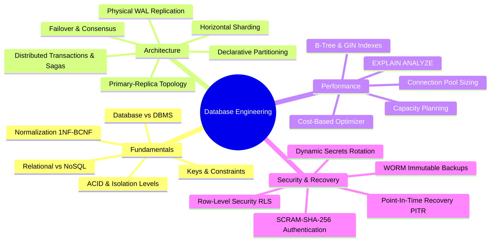

# Database Engineering Knowledge Base & Interview Preparation

A comprehensive, production-grade knowledge base and interview preparation repository covering database fundamentals, distributed database architecture, SQL optimization, high availability, replication, sharding, table partitioning, database releases, and real-world Java Spring Boot integration patterns.

---

## Table of Contents

- [1. Purpose & Learning Objectives](#1-purpose--learning-objectives)
- [2. Topics Covered](#2-topics-covered)
- [3. Complete Documentation Directory](#3-complete-documentation-directory)
- [4. Role-Based Learning Paths](#4-role-based-learning-paths)
  - [Beginner / Student Path](#beginner--student-path)
  - [Backend & Java Spring Boot Developer Path](#backend--java-spring-boot-developer-path)
  - [Database Administrator (DBA) / SRE Path](#database-administrator-dba--sre-path)
  - [Software Architect Path](#software-architect-path)
- [5. Database Release Tracking](#5-database-release-tracking)
- [6. Technical Interview Preparation Roadmap](#6-technical-interview-preparation-roadmap)
- [7. Practical Labs & SQL Playgrounds](#7-practical-labs--sql-playgrounds)
- [8. Visual Architecture Topologies](#8-visual-architecture-topologies)
- [9. Learning Progress Checklist](#9-learning-progress-checklist)
- [10. Documentation Conventions](#10-documentation-conventions)
- [11. Contributing](#11-contributing)
- [12. Authoritative References](#12-authoritative-references)

---

## 1. Purpose & Learning Objectives

This repository bridges the gap between theoretical relational database concepts, high-throughput cloud infrastructure engineering, and real-world backend software development.

### Learning Objectives:
- Master core database engine mechanics: storage pages, buffer pools, B-Trees, transaction logs (WAL/redo logs), and MVCC visibility pointers.
- Design resilient distributed topologies: synchronous vs asynchronous replication, automated failover, Patroni consensus, and split-brain fencing.
- Evaluate scaling trade-offs: when to index, when to partition declaratively, and when to shard horizontally across physical clusters.
- Implement production-ready Java Spring Boot patterns: dynamic DataSource routing (`AbstractRoutingDataSource`), HikariCP connection pool sizing, and thread-safe shard key context resolution.
- Excel in Senior Engineer and Software Architect technical interviews through scenario-based architectural deep dives.

---

## 2. Topics Covered

---

## 3. Complete Documentation Directory

### [Database Fundamentals](database-fundamentals/README.md)
Foundational relational and non-relational database principles.
- [Database vs DBMS](database-fundamentals/database-vs-dbms.md): Storage engines vs data files, DBMS architectural subsystems.
- [Relational vs NoSQL](database-fundamentals/relational-vs-nosql.md): Document, Key-Value, Wide-Column, and Graph comparisons.
- [SQL vs NoSQL](database-fundamentals/sql-vs-nosql.md): Selection criteria, ACID vs BASE, and polyglot persistence.
- [Database Keys](database-fundamentals/database-keys.md): Primary, Super, Candidate, Alternate, Foreign, Surrogate, and Composite keys.
- [Normalization and Denormalization](database-fundamentals/normalization-and-denormalization.md): 1NF, 2NF, 3NF, BCNF, relational anomalies, strategic denormalization.
- [Database Indexes](database-fundamentals/indexes.md): B-Tree internal layout, leaf traversal, page splits, and index taxonomy.
- [Database Transactions](database-fundamentals/transactions.md): Transaction states, savepoints, partial rollbacks, and Spring `@Transactional`.
- [ACID Properties](database-fundamentals/acid-properties.md): Atomicity (WAL), Consistency, Isolation, and Durability (`fsync`).
- [Isolation Levels](database-fundamentals/isolation-levels.md): Read Uncommitted, Read Committed, Repeatable Read, Serializable; MVCC mechanics.

### [Database Architecture](database-architecture/README.md)
Distributed database systems, topology design, and horizontal scaling.
- [Database Replication](database-architecture/database-replication.md): Physical WAL streaming, sync vs async, replication lag, standby read-only enforcement.
- [Database Sharding](database-architecture/database-sharding.md): Shard keys, hash vs range vs directory, consistent hashing, Spring Boot routing.
- [Database Partitioning](database-architecture/database-partitioning.md): Declarative range/list/hash partitioning, partition pruning, local B-Trees, instant DDL detach.
- [Replication vs Sharding vs Partitioning](database-architecture/replication-vs-sharding-vs-partitioning.md): Comprehensive 8-dimension comparison and unified 3-tier enterprise architecture.
- [Primary-Replica Architecture](database-architecture/primary-replica-architecture.md): Leader-follower responsibilities, log shipping, replication worker threads.
- [Read-Write Splitting](database-architecture/read-write-splitting.md): Spring Boot `AbstractRoutingDataSource`, AOP routing interceptors, read-after-write consistency.
- [Database Load Balancing](database-architecture/load-balancing.md): Layer 4 (TCP) vs Layer 7 (SQL proxy), health check endpoints, session state pinning.
- [Failover & High Availability](database-architecture/failover-and-high-availability.md): Patroni, etcd quorum consensus, STONITH split-brain fencing, RTO and RPO.
- [Connection Pooling](database-architecture/connection-pooling.md): HikariCP, PgBouncer transaction pooling, pool sizing formula, kernel context-switching.
- [Distributed Transactions](database-architecture/distributed-transactions.md): Two-Phase Commit (2PC / XA) flaws, Saga Pattern, Transactional Outbox pattern.
- [Consistency Models](database-architecture/consistency-models.md): CAP & PACELC theorems, Linearizability, Causal consistency, Eventual consistency.

### [SQL Reference & Practice Labs](sql/README.md)
- [`sql/ddl/`](sql/ddl/): Schema definitions, custom ENUMs, foreign keys, generated columns.
- [`sql/dml/`](sql/dml/): Batch inserts, `ON CONFLICT DO UPDATE` (upsert), `RETURNING` clauses.
- [`sql/joins/`](sql/joins/): Inner, Left, Right, Full Outer, Cross, Self, and Lateral Joins.
- [`sql/subqueries/`](sql/subqueries/): Scalar, multi-row, correlated subqueries, `EXISTS` vs `IN`.
- [`sql/cte-and-recursive-queries/`](sql/cte-and-recursive-queries/): Common Table Expressions, recursive hierarchy traversal.
- [`sql/window-functions/`](sql/window-functions/): `ROW_NUMBER()`, `RANK()`, `DENSE_RANK()`, `LEAD()`, `LAG()`, running aggregates.
- [`sql/indexes/`](sql/indexes/): Composite, Covering (`INCLUDE`), Partial, and Expression indexes.
- [`sql/transactions/`](sql/transactions/): Savepoints, `SELECT FOR UPDATE`, `SKIP LOCKED` job queue patterns.
- [`sql/performance-queries/`](sql/performance-queries/): `pg_stat_statements`, cache hit ratios, unused indexes, lock triage.

### [Database Performance](database-performance/README.md)
- [Query Optimization](database-performance/query-optimization.md): Non-SARGable predicate elimination, join algorithms, keyset pagination.
- [Execution Plans](database-performance/execution-plans.md): Reading `EXPLAIN (ANALYZE, BUFFERS)`, cost units, cardinality skews.
- [Indexing Strategies](database-performance/indexing-strategies.md): Composite ordering rules, covering indexes, write amplification management.
- [Slow Query Analysis](database-performance/slow-query-analysis.md): `pg_stat_statements`, active wait events analysis (`DataFileRead`, `Lock`).
- [Connection Pool Tuning](database-performance/connection-pool-tuning.md): Pool sizing formula, kernel context-switching penalties, Prometheus metrics.
- [Database Capacity Planning](database-performance/database-capacity-planning.md): IOPS modeling, annual storage projections, buffer pool working set sizing.

### [Database Security](database-security/README.md)
- [Authentication and Authorization](database-security/authentication-and-authorization.md): SCRAM-SHA-256, mTLS, AWS IAM token authentication.
- [Roles and Privileges](database-security/roles-and-privileges.md): Least privilege RBAC hierarchy, default privileges, Row-Level Security (RLS).
- [Database Encryption](database-security/encryption.md): TLS 1.3 in-transit, TDE / KMS at-rest, client-side field-level encryption.
- [Secrets Management](database-security/secrets-management.md): HashiCorp Vault dynamic ephemeral credentials, zero-trust rotation.
- [Database Auditing](database-security/auditing.md): `pgaudit`, audit classes, SIEM ingestion, PCI-DSS / SOC-2 compliance.
- [Backup Security](database-security/backup-security.md): Ransomware defense, S3 Object Lock (WORM), asymmetric GPG stream encryption.

### [Database Backup and Recovery](database-backup-and-recovery/README.md)
- [Backup Strategies](database-backup-and-recovery/backup-strategies.md): Logical vs Physical vs Cloud Snapshot, 3-2-1 backup rule.
- [Point-In-Time Recovery](database-backup-and-recovery/point-in-time-recovery.md): WAL archiving, `restore_command`, `recovery_target_time`.
- [Disaster Recovery](database-backup-and-recovery/disaster-recovery.md): Cold vs Warm vs Hot DR, active-passive cross-region failover.
- [Recovery Testing](database-backup-and-recovery/recovery-testing.md): Automated CI/CD restore verification pipelines, `pg_checksums`.

### [Database System Design](system-design/README.md)
- [Database Capacity Estimation](system-design/database-capacity-estimation.md): Mathematical formulas for QPS, storage, and RAM sizing.
- [E-Commerce Database Design](system-design/e-commerce-database-design.md): Catalog search, orders schema, Redis flash-sale inventory reservation.
- [Banking Database Design](system-design/banking-database-design.md): Double-entry bookkeeping, immutable ledger postings, fund transfer procedures.
- [Multi-Tenant Database Design](system-design/multi-tenant-database-design.md): DB-per-tenant vs Schema-per-tenant vs Shared Schema with RLS.
- [Database Scaling Strategies](system-design/database-scaling-strategies.md): The 6-stage roadmap from monolith to horizontal sharding.

### [Troubleshooting Runbooks](troubleshooting/README.md)
- [Replication Lag](troubleshooting/replication-lag.md): Diagnosing send/flush/replay byte lag, replica query conflicts.
- [Connection Exhaustion](troubleshooting/connection-exhaustion.md): `FATAL: too many connections`, idle in transaction termination.
- [Deadlocks](troubleshooting/deadlocks.md): Lock wait graph query, consistent lock ordering, application retries.
- [Slow Queries](troubleshooting/slow-queries.md): Query cancellation (`pg_cancel_backend`), execution plan analysis.
- [Failover Failures](troubleshooting/failover-failures.md): Split-brain resolution, Patroni triage, `pg_rewind` timeline alignment.
- [Data Consistency Issues](troubleshooting/data-consistency-issues.md): `amcheck` index validation, logical checksum reconciliation.

---

## 4. Role-Based Learning Paths

### Beginner / Student Path
1. [Database vs DBMS](database-fundamentals/database-vs-dbms.md) $\to$ [Relational vs NoSQL](database-fundamentals/relational-vs-nosql.md)
2. [Database Keys](database-fundamentals/database-keys.md) $\to$ [Normalization & Denormalization](database-fundamentals/normalization-and-denormalization.md)
3. [ACID Properties](database-fundamentals/acid-properties.md) $\to$ [Database Transactions](database-fundamentals/transactions.md)
4. [SQL DDL](sql/ddl/table-definitions.sql) & [SQL Joins](sql/joins/all-joins-demo.sql)
5. [Fundamentals Interview Questions](database-interview-questions/fundamentals.md)

### Backend & Java Spring Boot Developer Path
1. [ANSI Isolation Levels & MVCC](database-fundamentals/isolation-levels.md)
2. [Database Indexes & B-Tree Mechanics](database-fundamentals/indexes.md)
3. [Spring Boot Read-Write Routing Lab](practical-examples/spring-boot/read-write-routing/)
4. [HikariCP Connection Pool Sizing](database-performance/connection-pool-tuning.md)
5. [Transactions & Locking Interview Questions](database-interview-questions/transactions-and-locking.md)

### Database Administrator (DBA) / SRE Path
1. [Database Replication](database-architecture/database-replication.md) $\to$ [High Availability & Failover](database-architecture/failover-and-high-availability.md)
2. [Docker Compose PostgreSQL Replication Lab](practical-examples/postgresql/replication/)
3. [Point-In-Time Recovery Runbook](practical-examples/postgresql/backup-and-recovery/pitr-walkthrough.md)
4. [Slow Query Diagnostics & Profiling](database-performance/slow-query-analysis.md)
5. [Replication Lag & Connection Exhaustion Runbooks](troubleshooting/README.md)

### Software Architect Path
1. [Replication vs Sharding vs Partitioning Combined Architecture](database-architecture/replication-vs-sharding-vs-partitioning.md)
2. [Database Sharding & Consistent Hashing](database-architecture/database-sharding.md)
3. [Distributed Transactions & Sagas](database-architecture/distributed-transactions.md)
4. [Scenario-Based Interview Questions](database-interview-questions/scenario-based-questions.md)
5. [Software Architect System Design Questions](database-interview-questions/software-architect-questions.md)

---

## 5. Database Release Tracking

This repository maintains verified release documentation, upgrade runbooks, and breaking changes for official database products:

- **[PostgreSQL Releases](database-releases/postgresql/)**
  - [Release History & Roadmap](database-releases/postgresql/release-history.md)
  - [PostgreSQL 16 Release Notes](database-releases/postgresql/versions/postgresql-16.md)
  - [PostgreSQL 15 Release Notes](database-releases/postgresql/versions/postgresql-15.md)
- **[MySQL Releases](database-releases/mysql/)**
  - [Release History & Roadmap](database-releases/mysql/release-history.md)
  - [MySQL 8.4 LTS Release Notes](database-releases/mysql/versions/mysql-8-4-lts.md)
  - [MySQL 8.0 Release Notes](database-releases/mysql/versions/mysql-8-0.md)
- **[Release Note Template](database-releases/release-note-template.md)**

---

## 6. Technical Interview Preparation Roadmap

Explore our comprehensive, categorized interview guides featuring short interview-ready answers, deep technical explanations, code walkthroughs, and common misconceptions:

| Interview Guide | Focus Level | Key Questions Covered |
| :--- | :--- | :--- |
| **[Scenario-Based Questions](database-interview-questions/scenario-based-questions.md)** | Senior / Architect | Primary crash under load, read-after-write lag, shard key selection, overloaded shard triage, zero-downtime sharding migration, split-brain prevention, cross-shard sagas. |
| **[Software Architect Questions](database-interview-questions/software-architect-questions.md)** | Staff / Architect | 100B row annual pipelines, global multi-region consistency, zero-downtime schema migrations, multi-tenant persistence models. |
| **[Replication Questions](database-interview-questions/replication.md)** | Junior to Senior | WAL streaming, Sync vs Async, replication lag, standby recovery, failover candidate election. |
| **[Sharding Questions](database-interview-questions/sharding.md)** | Intermediate to Senior | Shard keys, consistent hashing, hot shard mitigation, cross-shard joins, distributed IDs. |
| **[Partitioning Questions](database-interview-questions/partitioning.md)** | Junior to Senior | Declarative table partitioning, range/list/hash, partition pruning, over-partitioning hazards. |
| **[Transactions & Locking](database-interview-questions/transactions-and-locking.md)** | All Levels | ANSI isolation levels, dirty/phantom reads, MVCC internals (`xmin`/`xmax`), deadlocks. |
| **[Indexing & Performance](database-interview-questions/indexing-and-performance.md)** | All Levels | B-Trees, covering indexes (`INCLUDE`), leftmost prefix rule, EXPLAIN ANALYZE, bloat. |
| **[SQL Problem-Solving](database-interview-questions/sql-queries.md)** | Developers / Analysts | N-th highest salary, `DENSE_RANK()`, recursive CTEs, tree traversal, window frames. |
| **[High Availability](database-interview-questions/high-availability.md)** | SRE / Architect | RTO, RPO, Raft/etcd consensus, STONITH split-brain fencing, false-positive prevention. |
| **[Database Security](database-interview-questions/database-security.md)** | Security / Backend | SQL injection, prepared statements, TDE encryption, Row-Level Security (RLS). |
| **[Fundamentals](database-interview-questions/fundamentals.md)** | Beginner / Junior | Database vs DBMS, relational vs NoSQL, database keys, 1NF-BCNF normalization. |

---

## 7. Practical Labs & SQL Playgrounds

### PostgreSQL Labs
- [Streaming Replication Lab (Docker Compose)](practical-examples/postgresql/replication/): Multi-node cluster with automated standby bootstrap and lag queries.
- [Declarative Partitioning Lab](practical-examples/postgresql/partitioning/): Monthly range partitioning, pruning verification, and concurrent detachment.
- [Advanced Indexing Lab](practical-examples/postgresql/indexing/): Covering indexes (`INCLUDE`), GIN on JSONB, and partial indexes.
- [Point-In-Time Recovery (PITR) Walkthrough](practical-examples/postgresql/backup-and-recovery/pitr-walkthrough.md): Step-by-step restoration from base backup and WAL archive.

### MySQL Labs
- [MySQL Indexing Lab](practical-examples/mysql/indexing/): Composite indexes and invisible index testing.
- [MySQL Partitioning Lab](practical-examples/mysql/partitioning/): InnoDB range partitioning by year.

### Java Spring Boot Labs
- [Dynamic Read-Write Routing](practical-examples/spring-boot/read-write-routing/): Dynamic routing via `AbstractRoutingDataSource` and `@Transactional(readOnly=true)`.
- [Shard Key Routing](practical-examples/spring-boot/shard-routing/): Dynamic shard routing with consistent hashing and dedicated Hikari pools.
- [HikariCP Connection Pool Tuning](practical-examples/spring-boot/connection-pooling/): Sizing formulas, starvation root causes, and Prometheus metrics.

---

## 8. Visual Architecture Topologies

All architecture diagrams are rendered natively via GitHub Flavored Markdown `mermaid` blocks. Editable diagram source files are maintained in [`diagrams/sources/`](diagrams/sources/):

1. **[Primary-Replica Replication Topology](diagrams/sources/primary-replica-replication.mmd)**
2. **[Failover & Replica Promotion Sequence](diagrams/sources/failover-and-replica-promotion.mmd)**
3. **[Read-Write Splitting Application Architecture](diagrams/sources/read-write-splitting.mmd)**
4. **[Consistent Hash Shard Routing Topology](diagrams/sources/shard-routing.mmd)**
5. **[Declarative Table Partition Pruning Mechanics](diagrams/sources/partitioned-table-structure.mmd)**
6. **[Combined Sharding, Replication, and Partitioning Topology](diagrams/sources/combined-architecture.mmd)**

---

## 9. Learning Progress Checklist

Track your database engineering mastery:

- [ ] **Fundamentals:** Can clearly explain ACID properties and the engine mechanisms enforcing each.
- [ ] **Concurrency:** Can differentiate all ANSI SQL isolation levels and explain how PostgreSQL MVCC avoids read-write blocking.
- [ ] **Indexing:** Can read an `EXPLAIN (ANALYZE, BUFFERS)` plan and diagnose Sequential Scans vs Index Scans vs Index-Only Scans.
- [ ] **Replication:** Can deploy PostgreSQL physical streaming replication and explain why standbys are strictly read-only.
- [ ] **High Availability:** Can diagram an automated Patroni + etcd failover flow and explain split-brain prevention (STONITH).
- [ ] **Partitioning:** Can author declarative range partitioning DDL and prove partition pruning with `EXPLAIN`.
- [ ] **Sharding:** Can design an application-level sharded architecture in Java Spring Boot with per-shard connection pools.
- [ ] **System Design:** Can calculate QPS, storage growth, and buffer pool RAM requirements for a high-throughput platform.
- [ ] **Disaster Recovery:** Can execute a Point-In-Time Recovery (PITR) using `pg_basebackup` and archived WAL segments.

---

## 10. Documentation Conventions

To maintain technical accuracy and consistency across this repository, all contributions must adhere to our standardized templates:
- [Concept Documentation Template](templates/concept-template.md)
- [Interview Question Template](templates/interview-question-template.md)
- [Release Note Template](templates/release-note-template.md)
- [Troubleshooting Incident Runbook Template](templates/troubleshooting-template.md)
- [Architecture Decision Record (ADR) Template](templates/architecture-decision-record-template.md)

---

## 11. Contributing

Contributions from database administrators, software engineers, and system architects are welcome! Please review [`CONTRIBUTING.md`](CONTRIBUTING.md) for code style guidelines, pull request procedures, and verification rules before opening a PR.

---

## 12. Authoritative References

- [PostgreSQL Official Documentation](https://www.postgresql.org/docs/)
- [MySQL 8.4 Reference Manual](https://dev.mysql.com/doc/refman/8.4/en/)
- [Designing Data-Intensive Applications (Martin Kleppmann)](https://dataintensive.net/)
- [Database System Concepts (Silberschatz, Korth, Sudarshan)](https://www.db-book.com/)
- [HikariCP Official Documentation & Pool Sizing](https://github.com/brettwooldridge/HikariCP)
- [Patroni High Availability Documentation](https://patroni.readthedocs.io/)
- [Use The Index, Luke! (Markus Winand)](https://use-the-index-luke.com/)
