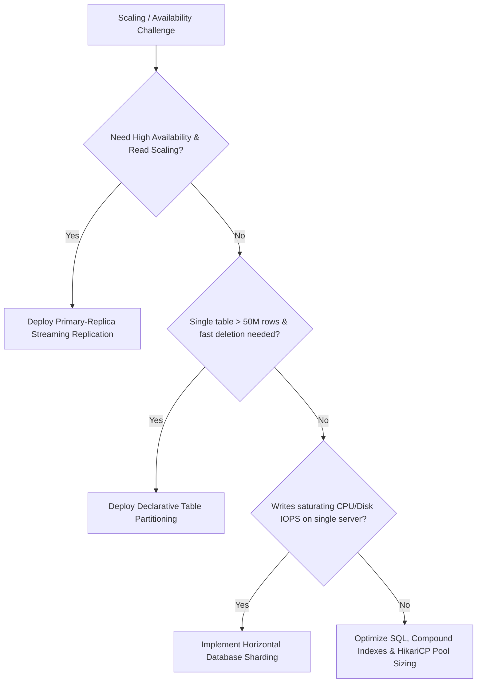

# Database Architecture & System Design

Welcome to the **Database Architecture** core module. This directory contains deep-dive engineering guides, distributed systems trade-offs, internal engine mechanics, and Java/Spring Boot integration patterns for designing mission-critical database platforms.

---

## Architecture Navigation & Core Modules

| Document | Topic & Focus Area | Key Architectural Patterns Covered |
| :--- | :--- | :--- |
| **[Database Replication](database-replication.md)** | Data duplication, HA, read scale | Physical WAL streaming, Sync vs Async, replication lag, standby recovery, failover candidate selection. |
| **[Database Sharding](database-sharding.md)** | Horizontal write & capacity scale | Shard keys, hash vs range vs directory, Spring Boot dynamic datasource routing, cross-shard joins & sagas. |
| **[Database Partitioning](database-partitioning.md)** | Single-node table manageability | Declarative range/list/hash partitioning, partition pruning, local B-Trees, instant DDL archival. |
| **[Replication vs Sharding vs Partitioning](replication-vs-sharding-vs-partitioning.md)** | Architectural comparison & synthesis | Unified 3-tier combined architecture, multi-dimensional trade-off matrix, selection flowcharts. |
| **[Primary-Replica Architecture](primary-replica-architecture.md)** | Leader-follower fundamentals | Transaction ID allocation, WAL sender/receiver daemons, standby read-only enforcement. |
| **[Read-Write Splitting](read-write-splitting.md)** | Application & proxy traffic separation | Spring Boot `@Transactional(readOnly=true)` AOP interceptor, `AbstractRoutingDataSource`, replica pool management. |
| **[Load Balancing](load-balancing.md)** | Connection & query distribution | Layer 4 (TCP) vs Layer 7 (SQL protocol) proxies, health check endpoints, session state pinning. |
| **[Failover & High Availability](failover-and-high-availability.md)** | Zero-downtime automated recovery | Patroni, etcd quorum consensus, STONITH split-brain fencing, client discovery, RTO & RPO. |
| **[Connection Pooling](connection-pooling.md)** | Connection reuse & throughput tuning | HikariCP, PgBouncer transaction pooling, pool sizing formula, OS context-switching penalties. |
| **[Distributed Transactions](distributed-transactions.md)** | Multi-node transactional boundaries | Two-Phase Commit (2PC / XA) flaws, Saga Pattern (orchestration vs choreography), Transactional Outbox. |
| **[Consistency Models](consistency-models.md)** | Theoretical data visibility contracts | CAP & PACELC theorems, Linearizability, Causal consistency, Read-Your-Own-Writes, Eventual consistency. |

---

## Architectural Decision Framework

---

## Related Hands-on Labs & Interview Prep
- [Practical PostgreSQL Replication Setup](../practical-examples/postgresql/replication/)
- [Practical Spring Boot Shard Routing](../practical-examples/spring-boot/shard-routing/)
- [Practical Spring Boot Read-Write Routing](../practical-examples/spring-boot/read-write-routing/)
- [Database Architecture Interview Questions](../database-interview-questions/software-architect-questions.md)
