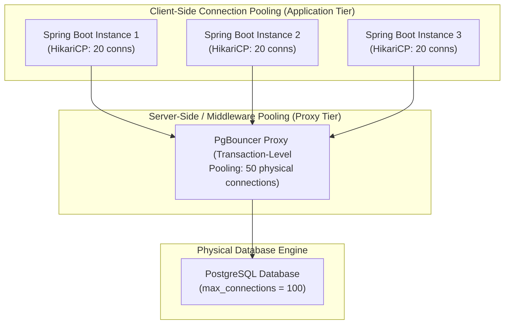

# Database Connection Pooling

> **Module:** Database Architecture  
> **Target Audience:** Backend Developers, Software Architects, Database Administrators  
> **Relevant Technologies:** HikariCP, PgBouncer, Tomcat JDBC, PostgreSQL, MySQL

---

## 1. What It Is

**Database Connection Pooling** is the design pattern and caching layer that maintains a pool of pre-established, authenticated, and reusable physical database network connections. 

Instead of an application opening a new physical TCP connection for every incoming HTTP request or SQL transaction and closing it afterward, the application rents an existing connection from the pool, executes its queries, and returns it to the pool for reuse.

```text
HTTP Request ──▶ Borrow Connection ──▶ Execute SQL ──▶ Return Connection to Pool ──▶ HTTP Response
```

---

## 2. Why It Is Needed: The Heavy Cost of Physical Connections

Opening a fresh physical database connection in PostgreSQL or MySQL is an extremely heavy and resource-intensive operation:
1. **Network Handshake:** 3-way TCP handshake + TLS negotiation round trips.
2. **Authentication & Authorization:** Exchanging SCRAM-SHA-256 or caching_sha2_password authentication tokens.
3. **OS Process Allocation:** In PostgreSQL, every client connection spawns a **brand-new operating system backend process** (`postgres: user db client`) consuming 5–20 MB of resident memory (`work_mem`, local catalogs, private buffers).
4. **Latency Penalty:** Creating a new physical connection can take 50ms to 200ms, whereas borrowing a connection from a warm pool (like HikariCP) takes less than 20 microseconds.

---

## 3. Architecture: Client-Side vs Server-Side Connection Pooling



### Comparison Matrix
| Dimension | Client-Side Pooling (HikariCP) | Server-Side Pooling (PgBouncer) |
| :--- | :--- | :--- |
| **Location** | In-process within the JVM application heap. | Dedicated proxy process running near the database. |
| **Scope** | Manages connections for that single JVM instance. | Centralizes connections across hundreds of microservice instances or serverless Lambdas. |
| **Pooling Modes** | Session-level: A connection is rented to a thread until returned. | Supports **Transaction Pooling** (connection rented only for the duration of a single `BEGIN ... COMMIT` block!). |
| **Memory Footprint** | Scales with the number of application pods: 50 pods $\times$ 20 conns = 1,000 DB connections. | Collapses 10,000 incoming app connections into 50–100 physical Postgres backends. |

---

## 4. Pool Sizing: Why Smaller Connection Pools Run Faster

A common beginner misconception is: *"If our database is slow, let's increase `maxPoolSize` from 20 to 200!"*

> [!CAUTION]
> **Increasing connection pool sizes beyond hardware limits degrades performance exponentially.**  
> When hundreds of backend database processes run simultaneously on an 8-core server, the operating system kernel spends 80%+ of its time performing CPU context switches between competing processes rather than executing disk I/O or query plans.

### The Canonical PostgreSQL / HikariCP Pool Sizing Formula
Published by the PostgreSQL performance research team:

$$\text{connections} = ((\text{core\_count} \times 2) + \text{effective\_spindle\_count})$$

- An 8-core database server with fast NVMe SSD storage ($effective\_spindle\_count \approx 1$) performs optimally with:
  $$\text{connections} = (8 \times 2) + 1 = 17 \text{ connections!}$$
- Setting a HikariCP pool to 20 connections on 8 cores achieves higher overall throughput and lower p99 latency than setting it to 200 connections.

---

## 5. Recommended Production HikariCP Configuration (Spring Boot)

```properties
# Primary HikariCP Pool Configuration
spring.datasource.hikari.pool-name=ProductionHikariPool
spring.datasource.hikari.maximum-pool-size=20
spring.datasource.hikari.minimum-idle=20

# Timeouts
# Maximum milliseconds a thread will wait to borrow a connection before throwing SQLTransientConnectionException
spring.datasource.hikari.connection-timeout=30000

# Maximum amount of time that a connection is allowed to sit idle in the pool
spring.datasource.hikari.idle-timeout=600000

# Maximum lifetime of a connection in the pool. Set 2-3 minutes shorter than any DB or infrastructure timeout
spring.datasource.hikari.max-lifetime=1800000

# Connection Validation
spring.datasource.hikari.validation-timeout=5000

# Performance: Use JDBC4 isValid() instead of legacy 'SELECT 1' test queries
# HikariCP automatically defaults to isValid()
```

---

## 6. Common Implementation Mistakes & Antipatterns

1. **Connection Leaks:** Borrowing a connection in raw JDBC and failing to close it in a `finally` block or `try-with-resources`. Over time, all connections remain active, permanently exhausting the pool.
2. **Long-Running Non-Database Work inside Transactions:** Making third-party HTTP calls, generating PDFs, or encoding images while holding an open database transaction keeps that connection locked away from other application threads.
3. **Misaligned `max-lifetime`:** If cloud load balancers or AWS security groups terminate idle TCP sockets after 60 minutes, but Hikari's `max-lifetime` is set to 2 hours, applications will borrow dead sockets, throwing `Connection reset by peer` errors.

---

## 7. Authoritative References

- [About Pool Sizing (HikariCP Official Documentation)](https://github.com/brettwooldridge/HikariCP/wiki/About-Pool-Sizing)
- [PgBouncer Official Architecture & Configuration](https://www.pgbouncer.org/)
- [PostgreSQL Connection Limits & Resource Consumption](https://www.postgresql.org/docs/current/runtime-config-connection.html)
