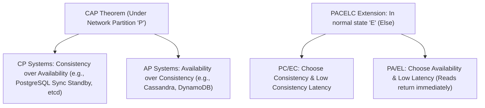

# Consistency Models in Database Engineering

> **Module:** Database Architecture  
> **Target Audience:** Systems Architects, Distributed Systems Engineers, Backend Developers  
> **Relevant Concepts:** CAP Theorem, PACELC, Linearizability, Sequential Consistency, Eventual Consistency

---

## 1. What It Is

A **Consistency Model** defines the formal contract and behavioral guarantees between a data storage system and its clients regarding the visibility, sequence, and timing of read operations relative to concurrent or prior write operations.

---

## 2. Theoretical Foundations: CAP & PACELC



- **CAP Theorem (Brewer):** In the event of a network partition (**P**), a distributed data store must choose between:
  - **Consistency (Linearizability - C):** Every read receives the most recent write or an error.
  - **Availability (A):** Every non-failing node returns a non-error response, even if stale.
- **PACELC Theorem (Abadi):** Expands CAP:
  - **IF** there is a **P**artition, how does the system choose between **A**vailability and **C**onsistency?
  - **E**lse (when the system is running normally without partitions), how does the system trade off **L**atency versus **C**onsistency?

---

## 3. The Spectrum of Consistency Models

```text
[Strongest / Highest Latency]                                [Weakest / Lowest Latency]
Linearizability ──▶ Sequential Consistency ──▶ Causal Consistency ──▶ Eventual Consistency
```

### 3.1 Linearizability (Strict Strong Consistency)
- **Definition:** Every operation appears to take effect atomically at a single discrete point in time between its invocation and its response, according to a global wall-clock time.
- **Client Guarantee:** Once client A completes a write, client B reading a millisecond later is mathematically guaranteed to observe that write or a later one.
- **Engines:** Google Spanner (TrueTime API), CockroachDB, etcd/Raft.

### 3.2 Sequential Consistency
- **Definition:** All operations are executed in some valid sequential order that is consistent with the program order observed by each individual process, and all nodes agree on this single sequence. Global real-time ordering is relaxed.

### 3.3 Causal Consistency
- **Definition:** Operations that are causally related (e.g., a question followed by its reply) must be seen by every process in the same relative order. Concurrent operations that are independent may be observed in different orders.
- **Guarantees:** Solves conversational anomalies (prevents replies from appearing before the comment being replied to).

### 3.4 Read-Your-Own-Writes (Monotonic Read Consistency)
- **Definition:** Guarantees that if a user updates a record, all subsequent read requests by that same user will reflect the update, even if other users experience a brief delay before observing it.
- **Implementation:** Pin user reads to the primary database for $N$ seconds after a mutation.

### 3.5 Eventual Consistency
- **Definition:** If no further updates are made to an object, all replicas will eventually converge to the same value. In the intermediate time, replicas return stale values.
- **Engines:** Asynchronous PostgreSQL/MySQL replication, Cassandra, DynamoDB, Amazon S3.

---

## 4. Practical Architecture Decision Guide

| Business Domain | Required Consistency Model | Architectural Justification |
| :--- | :--- | :--- |
| **Banking / Core Ledger** | **Linearizability / Strong ACID** | Overdrafts and double-spend exploits cannot be tolerated. Must forfeit write latency for strict global consistency. |
| **E-Commerce Inventory** | **Linearizability (Reserve) + Causal (Display)** | Checking out the last item requires atomic locking; browsing product catalogs uses eventual consistency with asynchronous replicas. |
| **Social Media Comments** | **Causal / Read-Your-Own-Writes** | Stale counts on video views are harmless; seeing answers before questions ruins user experience. |
| **IoT Telemetry Ingestion** | **Eventual Consistency** | Sensor readings arrive continuously. Dropping a packet or reading a 1-second stale metric does not impact the system. |

---

## 5. Authoritative References

- [Designing Data-Intensive Applications (Martin Kleppmann)](https://dataintensive.net/)
- [Consistency Models (Jepsen Analysis by Kyle Kingsbury)](https://jepsen.io/consistency)
- [PACELC Theorem Paper (Daniel Abadi)](https://www.cs.umd.edu/~abadi/papers/abadi-pacelc.pdf)
