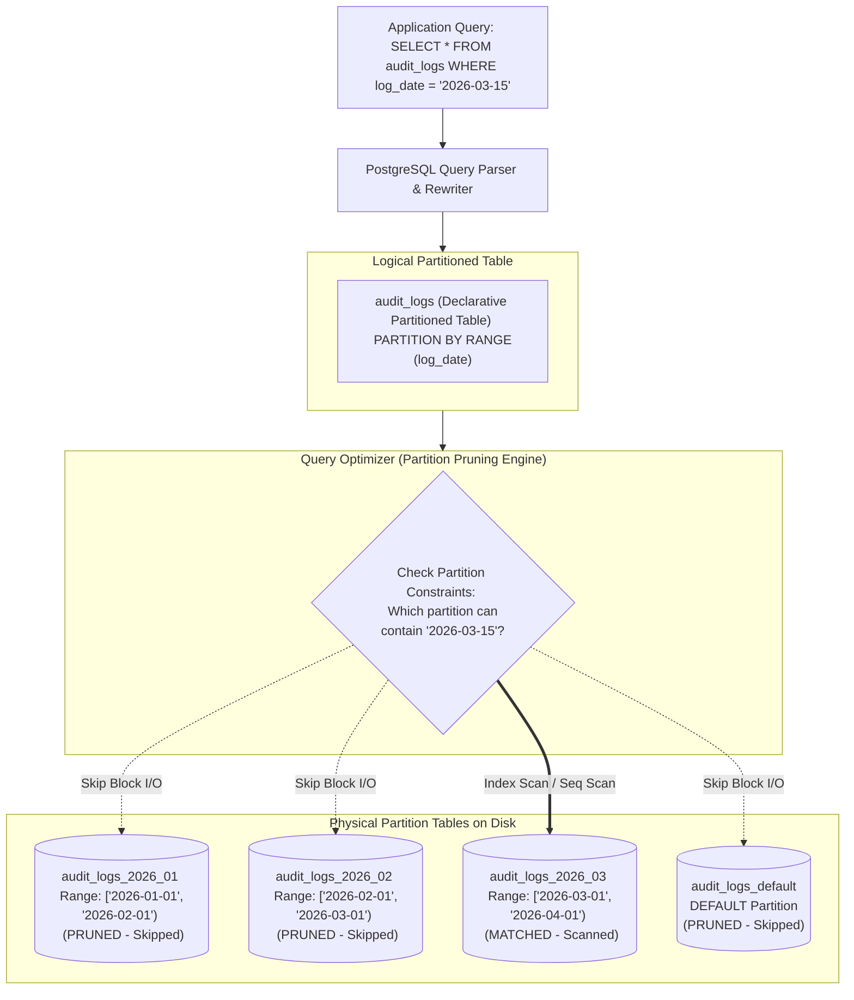
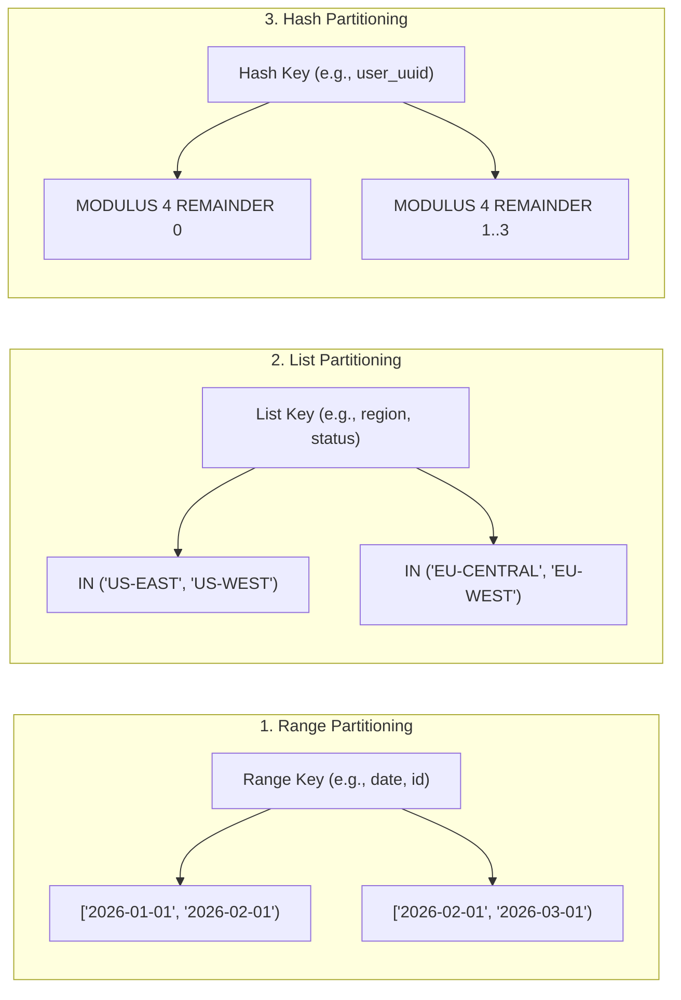

# Database Partitioning Architecture & Engineering Guide

> **Module:** Database Architecture  
> **Target Audience:** Database Engineers, Systems Architects, Backend Developers  
> **Relevant Engines:** PostgreSQL (Declarative Table Partitioning), MySQL (InnoDB Partitioning)

---

## 1. What It Is

**Database partitioning** is the database-native practice of physically decomposing a very large table into smaller, distinct physical storage units (called **partitions**) while presenting a single, unified **logical table** interface to application queries and SQL statements.

Unlike **sharding** (which distributes data across distinct physical database servers over a network), **partitioning operates entirely within a single database engine instance on one server or cluster**. The storage engine manages partition routing, query optimization, and disk organization transparently.

```text
                  Logical Table: "sensor_telemetry" (Application sees 1 table)
                                        │
           ┌────────────────────────────┼────────────────────────────┐
           ▼                            ▼                            ▼
Child Partition 2026_01      Child Partition 2026_02      Child Partition 2026_03
(Physical Table on Disk)     (Physical Table on Disk)     (Physical Table on Disk)
```

---

## 2. Why It Is Needed & Problems It Solves

When an individual relational table exceeds tens of millions or hundreds of millions of rows (hundreds of gigabytes), severe performance and maintenance challenges emerge:

1. **B-Tree Index Bloat & Cache Eviction:** B-Tree indexes on massive tables become too large to fit in RAM (`shared_buffers` or `innodb_buffer_pool`). Every index search forces expensive random disk I/O reads. Partitioning creates smaller, localized B-Trees per partition that stay memory-resident.
2. **Slow Historical Data Deletion (`DELETE` Overhead):** Deleting 50 million records from an old quarter with `DELETE FROM logs WHERE created_at < '2025-01-01'` generates massive WAL traffic, triggers heavy row locks, bloats table pages, and requires an aggressive `VACUUM FULL` to reclaim disk space. With partitioning, dropping 50 million rows is instantaneous via an atomic DDL command: `DROP TABLE logs_2024_q4` or `ALTER TABLE logs DETACH PARTITION`.
3. **Sequential Scan Penalties:** Analytical or aggregation queries scanning a time range must scan through terabytes of irrelevant data unless the query planner can physically skip those disk blocks.

---

## 3. Architecture & Internal Mechanics



### 3.1 Logical Tables vs Physical Partitions

In PostgreSQL (declarative partitioning introduced in version 10 and matured in 11–16):
- **Logical Parent Table:** Created with `PARTITION BY {RANGE | LIST | HASH}`. It acts as an entry point. It has no physical data files (relfilenode) of its own; it stores metadata in `pg_partitioned_table`.
- **Physical Child Partitions:** Created with `CREATE TABLE ... PARTITION OF ...`. These are concrete tables with their own disk storage files, indexes, statistics, autovacuum settings, and tablespaces.

### 3.2 Partitioning Methods



1. **Range Partitioning:** Divides data into explicit continuous non-overlapping ranges (e.g., dates, numeric timestamps, sequence ranges). Best suited for time-series, financial audit logs, and order histories.
2. **List Partitioning:** Divides data based on discrete key values (e.g., country code, geographic jurisdiction, business unit). Ideal for data residency regulations (GDPR/EU vs US data storage).
3. **Hash Partitioning:** Divides data by computing a hash modulus on the partition key. Balances rows evenly across a fixed number of partitions when data lacks natural chronological boundaries.

### 3.3 Partition Pruning Mechanics

**Partition Pruning** is the query optimizer optimization whereby the query planner proves that certain partitions cannot possibly contain rows matching the query's `WHERE` clause, excluding those physical tables from the execution plan entirely.

PostgreSQL executes pruning at two distinct phases:
1. **Planning-Time Pruning:** Occurs during query planning when query literals are static (e.g., `WHERE order_date >= '2026-03-01'`). The optimizer completely eliminates non-matching child tables before generating execution steps.
2. **Run-Time (Execution-Time) Pruning:** Occurs when the query filter relies on parameters, prepared statements (`$1`), or subqueries (e.g., `WHERE order_date = CURRENT_DATE` or `WHERE tenant_id = (SELECT my_tenant())`). During execution startup, the engine inspects the evaluated parameter and de-schedules non-matching partitions.

### 3.4 Indexes and Constraints on Partitioned Tables

1. **Local Indexes:** PostgreSQL automatically creates matching indexes on all existing and future child partitions when an index is created on the partitioned parent table (`CREATE INDEX ON orders (customer_id)`).
2. **Unique Constraints & Primary Keys:** 
   > [!IMPORTANT]
   > In PostgreSQL declarative partitioning, **a primary key or UNIQUE constraint on a partitioned table must include all columns in the partition key**.  
   > *Why?* PostgreSQL does not maintain cross-partition global indexes. To enforce uniqueness at the storage engine level without locking all partitions on every insert, the engine must be able to verify uniqueness within the target partition alone.

### 3.5 Partitioning vs Sharding

| Dimension | Database Partitioning | Database Sharding |
| :--- | :--- | :--- |
| **Physical Topology** | Single database instance (shared OS, CPU, RAM, buffer pool). | Multiple distinct database instances on separate servers over a network. |
| **Transparency** | Completely transparent to application; standard SQL without routing logic. | Requires routing logic (Spring Boot routing datasource, proxy, or middleware). |
| **Write Scalability** | **Limited by single node hardware** (single WAL stream, single CPU/disk ceiling). | **Linear horizontal write scale** across many nodes. |
| **Data Retention** | Instantaneous: `DETACH PARTITION` & `DROP TABLE`. | Requires cross-node deletion scripts or per-shard partition maintenance. |
| **Operational Overhead** | Low (managed via native DDL and automated cron/pg_partman). | High (requires cluster management, resharding runbooks, distributed backups). |

---

## 4. Real-World Industry Example: Financial Audit Ledger

A global banking application generates 800 million audit log events annually:
- **Table:** `audit_event`
- **Partition Strategy:** Declarative Range Partitioning by Month (`event_timestamp`).
- **Retention Policy:** Hot data (current quarter) resides on high-speed NVMe tablespaces. Data older than 7 years must be purged.
- **Maintenance:** At midnight on the last day of each month, an automated scheduler attaches the next month's partition. When a partition reaches 7 years of age, the DBA issues `ALTER TABLE audit_event DETACH PARTITION CONCURRENTLY` and archives the detached table to cold S3 storage before dropping it, consuming zero CPU or lock contention on the live system.

---

## 5. Practical Implementation & Verification (PostgreSQL Runnable Script)

Below is a complete, runnable PostgreSQL demonstration of declarative range partitioning, index propagation, partition pruning verification, and partition detachment.

### 5.1 Schema Setup: Partitioned Parent & Child Partitions
```sql
-- Clean up any prior demo runs
DROP TABLE IF EXISTS orders CASCADE;

-- 1. Create the logical master partitioned table
CREATE TABLE orders (
    order_id      BIGINT GENERATED ALWAYS AS IDENTITY,
    order_date    DATE NOT NULL,
    customer_id   VARCHAR(32) NOT NULL,
    total_amount  NUMERIC(12, 2) NOT NULL,
    status        VARCHAR(20) NOT NULL,
    -- Note: Partition key (order_date) MUST be included in the primary key
    PRIMARY KEY (order_id, order_date)
) PARTITION BY RANGE (order_date);

-- 2. Create physical monthly child partitions for Q1 2026
CREATE TABLE orders_2026_01 PARTITION OF orders
    FOR VALUES FROM ('2026-01-01') TO ('2026-02-01');

CREATE TABLE orders_2026_02 PARTITION OF orders
    FOR VALUES FROM ('2026-02-01') TO ('2026-03-01');

CREATE TABLE orders_2026_03 PARTITION OF orders
    FOR VALUES FROM ('2026-03-01') TO ('2026-04-01');

-- 3. Create a DEFAULT partition to catch outliers and protect inserts
CREATE TABLE orders_default PARTITION OF orders DEFAULT;

-- 4. Create an index on customer_id (automatically propagates to all partitions)
CREATE INDEX idx_orders_customer_id ON orders (customer_id);
```

### 5.2 Data Population
```sql
-- Insert records spanning multiple monthly ranges
INSERT INTO orders (order_date, customer_id, total_amount, status) VALUES
('2026-01-15', 'CUST_001', 149.50, 'COMPLETED'),
('2026-01-28', 'CUST_002', 89.00,  'COMPLETED'),
('2026-02-10', 'CUST_003', 499.00, 'COMPLETED'),
('2026-02-22', 'CUST_001', 35.20,  'SHIPPED'),
('2026-03-05', 'CUST_004', 1250.00,'PROCESSING'),
('2026-05-12', 'CUST_005', 75.00,  'FUTURE_DEFAULT'); -- Lands in orders_default
```

### 5.3 Verification: Data Distribution
```sql
-- Verify rows are stored in the respective physical child partitions:
SELECT tableoid::regclass AS physical_table, count(*) 
FROM orders 
GROUP BY tableoid;

-- Expected Output:
--  physical_table  | count 
-- -----------------+-------
--  orders_2026_01  |     2
--  orders_2026_02  |     2
--  orders_2026_03  |     1
--  orders_default  |     1
```

### 5.4 Verification: Partition Pruning with `EXPLAIN`
```sql
-- Ensure partition pruning is enabled (default is on)
SET enable_partition_pruning = on;

-- Query targeting February 2026:
EXPLAIN (COSTS OFF)
SELECT * FROM orders 
WHERE order_date BETWEEN '2026-02-01' AND '2026-02-28';

-- Expected Output:
--                           QUERY PLAN                           
-- ---------------------------------------------------------------
--  Append
--    ->  Seq Scan on orders_2026_02 orders
--          Filter: ((order_date >= '2026-02-01'::date) AND (order_date <= '2026-02-28'::date))
-- (Notice: orders_2026_01, orders_2026_03, and orders_default are NOT scanned!)
```

### 5.5 Fast Data Archival & Detachment
```sql
-- Detach January partition concurrently without locking the parent table
ALTER TABLE orders DETACH PARTITION orders_2026_01 CONCURRENTLY;

-- 'orders_2026_01' is now a standalone independent table!
-- Live queries to 'orders' immediately stop seeing January data.
-- Drop or archive the standalone table with zero impact on the master:
DROP TABLE orders_2026_01;
```

---

## 6. Advantages and Disadvantages

| Advantages | Disadvantages & Trade-offs |
| :--- | :--- |
| **Instant Data Purging:** `DETACH` / `DROP` partitions takes milliseconds with minimal lock contention and zero WAL bloat. | **Primary Key Limitation:** Primary keys and UNIQUE constraints must include the partition column. |
| **Query Performance (Pruning):** Scans only relevant physical tables, bypassing gigabytes of disk blocks. | **Over-Partitioning Overhead:** Creating thousands of partitions causes optimizer overhead, plan latency, and high memory usage. |
| **Smaller B-Trees:** Indexes fit comfortably in memory, maintaining high buffer pool cache hit ratios. | **No Foreign Key Reference Targets (pre-Postgres 12):** Other tables referencing partitioned tables had limitations in older engines. |
| **Transparent Application Interface:** Developers write standard SQL queries against the logical parent table. | **Locking during Non-Concurrent Partition Changes:** Non-concurrent `DETACH` or `ATTACH` acquires exclusive table locks. |

---

## 7. Common Implementation Mistakes & Antipatterns

1. **Omitting the Partition Key in Queries:** Running `SELECT * FROM orders WHERE customer_id = 'CUST_001'` forces the engine to scan **every single child partition**, defeating the primary benefit of partitioning.
2. **Creating Too Many Partitions (Over-Partitioning):** Partitioning by day over 10 years creates 3,650 partitions. The query planner must evaluate metadata and open file descriptors for thousands of tables, degrading query planning times from 2ms to 200ms.
3. **Missing DEFAULT Partition:** Failing to define a `DEFAULT` partition in range or list schemes causes sudden application crashes with `ERROR: no partition of relation "orders" found for row` when an out-of-bounds date arrives.
4. **Expecting Partitioning to Solve Single-Node Hardware Limits:** Partitioning does not increase available CPU cores, RAM, or total disk write IOPS. When a single node is saturated by writes, sharding is required.

---

## 8. Production Considerations & Operational Checklist

- [ ] **Automated Partition Creation:** Use `pg_partman` or Kubernetes cron jobs to automatically create future partitions at least 2 weeks in advance.
- [ ] **Partition Monitoring:** Alert if the `DEFAULT` partition contains records, indicating missing upcoming partition boundaries.
- [ ] **Tablespace Tiering:** Store recent, active partitions on high-performance NVMe SSDs and older partitions on lower-cost magnetic or cloud object storage.
- [ ] **Analyze & Vacuum:** Child partitions have independent statistics. Ensure autovacuum runs regularly on active child partitions.

---

## 9. Related Interview Questions

- [Partitioning Interview Deep Dive](../database-interview-questions/partitioning.md)
- [Scenario: When Indexing is Sufficient vs Partitioning vs Sharding](../database-interview-questions/scenario-based-questions.md#scenario-8-when-is-indexing-sufficient-and-when-should-partitioning-or-sharding-be-considered)
- [Software Architect: Multi-Tier Scaling Strategy](../database-interview-questions/software-architect-questions.md#question-2-how-do-you-architect-a-storage-engine-handling-100-billion-rows-annually)

---

## 10. Authoritative References

- [PostgreSQL Official Documentation: Table Partitioning](https://www.postgresql.org/docs/current/ddl-partitioning.html)
- [PostgreSQL Partition Pruning Optimization](https://www.postgresql.org/docs/current/ddl-partitioning.html#DDL-PARTITION-PRUNING)
- [MySQL 8.4 Reference Manual: Partitioning Overview](https://dev.mysql.com/doc/refman/8.4/en/partitioning.html)
