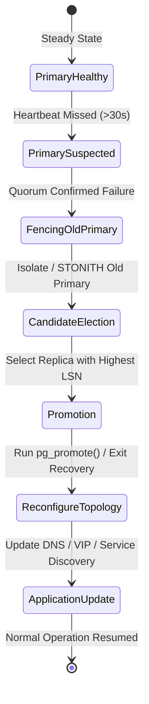

# Database Replication Architecture & Engineering Guide

> **Module:** Database Architecture  
> **Target Audience:** Database Engineers, Systems Architects, Senior Backend Engineers (Java/Spring Boot)  
> **Relevant Engines:** PostgreSQL (Streaming Physical Replication / Logical Replication), MySQL (Binary Log Replication)

---

## 1. What It Is

**Database replication** is the architectural practice of continuously copying and synchronizing data from a primary database instance to one or more secondary (standby/replica) database instances across independent hardware, networks, or availability zones.

In modern relational database management systems (RDBMS) such as PostgreSQL and MySQL, replication can be classified by:
1. **Physical Replication (Block/Byte Level):** Copies byte-for-byte disk changes recorded in the Write-Ahead Log (WAL) or redo log (e.g., PostgreSQL Streaming Replication). Standby nodes are exact byte-level physical mirrors of the primary.
2. **Logical Replication (Row/Statement Level):** Decodes internal transaction logs into a stream of logical row changes (INSERT, UPDATE, DELETE). This allows selective table replication, cross-major-version synchronization, and heterogeneous engine targets.

---

## 2. Why It Is Needed & Problems It Solves

Without replication, a single database server represents a catastrophic **Single Point of Failure (SPOF)** and a hard ceiling on read throughput:

- **High Availability & Fault Tolerance:** If a standalone database crashes, power fails, or underlying storage corrupts, the entire application tier halts. Replication provides warm or hot standbys ready to assume the primary role.
- **Horizontal Read Scalability:** E-commerce, social networks, and SaaS platforms typically exhibit 80:20 to 95:5 read-to-write ratios. Replication allows distributing compute-heavy `SELECT` queries across an elastic pool of read replicas.
- **Geographic Proximity & Latency Reduction:** Standbys placed in regional data centers serve low-latency read requests to geographically distributed users.
- **Offloading Heavy Background Workloads:** Analytical queries, report generation, ETL pipelines, and continuous physical backups (`pg_basebackup`) can target dedicated replicas without degrading primary online transaction processing (OLTP) throughput.

---

## 3. Architecture & Internal Mechanics

```mermaid
flowchart TD
    subgraph Clients["Application Cluster (Spring Boot)"]
        WriterApp["Writer Service (@Transactional)"]
        ReaderApp["Reader Service (@Transactional(readOnly=true))"]
    end

    subgraph PrimaryNode["PostgreSQL Primary Node (db-primary-01)"]
        BackendProc["Postgres Backend Processes"]
        WALWriter["WAL Writer Process"]
        WALBuffers["WAL Buffers & Disk WAL Segments (/pg_wal)"]
        WALSender["WAL Sender Background Worker (walsender)"]

        BackendProc -->|1. Generate changes| WALBuffers
        WALBuffers -->|2. fsync commit| WALWriter
        WALBuffers -->|3. Read WAL records| WALSender
    end

    subgraph Network["Replication Network (Dedicated VLAN / VPC Peering)"]
        WALStream["TCP Physical WAL Stream (Port 5432)"]
        WALSender --> WALStream
    end

    subgraph ReplicaNode["PostgreSQL Standby Node (db-replica-01)"]
        WALReceiver["WAL Receiver Process (walreceiver)"]
        StartupProc["Startup Process (Recovery Engine)"]
        SharedBuffers["Replica Buffer Pool / Shared Buffers"]
        ReplicaDisk[("Standby Data Files")]

        WALStream --> WALReceiver
        WALReceiver -->|Write received WAL| StartupProc
        StartupProc -->|Replay WAL records sequentially| SharedBuffers
        SharedBuffers -->|Flush dirty pages| ReplicaDisk
    end

    WriterApp -->|Port 5432 (Writes)| BackendProc
    ReaderApp -->|Port 5432 (Reads)| StartupProc
    WALReceiver -.->|Send Flush LSN ACK| WALSender
```

### 3.1 Primary and Replica Responsibilities

| Responsibility | Primary Node (Leader / Writer) | Standby Replica Node (Follower / Reader) |
| :--- | :--- | :--- |
| **Write Execution** | Executes `INSERT`, `UPDATE`, `DELETE`, `DDL` (`ALTER`, `CREATE`). Manages table-level and row-level write locks. | Rejects all write commands (`ERROR: cannot execute INSERT in a read-only transaction`). |
| **Transaction ID Allocation**| Generates monotonic 32-bit/64-bit Transaction IDs (`XID`), controls transaction snapshots, and logs to WAL. | Replays transaction states in the order assigned by the primary; never generates its own transaction IDs. |
| **Read Execution** | Can serve read queries, but typically reserved for transactional writes and read-your-own-writes consistency. | Serves read-only queries (`SELECT`) snapshot-isolated based on the latest replayed LSN. |
| **Vacuum & Bloat Management**| Runs `autovacuum` workers to reclaim dead tuples and freeze transaction IDs. | Cannot run autovacuum independently; applies vacuum WAL records generated by the primary. |

### 3.2 Why a Normal PostgreSQL Standby Is Read-Only

In PostgreSQL physical replication, the standby server runs in **Continuous Recovery Mode** (managed by the `Startup Process`). 
- Physical replication applies binary changes directly to shared memory blocks and data pages at the disk level via WAL replay.
- The standby does not assign transaction IDs (`XIDs`), does not generate write-ahead logs, and cannot write to system catalogs (`pg_class`, `pg_attribute`).
- If arbitrary writes were permitted on the standby, its physical page layouts, transaction status bits (`pg_xact`), and tuple visibility pointers would immediately diverge from the incoming WAL stream, leading to instant catastrophic storage corruption.
- As a result, PostgreSQL enforces `pg_is_in_recovery() = true`, making the engine strictly read-only (`Hot Standby`).

### 3.3 WAL Streaming and Change Propagation Mechanics

1. **Transaction Commit on Primary:** When a client issues `COMMIT`, the backend generates a commit record in `WAL Buffers`.
2. **Disk Flush:** The WAL Writer or backend flushes WAL bytes to disk (`/pg_wal/`) using `fsync()` up to the current **Log Sequence Number (LSN)**.
3. **Transmission:** The primary's background process `walsender` detects new LSN offsets and streams raw WAL bytes over a persistent TCP socket to the standby.
4. **Reception on Standby:** The standby's `walreceiver` process reads the stream and writes WAL chunks to its local `/pg_wal/` directory.
5. **Sequential Replay:** The standby's `Startup Process` continuously reads WAL records, validates checksums, and replays modifications into the standby's shared buffers and data files in deterministic order.
6. **Replication Feedback & ACKs:** The `walreceiver` periodically transmits its status back to the primary, reporting three distinct LSN positions:
   - `write_lsn`: Written to the standby's OS file system cache.
   - `flush_lsn`: Flushed to durable storage via `fsync()`.
   - `replay_lsn`: Replayed and visible to read queries running on the standby.

### 3.4 Synchronous vs Asynchronous Replication

```mermaid
flowchart LR
    subgraph Async["Asynchronous Replication"]
        P1["Primary: Commit"] -->|Flush LSN locally| P1_Done["Acknowledge Client (OK)"]
        P1 -.->|Background Stream| R1["Replica: Replay LSN"]
    end

    subgraph Sync["Synchronous Replication"]
        P2["Primary: Commit"] -->|Flush LSN locally| P2_Wait["Wait for ACK"]
        P2 -->|Stream LSN| R2["Replica: Flush LSN to disk"]
        R2 -->|Send ACK (Flush LSN)| P2_Wait
        P2_Wait --> P2_Done["Acknowledge Client (OK)"]
    end
```

| Dimension | Asynchronous Replication (Default) | Synchronous Replication |
| :--- | :--- | :--- |
| **Commit Latency** | **Minimal:** Client receives commit confirmation as soon as WAL is flushed to the primary's local disk. | **Higher:** Client thread is blocked until WAL is sent over network and flushed to one or more standbys. |
| **RPO (Recovery Point Objective)** | **> 0 (Data Loss Possible):** If primary crashes before WAL is transmitted, committed transactions not yet sent to the standby are lost upon failover. | **0 (Zero Data Loss):** Guarantees at least one synchronous standby has persisted the WAL record before the client gets an OK. |
| **Availability / Fault Sensitivity** | **High:** Primary continues processing writes even if all replicas disconnect or crash. | **Vulnerable to Hangs:** If the synchronous replica crashes or experiences a network partition, the primary blocks all write commits until a timeout or reconfiguration. |
| **PostgreSQL Setting** | `synchronous_commit = off` or `local` | `synchronous_commit = on` (or `remote_apply`) and `synchronous_standby_names = 'FIRST 1 (rep1, rep2)'` |

### 3.5 Replication Lag and Consistency Challenges

**Replication lag** is the temporal or byte delay between when a transaction is committed on the primary and when that transaction becomes visible to read queries on the replica.

#### Measuring Lag in PostgreSQL
Lag is measured in both **bytes** (distance between Primary's current WAL insert LSN and Standby's replay LSN) and **time** (delay based on commit timestamps).

```sql
-- Executed on Primary to view replication status and byte lag:
SELECT 
    client_addr, 
    application_name, 
    state, 
    sync_state,
    sync_priority,
    pg_wal_lsn_diff(pg_current_wal_lsn(), sent_lsn) AS sent_byte_lag,
    pg_wal_lsn_diff(sent_lsn, write_lsn) AS write_byte_lag,
    pg_wal_lsn_diff(write_lsn, flush_lsn) AS flush_byte_lag,
    pg_wal_lsn_diff(flush_lsn, replay_lsn) AS replay_byte_lag,
    pg_wal_lsn_diff(pg_current_wal_lsn(), replay_lsn) AS total_byte_lag
FROM pg_stat_replication;
```

```sql
-- Executed on Standby to view time lag and recovery status:
SELECT 
    pg_is_in_recovery() AS is_standby,
    pg_last_wal_receive_lsn() AS receive_lsn,
    pg_last_wal_replay_lsn() AS replay_lsn,
    now() - pg_last_xact_replay_timestamp() AS replication_time_lag;
```

#### Causes of High Replication Lag
1. **Long-Running Queries on Replicas (Replication Conflicts):** If a query on the replica reads a table being vacuumed or altered by an incoming WAL record, PostgreSQL must either pause WAL replay or cancel the read query (`ERROR: canceling statement due to conflict with recovery`). Tuned via `max_standby_archive_delay` and `max_standby_streaming_delay`.
2. **I/O Bottlenecks on Replicas:** The standby startup process replays WAL single-threaded or with limited parallelism in older engines, whereas the primary writes concurrently across dozens of CPU cores.
3. **Massive Bulk Writes on Primary:** Running `UPDATE large_table SET status = 'INACTIVE'` generates gigabytes of WAL in seconds, saturating network bandwidth and replica replay buffers.

#### Consistency Impacts: Read-After-Write Stale Data
In asynchronous replication, if a user updates their profile on the primary and is redirected immediately to a read replica, the replica may not have replayed that transaction yet. The user sees their old profile data, commonly misdiagnosed as an application caching bug.

### 3.6 Read Routing and Load Balancing

Replicas require intelligent routing at either the **Application Layer** or **Proxy/Infrastructure Layer**.

```mermaid
flowchart TD
    AppTier["Spring Boot Application"]
    Proxy["Smart Proxy / Load Balancer (pgpool-II / ProxySQL / HAProxy)"]
    Primary["PostgreSQL Primary (Port 5432)"]
    ReplicaA["PostgreSQL Standby A (Port 5432)"]
    ReplicaB["PostgreSQL Standby B (Port 5432)"]

    AppTier -->|Single Connection String| Proxy
    Proxy -->|Parses SQL: INSERT/UPDATE| Primary
    Proxy -->|Parses SQL: SELECT (Round-Robin)| ReplicaA
    Proxy -->|Parses SQL: SELECT (Round-Robin)| ReplicaB
```

#### Why Load Balancers Balance Connections Rather Than Individual Queries
Standard Layer 4 load balancers (AWS NLB, F5, HAProxy in TCP mode) establish a TCP connection between client and database:
1. **Connection Affinity:** A JDBC connection stays pinned to one backend server for the duration of the pool session. The LB cannot inspect the SQL payload inside encrypted TLS packets.
2. **Transaction Integrity:** If an individual connection routed queries to different nodes mid-session, a multi-statement transaction (`BEGIN -> UPDATE -> SELECT -> COMMIT`) would have its `UPDATE` on the primary and `SELECT` on a lagging replica, causing severe transactional anomalies.
3. **Session State:** Session-level variables (`SET search_path`, prepared statements, temporary tables) are bound to the specific database connection.
4. **Resolution:** Layer 7 proxies (pgpool-II, PgBouncer, AWS RDS Proxy) or application-level data routing (Spring Boot `AbstractRoutingDataSource`) must be used to intelligently separate read and write connections.

### 3.7 Health Checks, Failover, Replica Promotion, and Split-Brain Prevention

When a primary fails, high-availability managers (e.g., **Patroni**, **repmgr**, **AWS Aurora / RDS Orchestrator**) execute an automated failover sequence:



#### Selection of Promotion Candidate
If multiple standbys exist, the orchestrator queries each candidate's `pg_last_wal_replay_lsn()`. The standby with the highest LSN (least data loss / closest to primary) is chosen for promotion.

#### Promotion Command
```sql
-- In PostgreSQL 12+, promotion is executed via SQL:
SELECT pg_promote(wait := true, wait_seconds := 60);
```
Or via shell utility:
```bash
pg_ctl promote -D /var/lib/postgresql/data
```
The promoted standby ceases recovery, updates its timeline ID (e.g., from Timeline 1 to Timeline 2), writes an end-of-recovery record in WAL, and opens for read-write transactions.

#### Split-Brain Prevention & Fencing (STONITH)
**Split-brain** occurs when a network partition isolates the primary from its standbys, but both sides believe they are the legitimate writer. If the orchestrator promotes a replica while the original primary continues accepting writes from an isolated subset of application clients, **data diverges irreversibly**.

To prevent split-brain:
1. **Distributed Consensus Store (DCS):** Production HA frameworks (such as Patroni using `etcd`, `Consul`, or `ZooKeeper`) require leader keys guarded by short-lived leases with heartbeats. A node cannot act as primary without holding the DCS leader lease.
2. **Fencing (STONITH - Shoot The Other Node In The Head):** Before promoting a standby, the HA system cuts power, revokes network route tables, or detaches the EBS volume from the old primary.
3. **Quorum Consensus:** Failover requires a majority vote (`(N/2) + 1`). In a 3-node cluster, 2 nodes must agree before promoting.

### 3.8 Interaction with Connection Pools and Transactions

1. **Transaction Pinning:** Any transaction that performs a write must execute all subsequent operations within that same physical connection on the primary.
2. **HikariCP Isolation:** An application must maintain distinct connection pools: one for the primary writer and another for read-only replicas.
3. **Idle in Transaction Timeouts:** Standbys replaying WAL can be stalled if long-lived transactions hold snapshot locks. Enforce `idle_in_transaction_session_timeout = '30s'` and `statement_timeout = '60s'`.

---

## 4. Real-World Industry Example: Fintech Core Ledger

In a digital payments platform processing 10,000 credit card authorizations per second:
- **Write Path:** The Authorization Service writes to a 3-node PostgreSQL cluster. To guarantee zero financial loss, it uses **Synchronous Replication** (`synchronous_standby_names = 'ANY 1 (standby_az2, standby_az3)'`) spanning two Availability Zones. Every balance deduction must be flushed to at least one standby before returning HTTP 200 to the payment gateway.
- **Read Path:** The Merchant Analytics Dashboard and Customer History Services route their read-only queries to a pool of 4 **Asynchronous Replicas**. Lag of 200ms is acceptable for historical reporting, protecting the synchronous primary cluster from analytical load.

---

## 5. Practical Implementation & Verification (PostgreSQL 14+)

### 5.1 Primary Configuration (`postgresql.conf`)
```ini
# postgresql.conf on Primary
listen_addresses = '*'
wal_level = replica                  # Minimal level for streaming replication
max_wal_senders = 10                 # Max concurrent replication streaming connections
max_replication_slots = 10           # Protect WAL from being recycled before replica consumes
wal_keep_size = 2048MB               # Reserve WAL volume on disk for standbys
archive_mode = on                    # Enable continuous archiving for PITR
archive_command = 'cp %p /var/lib/postgresql/archive/%f'

# Synchronous replication configuration (Optional / High-Durability):
# synchronous_commit = on
# synchronous_standby_names = 'FIRST 1 (replica_01, replica_02)'
```

### 5.2 Access Control (`pg_hba.conf`)
```text
# Allow replication user from the replica subnet
host    replication     replicator      10.0.10.0/24           scram-sha-256
```

### 5.3 Provisioning Replication User & Slot
```sql
-- Executed on Primary:
CREATE ROLE replicator WITH REPLICATION LOGIN ENCRYPTED PASSWORD 'StrongReplicationPassword123!';

-- Create a physical replication slot to guarantee the primary preserves WAL:
SELECT pg_create_physical_replication_slot('standby_slot_01');
```

### 5.4 Standby Bootstrapping via `pg_basebackup`
```bash
# Executed on Replica server (stops Postgres first):
pg_ctl -D /var/lib/postgresql/data stop

# Wipe existing data directory
rm -rf /var/lib/postgresql/data/*

# Stream physical base backup from primary and create standby.signal
pg_basebackup -h 10.0.10.5 -p 5432 -U replicator -D /var/lib/postgresql/data -Fp -Xs -R -S standby_slot_01 -v -W
```
*Note: The `-R` flag automatically creates `standby.signal` and configures `primary_conninfo` in `postgresql.auto.conf`.*

### 5.5 Standby Verification
```bash
# Start standby
pg_ctl -D /var/lib/postgresql/data start
```

```sql
-- Executed on Standby to confirm read-only recovery status:
SELECT pg_is_in_recovery(); 
-- Returns: true

-- Attempting a write verifies enforcement:
CREATE TABLE test_write (id INT);
-- Output:
-- ERROR: cannot execute CREATE TABLE in a read-only transaction
```

---

## 6. Advantages and Disadvantages

| Advantages | Disadvantages & Trade-offs |
| :--- | :--- |
| **High Availability:** Enables automated failover with minimal RTO. | **Infrastructure Cost:** Multiple database instances require duplicated CPU, RAM, and high-performance storage. |
| **Horizontal Read Scaling:** Scales read throughput linearly by adding replicas. | **Replication Lag & Eventual Consistency:** Asynchronous replication exposes readers to stale reads. |
| **Data Protection & Disaster Recovery:** Geographical replication guards against regional outages. | **Network Bandwidth:** High write volume consumes significant inter-DC or cross-AZ network bandwidth. |
| **Zero Downtime Upgrades:** Enables rolling upgrades and canary deployments. | **Operational Complexity:** Requires consensus engines, split-brain protection, and monitoring. |

---

## 7. Common Implementation Mistakes & Antipatterns

1. **Relying on Async Replication for Read-After-Write Operations:** Directing a user's redirect request to a replica immediately after a form submission creates "phantom disappearances" of newly created records.
2. **Neglecting Replication Slots Monitoring:** If a replication slot is configured on the primary and the replica drops offline for hours, the primary retains all WAL files. This can fill the primary's disk, taking down the entire production cluster.
3. **Synchronous Replication with a Single Standby:** If the sole synchronous standby reboots, the primary freezes all subsequent write commits, transforming a secondary failure into a total write outage.
4. **Ignoring Replication Conflicts:** Long queries on the replica blocking WAL replay without setting `max_standby_streaming_delay` leads to unexpected query termination or massive replication lag.

---

## 8. Production Considerations & Operational Checklist

- [ ] **Replication Slots:** Monitor `pg_replication_slots.active` and `wal_status`. Alert if retained WAL exceeds 80% disk capacity.
- [ ] **Heartbeat Tables:** Deploy an automated heartbeat writer (e.g., updating a `heartbeat` table with `clock_timestamp()` every 1s) to measure genuine end-to-end replay delay independent of system clocks.
- [ ] **Fencing & DCS:** Deploy Patroni with an odd-numbered etcd quorum (3 or 5 nodes) across separate failure zones.
- [ ] **Connection Draining:** Implement graceful connection draining during promotion so the application can terminate stale read connections and establish connections to the new topology.

---

## 9. Related Interview Questions

- [Replication Interview Deep Dive](../database-interview-questions/replication.md)
- [Scenario: Primary Database Fails Under Load](../database-interview-questions/scenario-based-questions.md#scenario-1-a-primary-database-fails-while-thousands-of-orders-are-being-placed)
- [Scenario: Replica Behind Primary & Read-After-Write Consistency](../database-interview-questions/scenario-based-questions.md#scenario-2-a-replica-is-behind-the-primary-can-it-safely-serve-a-read-after-write-request)

---

## 10. Authoritative References

- [PostgreSQL Official Documentation: High Availability, Load Balancing, and Replication](https://www.postgresql.org/docs/current/high-availability.html)
- [PostgreSQL Official Documentation: Continuous Archiving and Standby Servers](https://www.postgresql.org/docs/current/continuous-archiving.html)
- [MySQL 8.4 Reference Manual: Replication Architecture](https://dev.mysql.com/doc/refman/8.4/en/replication.html)
