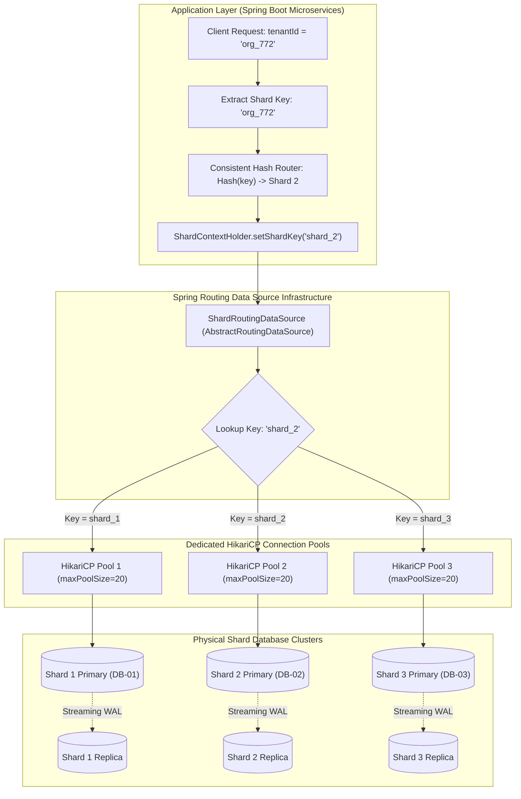
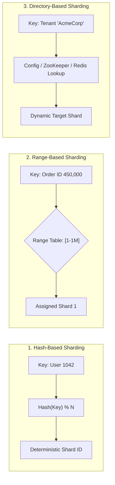
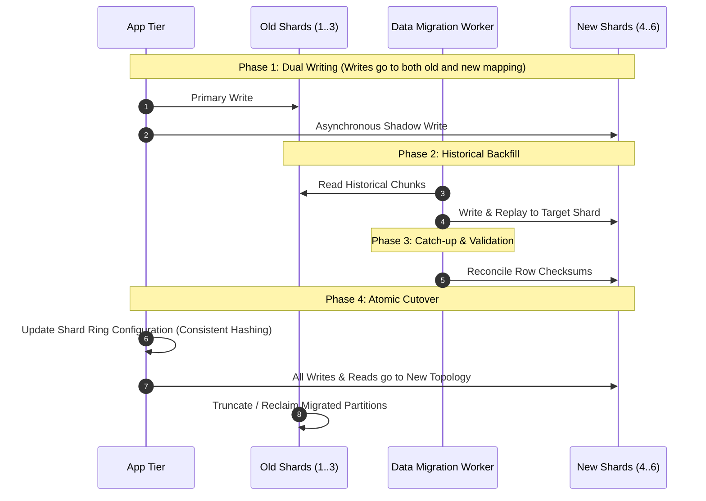

# Database Sharding Architecture & Engineering Guide

> **Module:** Database Architecture  
> **Target Audience:** Systems Architects, Principal Engineers, Senior Java/Spring Boot Developers  
> **Prerequisites:** Primary-Replica Replication, ACID Transactions, Connection Pooling (HikariCP)

---

## 1. What It Is

**Database sharding** is a horizontal data partitioning strategy in which a large logical dataset is split across two or more completely independent, physically isolated database instances called **shards**. 

Unlike standard replication (where every node holds a copy of the same dataset) or single-node table partitioning (where partitions share the same CPU, memory, and database process), **each shard contains an exclusive, non-overlapping subset of the data and runs on its own independent hardware resources**.

```text
Logical Database: 300 Million Customer Accounts (3 TB)
           │
           ├── Shard 01 (Independent Server): IDs 1       to 100,000,000 (1 TB)
           ├── Shard 02 (Independent Server): IDs 100,000,001 to 200,000,000 (1 TB)
           └── Shard 03 (Independent Server): IDs 200,000,001 to 300,000,000 (1 TB)
```

---

## 2. Why It Is Needed & Problems It Solves

Relational databases running on a single primary node inevitably encounter **vertical scaling ceilings**:
1. **Write Throughput Saturation:** Read replicas scale read queries, but **all writes must serialize through the single primary's WAL and lock manager**. When write transactions exceed disk IOPS, memory bandwidth, or CPU core limits, vertical scaling fails.
2. **Buffer Pool Cache Thrashing:** When working data exceeds total physical RAM, the database buffer pool constantly swaps pages to and from disk, causing query p99 latency to explode.
3. **Storage & Maintenance Limits:** A 20 TB table makes backups (`pg_dump`), indexing (`CREATE INDEX CONCURRENTLY`), `VACUUM`, and failover recovery excessively slow and risky.
4. **Blast Radius:** A corrupted disk or hung primary in a non-sharded database brings down the entire global application. Sharding divides the blast radius: a failure on Shard 2 affects only 33% of users, while Shards 1 and 3 remain operational.

---

## 3. Architecture & Internal Mechanics



### 3.1 Shard Keys & Shard-Key Selection

A **shard key** is one or more columns present on every row that the routing mechanism inspects to assign the row to a specific physical shard.

#### Selection Criteria
- **High Cardinality:** A boolean column like `is_active` has a cardinality of 2—it can only support two shards. A UUID or numeric `customer_id` has millions of distinct values, allowing smooth distribution.
- **Query Colocation (Even Distribution):** The ideal shard key aligns with 90%+ of application query filters. If queries specify `WHERE customer_id = ?`, all related tables (`customers`, `orders`, `invoices`, `payments`) should be sharded on `customer_id`.
- **Low Temporal Clustering:** Sharding on monotonically increasing timestamps (e.g., `created_at`) routes 100% of current writes to the newest shard, creating a severe **hot-shard problem**.

### 3.2 Sharding Strategies: Hash vs Range vs Directory



| Strategy | Mechanism | Pros | Cons |
| :--- | :--- | :--- | :--- |
| **Hash-Based** | `ShardID = Hash(shard_key) % NumShards` or Consistent Hash Ring. | Uniform distribution; eliminates sequential hot spots. | Range queries (`WHERE date BETWEEN x AND y`) require querying **all** shards (scatter-gather). |
| **Range-Based** | Routes by value boundaries (e.g., IDs 1–1M $\to$ Shard 1; 1M–2M $\to$ Shard 2). | Efficient range scans; predictable grouping. | Hot spot on the newest range receiving current inserts. |
| **Directory-Based** | Application queries a central routing lookup table or service (Redis/ZooKeeper). | Total flexibility; individual tenants can move between shards without mathematical hashing constraints. | Extra network hop to query the lookup service; lookup directory becomes a SPOF if not cached. |

### 3.3 Shard Routing in Java and Spring Boot

In Java Spring Boot, application-level sharding leverages Spring's `AbstractRoutingDataSource`. 

#### Architectural Components
1. **ThreadLocal Shard Context:** Stores the resolved target shard for the current executing HTTP request thread.
2. **Dynamic Routing DataSource:** Intercepts JDBC connection acquisition requests and pulls the target connection from the appropriate HikariCP pool.
3. **Separate Connection Pools:** Each physical shard must have its own isolated `HikariDataSource` instance to prevent connection starvation on one shard from blocking queries to others.

#### Working Educational Java Implementation

```java
package com.database.sharding.routing;

import org.springframework.jdbc.datasource.lookup.AbstractRoutingDataSource;
import java.util.Map;
import javax.sql.DataSource;

/**
 * Educational Shard Routing Data Source.
 * Resolves the underlying DataSource based on the ThreadLocal shard key.
 */
public class ShardRoutingDataSource extends AbstractRoutingDataSource {

    @Override
    protected Object determineCurrentLookupKey() {
        String shardKey = ShardContextHolder.getCurrentShard();
        // Fallback to default shard if no key context is set (e.g. background maintenance)
        return (shardKey != null) ? shardKey : "SHARD_1";
    }
}
```

```java
package com.database.sharding.routing;

/**
 * Thread-safe context holder for the active shard identifier.
 */
public final class ShardContextHolder {

    private static final ThreadLocal<String> CURRENT_SHARD = new ThreadLocal<>();

    private ShardContextHolder() {}

    public static void setCurrentShard(String shardId) {
        CURRENT_SHARD.set(shardId);
    }

    public static String getCurrentShard() {
        return CURRENT_SHARD.get();
    }

    public static void clear() {
        CURRENT_SHARD.remove();
    }
}
```

```java
package com.database.sharding.config;

import com.database.sharding.routing.ShardRoutingDataSource;
import com.zaxxer.hikari.HikariConfig;
import com.zaxxer.hikari.HikariDataSource;
import org.springframework.context.annotation.Bean;
import org.springframework.context.annotation.Configuration;
import org.springframework.context.annotation.Primary;

import javax.sql.DataSource;
import java.util.HashMap;
import java.util.Map;

@Configuration
public class ShardDataSourceConfig {

    private HikariDataSource createPool(String jdbcUrl, String username, String password, String poolName) {
        HikariConfig config = new HikariConfig();
        config.setJdbcUrl(jdbcUrl);
        config.setUsername(username);
        config.setPassword(password);
        config.setPoolName(poolName);
        config.setMaximumPoolSize(20);
        config.setMinimumIdle(5);
        config.setConnectionTimeout(30000);
        config.setIdleTimeout(600000);
        config.setMaxLifetime(1800000);
        return new HikariDataSource(config);
    }

    @Bean
    @Primary
    public DataSource dataSource() {
        // Build dedicated physical pools for each shard
        DataSource shard1 = createPool("jdbc:postgresql://db-shard-01:5432/app_db", "app_user", "SecretPass1!", "HikariPool-Shard-1");
        DataSource shard2 = createPool("jdbc:postgresql://db-shard-02:5432/app_db", "app_user", "SecretPass1!", "HikariPool-Shard-2");
        DataSource shard3 = createPool("jdbc:postgresql://db-shard-03:5432/app_db", "app_user", "SecretPass1!", "HikariPool-Shard-3");

        Map<Object, Object> targetDataSources = new HashMap<>();
        targetDataSources.put("SHARD_1", shard1);
        targetDataSources.put("SHARD_2", shard2);
        targetDataSources.put("SHARD_3", shard3);

        ShardRoutingDataSource routingDataSource = new ShardRoutingDataSource();
        routingDataSource.setTargetDataSources(targetDataSources);
        routingDataSource.setDefaultTargetDataSource(shard1);
        routingDataSource.afterPropertiesSet();

        return routingDataSource;
    }
}
```

```java
package com.database.sharding.service;

import com.database.sharding.routing.ShardContextHolder;
import org.springframework.stereotype.Service;

@Service
public class ShardRouterService {

    private static final int TOTAL_SHARDS = 3;

    public String resolveShard(String customerId) {
        if (customerId == null || customerId.isBlank()) {
            return "SHARD_1";
        }
        // Use consistent hash or modulo on positive hash
        int hash = Math.abs(customerId.hashCode());
        int shardIndex = (hash % TOTAL_SHARDS) + 1;
        return "SHARD_" + shardIndex;
    }

    public <T> T executeOnShard(String customerId, ShardSupplier<T> supplier) {
        String targetShard = resolveShard(customerId);
        ShardContextHolder.setCurrentShard(targetShard);
        try {
            return supplier.get();
        } finally {
            ShardContextHolder.clear(); // Always clear ThreadLocal to avoid memory leaks or thread reuse pollution
        }
    }

    @FunctionalInterface
    public interface ShardSupplier<T> {
        T get();
    }
}
```

> [!WARNING]
> **Limitations of this Educational Implementation & Production Requirements:**  
> 1. **Cross-Shard Transactions:** If a business use case requires updating data on `SHARD_1` and `SHARD_2` simultaneously, standard `@Transactional` cannot coordinate both. A distributed transaction coordinator (2PC / Sagas) is required.  
> 2. **Cross-Shard Queries (Scatter-Gather):** This implementation cannot perform queries without a shard key (e.g., `SELECT * FROM orders WHERE status = 'PENDING'`). A production system requires an orchestration middleware (e.g., Apache ShardingSphere, Vitess, or Citus) that parallelizes queries across all shards and merges result sets in memory.  
> 3. **Dynamic Topology Changes:** Adding a new shard requires modifying Spring configurations or maintaining dynamic registry integration.

### 3.4 What Happens When a Shard Fails

If Shard 2 crashes and does not have an automated failover replica:
- Any query attempting to read or write data mapped to Shard 2 fails with a connection timeout or JDBC exception.
- Queries routed to Shard 1 and Shard 3 succeed without degradation.
- **Production Standard:** Every individual shard **must** be deployed as a high-availability cluster using Primary-Replica streaming replication. Shard 2's primary is backed by a synchronous or hot standby with automated failover (e.g., Patroni).

### 3.5 Shard Rebalancing and Resharding

When data grows or shard capacity reaches 80%, new shards must be added (e.g., moving from 3 shards to 6 shards).



1. **Consistent Hashing (Virtual Nodes):** Instead of simple `hash % N`, consistent hashing places shards on a virtual ring (0 to $2^{32}-1$). Adding a node moves only $K/N$ keys, avoiding a total redistribution of data.
2. **Online Resharding:**
   - Deploy new shard instances.
   - Dual-write application updates to both old and new targets.
   - Backfill historical data via asynchronous worker.
   - Verify row counts and cryptographic checksums.
   - Switch application routing atomically.
   - Reclaim disk on original shards.

### 3.6 Cross-Shard Joins and Transactions

1. **Denormalization / Duplication:** Small reference tables (e.g., `countries`, `currencies`, `product_categories`) are replicated in full to every single shard. Joins between `orders` and `countries` can then run locally on that single shard.
2. **Entity Colocation:** Design schemas such that child tables inherit the parent's shard key. `order_items` stores `customer_id` even if redundant, ensuring that `orders` and `order_items` always land on the same physical shard.
3. **Two-Phase Commit (2PC) vs Saga Pattern:** Avoid distributed 2PC (`XA transactions`) in high-throughput systems due to lock amplification and coordinator blocking. Prefer eventual consistency using asynchronous messaging and the **Saga Pattern** (orchestrated or choreographed with compensation transactions).

---

## 4. Real-World Industry Example: Global Multi-Tenant SaaS

A multi-tenant enterprise ERP platform hosts 50,000 corporate tenants:
- **Shard Key:** `tenant_id` (UUID).
- **Topology:** 16 independent PostgreSQL shard clusters. Each cluster has a primary writer and two read replicas.
- **Routing:** Application inspects the JWT claim `tenant_id`, computes the MurmurHash3 value, and routes to Shard 1..16.
- **Tenant Isolation:** Large enterprise customers (generating 40% of all activity) are assigned dedicated physical shards (directory-based assignment), while 49,990 smaller companies share the remaining hash-distributed shards.

---

## 5. Practical Implementation & Verification

### 5.1 Verification: Simulating Shard Isolation
```sql
-- On Physical Shard 1 (e.g., db-shard-01):
CREATE TABLE accounts (
    account_id VARCHAR(64) PRIMARY KEY,
    owner_name VARCHAR(100) NOT NULL,
    balance NUMERIC(15, 2) NOT NULL,
    created_at TIMESTAMPTZ DEFAULT clock_timestamp()
);

-- Insert record assigned to Shard 1:
INSERT INTO accounts (account_id, owner_name, balance) 
VALUES ('ACC_US_1001', 'Alice Engineering', 450000.00);

-- Query on Shard 1 succeeds:
SELECT * FROM accounts WHERE account_id = 'ACC_US_1001';
```

```sql
-- On Physical Shard 2 (e.g., db-shard-02):
-- Account 'ACC_US_1001' does NOT exist here:
SELECT * FROM accounts WHERE account_id = 'ACC_US_1001';
-- Output: (0 rows)
```

---

## 6. Advantages and Disadvantages

| Advantages | Disadvantages & Trade-offs |
| :--- | :--- |
| **Unlimited Horizontal Scale:** Scale both read and write workloads linearly by adding more hardware nodes. | **High Architectural Complexity:** Application or proxy must implement custom shard routing, connection pooling, and error handling. |
| **Smaller Fault Domains:** Hardware failure on one shard impacts only a fraction of the total user base. | **No Native Cross-Shard Joins:** Relational joins across different shards cannot be performed by the database engine. |
| **Smaller Working Sets:** Each shard fits its active data and indexes entirely within memory (buffer pool), maximizing cache hit ratios. | **Complex Schema Migrations:** DDL updates (Flyway/Liquibase) must be executed across every physical database instance in parallel. |
| **Localized Maintenance:** Vacuuming, re-indexing, and point-in-time recovery are fast on smaller 500 GB databases compared to a monolithic 15 TB instance. | **Resharding Pain:** Rebalancing data across shards under active production load is an operationally risky, engineering-intensive effort. |

---

## 7. Common Implementation Mistakes & Antipatterns

1. **Sharding Prematurely:** Implementing sharding when table sizes are under 500 GB or when read replicas and proper indexing would solve the problem with 10x less operational overhead.
2. **Selecting a Shard Key with Poor Distribution:** Choosing a low-cardinality key (e.g., `country_code`) where 80% of users reside in one country, turning that shard into an unscalable bottleneck.
3. **Executing Scatter-Gather Queries in Critical Request Paths:** Firing queries without a shard key causes the application to issue requests to all 30 shards and aggregate results in memory, causing p99 latencies to skyrocket.
4. **Shared Connection Pools:** Using a single shared pool for multiple shards. When Shard 3 hangs, its threads exhaust the entire pool, starving Shards 1 and 2 of connections.

---

## 8. Production Considerations & Operational Checklist

- [ ] **Capacity Alarms:** Set alerts when any individual shard exceeds 70% storage or IOPS capacity.
- [ ] **Global Unique Identifiers:** Avoid database auto-incrementing serial sequences (`BIGSERIAL`). Use distributed ID generators such as **UUIDv7** or **Twitter Snowflake** to avoid primary key collisions across shards.
- [ ] **Cross-Shard Scatter-Gather Quotas:** Enforce timeouts (`scatter_gather_timeout = '2000ms'`) and circuit breakers on non-targeted queries.
- [ ] **Dedicated Per-Shard Backups:** Configure independent backup schedules and PITR for each physical shard.

---

## 9. Related Interview Questions

- [Sharding Interview Deep Dive](../database-interview-questions/sharding.md)
- [Scenario: E-Commerce Shard Key Selection](../database-interview-questions/scenario-based-questions.md#scenario-3-how-would-you-select-a-shard-key-for-an-e-commerce-application)
- [Scenario: Overloaded Shard Triage](../database-interview-questions/scenario-based-questions.md#scenario-4-what-happens-when-a-shard-is-overloaded)
- [Scenario: Migrating from Monolith to Shards](../database-interview-questions/scenario-based-questions.md#scenario-5-how-do-you-migrate-from-one-database-to-multiple-shards)

---

## 10. Authoritative References

- [Distributed SQL & Sharding Patterns (Martin Kleppmann, Designing Data-Intensive Applications)](https://dataintensive.net/)
- [PostgreSQL Citus Distributed Architecture](https://www.citusdata.com/documentation/)
- [Spring Framework: AbstractRoutingDataSource Documentation](https://docs.spring.io/spring-framework/docs/current/javadoc-api/org/springframework/jdbc/datasource/lookup/AbstractRoutingDataSource.html)
