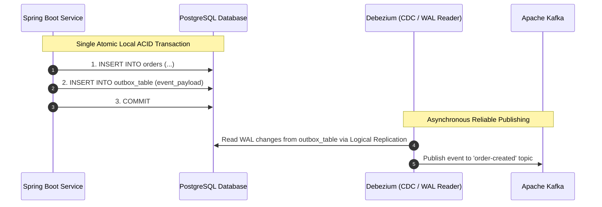

# Distributed Transactions Architecture

> **Module:** Database Architecture  
> **Target Audience:** Systems Architects, Principal Engineers, Senior Backend Developers  
> **Relevant Technologies:** Two-Phase Commit (2PC / XA), Saga Pattern, Eventual Consistency, Outbox Pattern

---

## 1. What It Is

A **Distributed Transaction** is an atomic set of data operations that updates state across multiple physically separated database nodes, microservices, or heterogeneous persistence engines.

In a single relational database, ACID guarantees are enforced internally by a centralized lock manager and Write-Ahead Log. Across distributed databases or microservice boundaries, **there is no shared memory, no single clock, and network partitions are inevitable**, making atomic coordination significantly more complex.

---

## 2. Core Patterns: Two-Phase Commit (2PC) vs Saga Pattern

```mermaid
flowchart TD
    subgraph 2PC["1. Two-Phase Commit (2PC / XA) - Strong Consistency"]
        Coord["Coordinator Node"]
        Node1["DB Node A"]
        Node2["DB Node B"]
        Coord -->|Phase 1: PREPARE (Acquire Locks)| Node1
        Coord -->|Phase 1: PREPARE (Acquire Locks)| Node2
        Coord -->|Phase 2: COMMIT (Release Locks)| Node1
        Coord -->|Phase 2: COMMIT (Release Locks)| Node2
    end

    subgraph Saga["2. Saga Pattern - Eventual Consistency"]
        Step1["Step 1: Order Service (Local Commit)"]
        Step2["Step 2: Payment Service (Local Commit)"]
        Compensate["Compensating Tx (Undo Step 1 if Step 2 Fails)"]
        Step1 -->|Success: Event Trigger| Step2
        Step2 -.->|Failure: Compensate| Compensate
    end
```

### 2.1 Two-Phase Commit (2PC / XA)
- **Phase 1 (Prepare):** The coordinator asks all participating databases: *"Can you commit this transaction?"* Each participant acquires exclusive row locks, writes changes to its local redo log, and votes `VOTE_COMMIT` or `VOTE_ABORT`.
- **Phase 2 (Commit):** If **all** participants voted commit, the coordinator sends `COMMIT`. If any node voted abort or timed out, the coordinator sends `ROLLBACK`.
- **Fatal Flaw of 2PC (Coordinator SPOF & Blocking):** If the coordinator crashes after Phase 1, participants are left **blocked indefinitely in the prepared state**, holding row locks on production tables and stalling all subsequent queries.

### 2.2 Saga Pattern (Recommended for Modern Microservices)
Instead of holding global locks across databases, a Saga breaks the business transaction into a series of **local independent ACID transactions**.
- Each service executes its local transaction and publishes a message/event.
- If a step fails, the saga triggers **Compensating Transactions** that run backward to undo the business effects (e.g., if payment authorization fails, cancel the reserved order).
- **Two Coordination Approaches:**
  1. **Choreography:** Microservices listen to Kafka/RabbitMQ events and publish the next event without a central orchestrator.
  2. **Orchestration:** A dedicated orchestrator state machine (e.g., Temporal, AWS Step Functions, or Camunda) sends commands to microservices.

---

## 3. Transactional Outbox Pattern

When a microservice needs to update its local database AND publish an event to a message broker (e.g., Kafka), performing both actions without dual-write inconsistency requires the **Transactional Outbox Pattern**:



1. The application inserts the business entity (`orders`) and the event record (`outbox`) inside the **exact same local ACID database transaction**.
2. A Change Data Capture (CDC) agent (like **Debezium**) reads the database WAL stream using logical decoding and streams events to Kafka with **at-least-once delivery guarantees**.

---

## 4. Architectural Comparison

| Dimension | Two-Phase Commit (2PC) | Saga Pattern |
| :--- | :--- | :--- |
| **Consistency Model** | **Strong Consistency** (ACID). No dirty reads across nodes. | **Eventual Consistency** (BASE). Intermediate states are visible. |
| **Throughput & Scalability** | **Extremely Low:** Lock amplification and network latency limit scale to < 100 tx/sec. | **Extremely High:** Each node commits locally; zero blocking locks across nodes. |
| **Failure Recovery** | Automatic engine-level abort or blocking wait. | Requires authoring explicit compensating business logic for every failure scenario. |
| **Best Used For** | Atomic updates within a single distributed engine (e.g., CockroachDB Raft-based 2PC). | Cross-service business workflows across microservices and external APIs. |

---

## 5. Authoritative References

- [Distributed Systems: Principles and Paradigms (Tanenbaum & Van Steen)](https://www.distributed-systems.net/)
- [Microservices Patterns: With Examples in Java (Chris Richardson)](https://microservices.io/patterns/data/saga.html)
- [Debezium: Transactional Outbox Pattern Guide](https://debezium.io/documentation/reference/stable/transformations/outbox-event-router.html)
