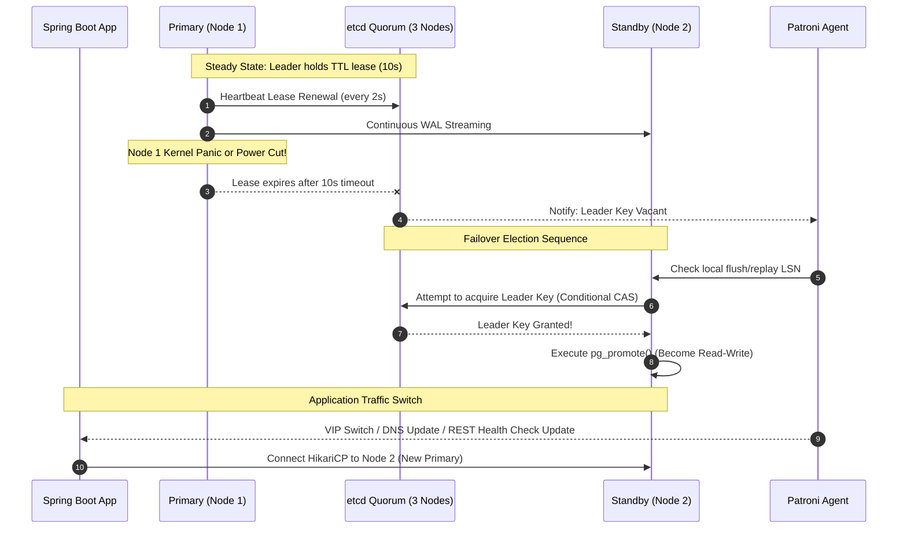

# Failover and High Availability Architecture

> **Module:** Database Architecture  
> **Target Audience:** Systems Architects, Database Administrators, SREs  
> **Relevant Technologies:** Patroni, etcd, Consul, Keepalived, PostgreSQL, MySQL Orchestrator

---

## 1. What It Is

**High Availability (HA)** is the architectural guarantee that a database system remains accessible and operational with minimal unplanned downtime, typically targeting 99.99% ("four nines" = ~52 minutes of downtime/year) or 99.999% ("five nines" = ~5 minutes/year).

**Failover** is the automated or manual operational procedure whereby a secondary standby database assumes the role of primary writer following the failure, isolation, or scheduled maintenance of the active primary.

---

## 2. Core High Availability Metrics: RPO and RTO

```text
Time ───▶ [Last Persisted Backup/WAL ACK] ──(RPO Gap)──▶ [CRASH] ──(RTO Downtime)──▶ [System Restored]
```

- **RPO (Recovery Point Objective):** The maximum tolerable amount of data loss measured in time or transaction volume. In synchronous replication, RPO = 0. In asynchronous replication, RPO equals the replication lag at the instant of failure.
- **RTO (Recovery Time Objective):** The duration of time required to detect the failure, fence the failed node, elect a candidate, promote the replica, update network routing, and resume normal application write operations.

---

## 3. High Availability Architecture: Patroni + Distributed Consensus (etcd)



---

## 4. Key Mechanisms for Reliable Failover

### 4.1 Split-Brain Prevention
When network partitions occur, if two nodes both believe they are the legitimate primary, application clients will write conflicting records to both nodes, resulting in **irreparable catalog and data divergence**.
- **Quorum Consensus Requirement:** A leader can only be elected if approved by a strict majority:
  $$\text{Quorum} = \left\lfloor \frac{N}{2} \right\rfloor + 1$$
  A 3-node consensus store requires 2 votes; a 5-node cluster requires 3 votes.
- **Fencing (STONITH):** Before an HA manager promotes a standby, it must positively fence the old primary (e.g., cutting IPMI/iLO power, revoking IAM EBS attachments, or changing security groups) to ensure it cannot continue accepting writes.

### 4.2 Candidate Election
If multiple standbys exist, not all standbys have identical data:
- The HA manager inspects the `pg_last_wal_replay_lsn()` of all healthy standbys.
- The standby that has replayed the highest LSN position is selected to guarantee minimal or zero data loss.

### 4.3 Client Discovery after Failover
How does Spring Boot find the new primary without restarting all pods?
1. **Virtual IP (VIP) / Keepalived:** A floating IP moves to the new primary within seconds.
2. **DNS with Short TTL:** DNS record `db-primary.internal` is updated (vulnerable to JVM DNS caching unless `networkaddress.cache.ttl` is set to 1–5 seconds).
3. **Smart Proxies (HAProxy / PgBouncer):** Proxy checks backend Patroni HTTP health endpoints (`/primary` returns 200, `/replica` returns 503) and re-routes new TCP connections instantly.
4. **Multi-Host JDBC Connection Strings:**
   ```properties
   spring.datasource.url=jdbc:postgresql://db-01:5432,db-02:5432,db-03:5432/app_db?targetServerType=primary
   ```
   The official PostgreSQL JDBC driver automatically connects to each node sequentially, tests if `pg_is_in_recovery() = false`, and establishes connections only to the current primary.

---

## 5. Advantages and Disadvantages

| Advantages | Disadvantages & Trade-offs |
| :--- | :--- |
| Guarantees continuous uptime and business continuity during infrastructure crashes. | High infrastructure cost: minimum 3 nodes for quorum + database instances. |
| Eliminates manual human intervention during 3:00 AM server failures. | Misconfigured failover triggers can initiate accidental, disruptive failovers during temporary network blips. |
| Protects financial and regulatory compliance through audited RTO/RPO limits. | Testing failover is technically challenging (requires chaos engineering/game days). |

---

## 6. Authoritative References

- [Patroni Documentation & Architecture](https://patroni.readthedocs.io/en/latest/)
- [PostgreSQL High Availability Strategies](https://www.postgresql.org/docs/current/high-availability.html)
- [etcd Distributed Consensus Store](https://etcd.io/docs/)
