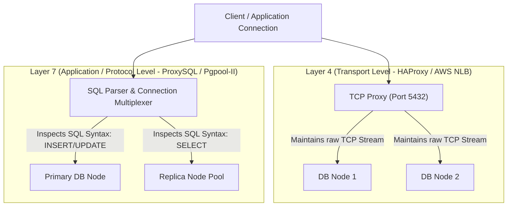

# Database Load Balancing

> **Module:** Database Architecture  
> **Target Audience:** Systems Architects, SREs, Database Administrators, Backend Engineers  
> **Relevant Technologies:** HAProxy, AWS NLB/ALB, Envoy, Pgpool-II, ProxySQL, PgBouncer

---

## 1. What It Is

**Database Load Balancing** is the architectural practice of distributing database client connection requests and query traffic across a cluster of database instances to maximize resource utilization, minimize response latency, and prevent node saturation.

---

## 2. Layer 4 vs Layer 7 Database Load Balancing



| Dimension | Layer 4 (Transport / TCP Level) | Layer 7 (Protocol / SQL Level) |
| :--- | :--- | :--- |
| **Inspection Capability** | Operates strictly on IP packets and TCP ports. Cannot read SQL statements or TLS-encrypted payloads. | Terminates database protocol; parses SQL grammar, comments, and query types. |
| **Routing Granularity** | **Per-Connection:** Once a connection is established to Node A, all queries on that connection stay on Node A. | **Per-Query / Per-Transaction:** Can route a `SELECT` on one connection to a replica and an `UPDATE` on the same connection to the primary. |
| **Performance Overhead** | Sub-millisecond (bare metal kernel TCP splicing / IPVS). | 1–3ms additional CPU overhead for SQL lexical analysis and tokenization. |
| **Common Tools** | HAProxy (TCP mode), AWS Network Load Balancer (NLB), Keepalived. | ProxySQL (MySQL), Pgpool-II (PostgreSQL), AWS RDS Proxy. |

---

## 3. Load Balancing Algorithms

1. **Round Robin:** Sequential distribution across active nodes. Simple, but vulnerable if queries have vastly different computational costs.
2. **Least Connections:** Routes new connections to the database node currently handling the fewest active client connections. Highly effective for long-lived reporting queries.
3. **Weight-Based / Capacity-Aware:** Assigns weights proportional to node hardware (e.g., Node 1 with 64 cores has weight 4; Node 2 with 16 cores has weight 1).
4. **Health & Replication Lag Aware:** Dynamically removes nodes from the reader pool if replication lag exceeds an acceptable threshold (e.g., `lag > 5 seconds`).

---

## 4. Health Checks in Database Load Balancing

A simple TCP socket ping (`check port 5432`) is **dangerously insufficient** for database load balancing:
- A database node may respond to TCP connection handshakes while deadlocked, memory-exhausted, or running emergency crash recovery.
- An HAProxy health check must execute an HTTP or database-level check:

```text
# HAProxy PostgreSQL Health Check Example
backend pg_replicas_backend
    mode tcp
    balance leastconn
    option httpchk GET /replica-health HTTP/1.1\r\nHost:\ pg-health-check
    http-check expect status 200
    default-server inter 3s fall 3 rise 2 on-marked-down shutdown-sessions
    server db-rep-01 10.0.1.11:5432 check port 8008
    server db-rep-02 10.0.1.12:5432 check port 8008
```
*Note: Standby nodes run a sidecar daemon (such as Patroni's REST API on port 8008) returning HTTP 200 only when the node is in recovery and replication lag is within tolerance.*

---

## 5. Production Considerations & Pitfalls

1. **Session-Level Contamination:** Layer 7 proxies that multiplex queries across different backends can leak session states (e.g., `SET search_path`, temporary tables, or advisory locks) into subsequent user queries.
2. **Prepared Statements:** Client-side prepared statements executed through a naive L7 load balancer can fail if the execution statement is routed to a node that did not receive the initial `PREPARE` statement.
3. **Connection Spikes During Health Check Failures:** If one replica fails health checks, all its connections are dropped simultaneously, slamming remaining replicas with an instant surge of connection storms.

---

## 6. Authoritative References

- [HAProxy Configuration Guide for PostgreSQL](https://www.haproxy.com/blog/how-to-use-haproxy-with-postgresql/)
- [ProxySQL High Performance Routing](https://proxysql.com/documentation/)
- [AWS RDS Proxy Architecture](https://docs.aws.amazon.com/AmazonRDS/latest/UserGuide/rds-proxy.html)
