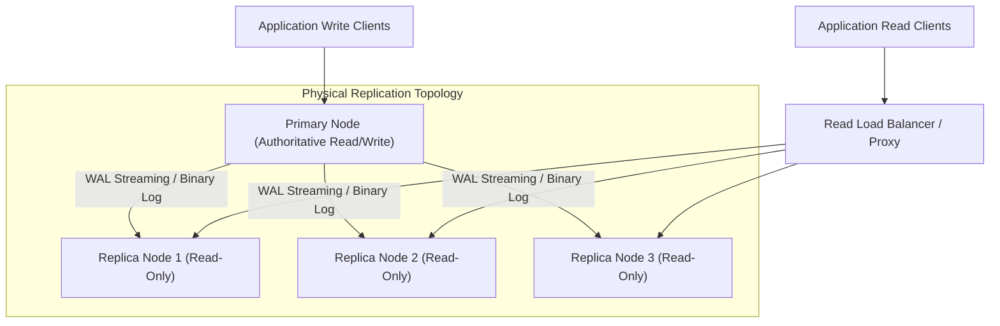

# Primary-Replica Architecture

> **Module:** Database Architecture  
> **Target Audience:** Systems Architects, Database Administrators, Backend Engineers  
> **Relevant Engines:** PostgreSQL, MySQL, Distributed RDBMS

---

## 1. What It Is

**Primary-Replica Architecture** (historically termed Master-Slave architecture) is a database topology where a single designated node—the **Primary**—serves as the authoritative source for all data modification statements (`INSERT`, `UPDATE`, `DELETE`, `DDL`), while one or more secondary nodes—the **Replicas**—maintain read-only copies of the primary's dataset by continuously consuming and replaying its transaction logs.

---

## 2. Why It Is Needed (Problem Statement)

1. **Write Serialization & Concurrency Bottlenecks:** Relational integrity guarantees require a single authoritative coordinator to order transactions, allocate monotonically increasing transaction IDs (XIDs), and enforce ACID properties.
2. **Read-Heavy Workload Asymmetry:** In modern web applications (e-commerce catalogs, news portals, social feeds), read requests outnumber write transactions by 10:1 to 100:1. Confining all traffic to a single node exhausts CPU and memory, causing read latency degradation.
3. **High Availability:** If the primary node suffers hardware failure, a standby replica can be promoted to become the new primary, minimizing Recovery Time Objective (RTO).

---

## 3. Architecture & Internal Mechanics



### 3.1 Component Mechanics
- **Transaction Engine (Primary):** Executes transactions, modifies shared buffers, and commits records to the Write-Ahead Log (WAL in PostgreSQL) or Binary Log (binlog in MySQL).
- **Log Sender Process:** Dedicated background worker (`walsender` in PostgreSQL, `Binlog Dump Thread` in MySQL) reads committed log blocks from disk/cache and streams them over TCP.
- **Log Receiver Process:** Standby daemon (`walreceiver` in PostgreSQL, `I/O Thread` in MySQL) receives the stream and writes to local relay logs or WAL segments.
- **Replay Engine:** Background recovery worker (`Startup Process` in PostgreSQL, `SQL Thread` in MySQL) parses log records and updates local data blocks.

---

## 4. Real-World Industry Example: Content Streaming Platform

A global video streaming service processes 150 million user views per hour:
- **Primary:** Handles user profile creation, password changes, and subscription billing transactions (5,000 writes/sec).
- **Replica Pool:** 12 Read Replicas distributed across multiple AWS Availability Zones serve content catalog searches, video metadata queries, and recommendation feeds (250,000 reads/sec).
- **Resilience:** When AZ-1 suffered a fiber cut, the HA manager promoted AZ-2 Standby within 12 seconds, preventing service outage.

---

## 5. Practical Implementation & Verification

### Checking Primary vs Standby Role in PostgreSQL
```sql
-- Executed on any node to verify its operational state:
SELECT pg_is_in_recovery() AS is_replica;

-- Returns:
-- false -> Node is a PRIMARY (Read/Write)
-- true  -> Node is a STANDBY REPLICA (Read-Only)
```

### Inspecting Active Replicas on Primary
```sql
SELECT 
    client_addr AS replica_ip,
    usename AS replication_user,
    application_name,
    state,
    sync_state
FROM pg_stat_replication;
```

---

## 6. Advantages and Disadvantages

| Advantages | Disadvantages & Trade-offs |
| :--- | :--- |
| Clear authoritative source for data integrity and ACID compliance. | Single point of failure for writes; write scaling is capped by single primary hardware. |
| Horizontal read scalability by scaling replica instances out. | Standby replication lag introduces potential stale reads. |
| Minimal write amplification compared to multi-primary topologies. | Automated failover requires complex consensus mechanisms (Patroni/etcd) to avoid split-brain. |

---

## 7. Common Implementation Mistakes

1. **Routing Writes to Replicas:** Failing to separate read and write connection pools in the application layer, resulting in `read-only transaction` exceptions.
2. **Ignoring Network Latency between Primary and Replicas:** Placing synchronous standbys in distant geographic regions, resulting in high network round-trip time (RTT) on every transaction commit.
3. **Starving Replay Workers:** Allowing long-running reporting queries on replicas to hold locks that block WAL replay, causing replication lag to balloon.

---

## 8. Production Considerations

- Deploy an odd number of nodes or a distributed consensus store (etcd/Consul) for leader election.
- Configure `idle_in_transaction_session_timeout` to kill stalled transactions on both primary and standbys.
- Set up monitoring on WAL generation rate, replica disk space, and byte lag metrics.

---

## 9. Related Topics & Interview Questions

- [Database Replication In-Depth](database-replication.md)
- [Read-Write Splitting Guide](read-write-splitting.md)
- [Failover & High Availability](failover-and-high-availability.md)
- [Replication Interview Questions](../database-interview-questions/replication.md)
