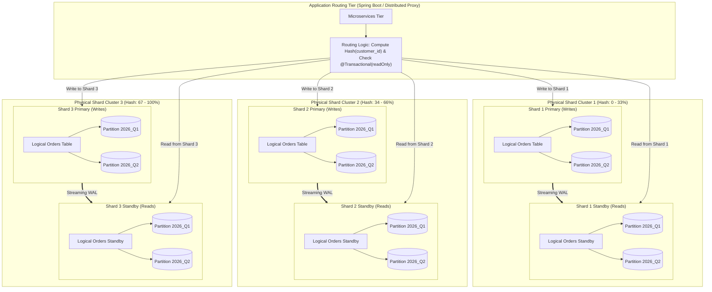
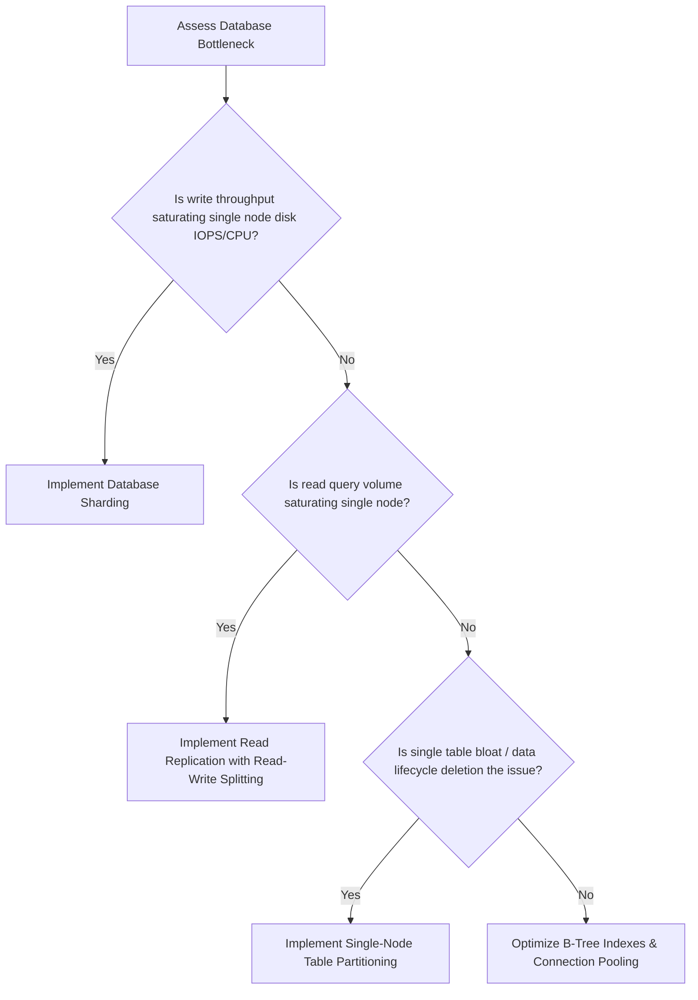

# Replication vs Sharding vs Partitioning: Architectural Comparison

> **Module:** Database Architecture  
> **Target Audience:** Principal Architects, Database Administrators, Senior Backend Engineers  
> **Prerequisites:** Understanding of Database Replication, Sharding, and Declarative Table Partitioning

---

## 1. Executive Overview

Software engineers and architects frequently confuse **Replication**, **Sharding**, and **Partitioning** because all three techniques divide, duplicate, or distribute data to achieve scale. However, each technique operates at a fundamentally different layer of the system architecture and solves a distinct engineering problem:

```text
Replication  ──> DUPLICATES identical data across nodes (High Availability & Read Scalability)
Sharding     ──> SPLITS data across independent physical nodes (Horizontal Write & Storage Scale)
Partitioning ──> DIVIDES data into smaller chunks within a single node (Manageability & Pruning)
```

---

## 2. Comprehensive Architectural Comparison

| Dimension | Database Replication | Database Sharding | Database Partitioning |
| :--- | :--- | :--- | :--- |
| **Primary Purpose** | **High Availability & Fault Tolerance**; horizontal read scalability; DR. | **Horizontal Write & Storage Scaling** beyond the limits of a single machine. | **Local Table Manageability**; rapid data purging; B-Tree index cache efficiency. |
| **Physical Data Placement** | Full copy of data duplicated across **multiple distinct database nodes**. | Disjoint, non-overlapping subsets distributed across **multiple database servers**. | Disjoint subsets stored across **different physical tables/files within a single database instance**. |
| **Scalability Dimension** | **Reads:** Linear scale.<br/>**Writes:** Zero horizontal scale (all writes hit primary). | **Reads & Writes:** Linear horizontal scale across cluster. | **Reads:** Improves via pruning.<br/>**Writes:** No horizontal scale (single machine limits). |
| **High Availability (HA)** | **Built-in:** Replicas act as warm/hot standbys for automated failover. | **None natively:** If a shard dies without replicas, that shard's data is completely unavailable. | **None:** Tied directly to the single server instance. If the server crashes, all partitions are down. |
| **Write Handling** | Serialized through a single primary Write-Ahead Log (WAL) engine. | Dispersed across independent shard primaries in parallel. | Written to a single server's WAL, routed internally to child physical files. |
| **Query Routing Responsibility** | Application or Layer-7 Proxy (routing reads to standbys, writes to primary). | Application code (Spring Boot `AbstractRoutingDataSource`) or Sharding Proxy (Citus, Vitess). | Database Query Optimizer (transparent partition pruning based on `WHERE` clauses). |
| **Relational Integrity & Joins** | Fully supported across all tables on the node. | **No native cross-shard joins** or cross-shard foreign keys without heavy performance penalties. | Fully supported; foreign keys allowed (partition key must be included in unique keys). |
| **Data Purging / Lifecycle** | Standard `DELETE` operations (slow, WAL-heavy, causes bloat). | Requires deleting across shards or running per-shard drop scripts. | **Instantaneous:** `DETACH PARTITION` and `DROP TABLE` in milliseconds with zero lock bloat. |
| **Engineering & Operational Complexity** | Low to Moderate (managed by Patroni, AWS RDS, Pgpool). | **Extremely High** (cluster orchestration, resharding, cross-shard 2PC/Sagas, scatter-gather queries). | **Low** (native declarative DDL in PostgreSQL 11+ and MySQL 8+). |
| **Typical Scale Threshold** | Applied from day 1 for HA and read scaling up to ~10,000 QPS. | Applied when dataset > 5–10 TB or write throughput > 15,000–50,000 writes/sec. | Applied when single table exceeds ~50M–100M rows or time-series data requires retention cleanup. |

---

## 3. Why and How They Combine in Enterprise Architectures

These three patterns are **not mutually exclusive**. High-scale enterprise architectures (e.g., Stripe, Uber, Shopify, Netflix) combine all three strategies within a unified multi-tier topology.



### 3.1 Layered Responsibilities in the Combined Architecture

1. **Tier 1 — Sharding (Horizontal Write & Capacity Distribution):**
   - The application receives an order for `customer_id = 9182`.
   - The hashing router calculates `Hash(9182) % 3 = 1`, selecting **Physical Shard Cluster 1**.
   - Sharding distributes write IOPS and disk storage evenly across 3 completely separate servers.
2. **Tier 2 — Replication (High Availability & Read Scalability per Shard):**
   - Each shard is deployed as a 2-node or 3-node PostgreSQL cluster.
   - Write transactions hit the Primary of Shard 1.
   - Read-heavy queries (e.g., viewing past order receipts) are routed to the Standby Replica of Shard 1.
   - If Shard 1's Primary crashes, Patroni automatically promotes its Standby without impacting Shards 2 or 3.
3. **Tier 3 — Partitioning (Localized Lifecycle & Cache Efficiency within each Shard):**
   - Within Shard 1, the `orders` table is declaratively partitioned by quarter (`PARTITION BY RANGE (order_date)`).
   - Queries filtering for `WHERE order_date BETWEEN '2026-01-01' AND '2026-03-31'` perform partition pruning and scan only the `2026_Q1` physical partition.
   - B-Tree indexes for the current active quarter remain pinned in memory, while obsolete historical quarters can be detached in milliseconds.

---

## 4. Architectural Decision Matrix: When to Use Which?



- **Scenario A:** Table has 200 million rows of time-series IoT data. Write throughput is 2,000 writes/sec (well within a single NVMe disk's limits). Old data must be dropped after 90 days.  
  $\to$ **Solution:** Single-node PostgreSQL with **Declarative Range Partitioning**.
- **Scenario B:** Read traffic is 25,000 requests/sec; write traffic is 800 writes/sec. System must guarantee 99.99% uptime.  
  $\to$ **Solution:** **Primary-Replica Streaming Replication** with 3 Read Replicas and automated failover (Patroni).
- **Scenario C:** Global payment platform processing 60,000 financial write transactions per second with 20 TB storage growth annually.  
  $\to$ **Solution:** **Combined Architecture** (16 Shards, each running Primary-Replica replication, with tables locally partitioned by billing cycle).

---

## 5. Related Interview Questions

- [Scenario: When Indexing is Sufficient vs Partitioning vs Sharding](../database-interview-questions/scenario-based-questions.md#scenario-8-when-is-indexing-sufficient-and-when-should-partitioning-or-sharding-be-considered)
- [Software Architect: Multi-Tier Scaling Strategy](../database-interview-questions/software-architect-questions.md#question-2-how-do-you-architect-a-storage-engine-handling-100-billion-rows-annually)
- [Replication Interview Guide](../database-interview-questions/replication.md)
- [Sharding Interview Guide](../database-interview-questions/sharding.md)
- [Partitioning Interview Guide](../database-interview-questions/partitioning.md)

---

## 6. Authoritative References

- [Designing Data-Intensive Applications (Martin Kleppmann)](https://dataintensive.net/)
- [PostgreSQL Documentation on High Availability & Partitioning](https://www.postgresql.org/docs/current/)
- [Database Sharding Principles & Architecture](https://aws.amazon.com/blogs/database/sharding-with-amazon-relational-database-service/)
