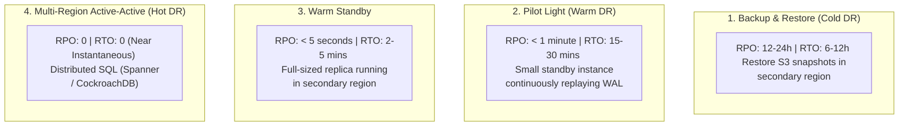

# Disaster Recovery (DR) Architecture for Databases

> **Category:** Database Backup & Recovery  
> **Target Audience:** Enterprise Architects, CTOs, SRE Leads

---

## 1. Defining Disaster Recovery: RTO vs RPO

```text
[Healthy Operations] ──▶ [REGIONAL DISASTER / POWER CUT] ──(RTO Downtime)──▶ [Service Restored in Secondary Region]
                                 ▲
                                 └── (RPO Data Gap: Committed data lost during replication delay)
```

- **RPO (Recovery Point Objective):** Measures the maximum tolerable data loss from the moment of disaster back to the last preserved transaction.
- **RTO (Recovery Time Objective):** Measures the clock time required from disaster declaration to normal application availability in the secondary region.

---

## 2. Disaster Recovery Tiers



---

## 3. Active-Passive Cross-Region Failover Runbook
1. **Declare Disaster:** Incident Commander confirms primary region is unrecoverable.
2. **Promote DR Standby:**
   ```bash
   pg_ctl promote -D /var/lib/postgresql/data
   ```
3. **Route Traffic:** Update Route 53 global DNS records or Cloudflare Load Balancing to point application endpoints to the secondary region.
4. **Post-Failover Audit:** Reconcile transaction logs against payment gateways or message bus consumer offsets to identify any un-replicated orders.

---

## 4. Authoritative References
- [AWS Disaster Recovery Architecture Whitepaper](https://docs.aws.amazon.com/whitepapers/latest/disaster-recovery-workloads-on-aws/disaster-recovery-workloads-on-aws.html)
