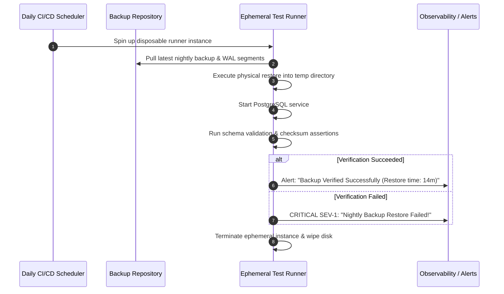

# Automated Recovery Testing & Backup Verification

> **Category:** Database Backup & Recovery  
> **Target Audience:** SREs, QA Engineers, Database Reliability Engineers

---

## 1. The Fallacy of Untested Backups
> *"An untested backup is not a backup—it is merely an aspiration."*

Every year, major engineering organizations suffer total data loss during outages because their automated backup scripts were silently creating empty files, backups were corrupted by filesystem bugs, or encryption keys had been rotated and lost.

---

## 2. Automated Restore Validation Pipeline

---

## 3. Post-Restore Verification Checklist
1. **Startup Check:** Does the PostgreSQL daemon start without PANIC or FATAL recovery errors?
2. **Catalog Integrity:** Does `SELECT count(*) FROM pg_database;` execute cleanly?
3. **Data Checksums:** If data checksums are enabled (`initdb -k`), run `pg_checksums -c -D /path/to/data` to verify zero bit-rot or block corruption.
4. **Smoke Queries:** Execute targeted queries verifying expected row counts on primary business tables.

---

## 4. Authoritative References
- [PostgreSQL pg_checksums Documentation](https://www.postgresql.org/docs/current/app-pgchecksums.html)
