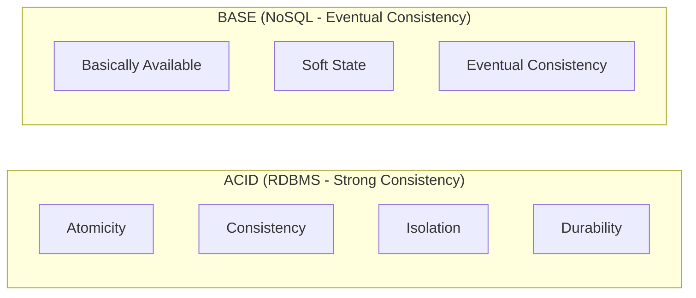

# ACID Properties in Relational Databases

> **Category:** Database Fundamentals  
> **Target Audience:** Software Engineers, Systems Architects  
> **Relevant Engines:** PostgreSQL, MySQL (InnoDB), Oracle

---

## 1. What Are ACID Properties?
The **ACID** properties form the core architectural contract that guarantees reliable transaction processing in database management systems.

```text
A ──▶ Atomicity   (All-or-Nothing execution)
C ──▶ Consistency (Preservation of schema invariants and business rules)
I ──▶ Isolation   (Concurrency control and visibility protection)
D ──▶ Durability  (Committed changes survive hardware crashes and power loss)
```

---

## 2. In-Depth Technical Breakdown

### 2.1 Atomicity (All-or-Nothing)
- **Engine Mechanic:** Enforced via the **Undo Log** (in MySQL InnoDB) or **Write-Ahead Log (WAL) and MVCC status bits** (in PostgreSQL).
- If a server crashes mid-transaction, during crash recovery the engine reads the transaction status. If a transaction lacks a `COMMIT` record in WAL, all uncommitted changes are undone.

### 2.2 Consistency (Integrity Invariants)
- **Engine Mechanic:** Enforced through schema validation, primary keys, foreign keys, `CHECK` constraints, unique indexes, and triggers.
- Transitions the database from one mathematically valid state to another. If any statement violates a constraint, the entire transaction is rejected.

### 2.3 Isolation (Concurrency Control)
- **Engine Mechanic:** Enforced using **Locking Mechanisms** (Pessimistic: shared and exclusive locks) and **Multi-Version Concurrency Control (MVCC)**.
- Dictates how and when changes made by one transaction become visible to concurrent transactions, preventing anomalies like dirty reads and lost updates.

### 2.4 Durability (Survivability)
- **Engine Mechanic:** Enforced via the **Write-Ahead Log (WAL / Redo Log)** and the POSIX `fsync()` system call.
- When `COMMIT` is executed, the database writes the commit record to the sequential WAL file and forces a disk sync (`fsync()`) before returning success to the application client. Even if power cuts a millisecond later, the committed state is recovered from disk upon reboot.

---

## 3. ACID vs BASE (Distributed NoSQL)



| Dimension | ACID (Relational / Distributed SQL) | BASE (Distributed NoSQL) |
| :--- | :--- | :--- |
| **Focus** | Absolute correctness, financial integrity, zero data loss. | High availability, partition tolerance, low latency. |
| **State** | Deterministic and immediately consistent. | Intermediate states visible; converges eventually. |
| **Scale** | Vertical scale, read replication, or complex sharding. | Horizontal elastic scale out-of-the-box. |

---

## 4. Authoritative References
- [Jim Gray: The Transaction Concept (1981)](https://www.microsoft.com/en-us/research/publication/the-transaction-concept-virtues-and-limitations/)
- [PostgreSQL WAL Architecture](https://www.postgresql.org/docs/current/wal-intro.html)
