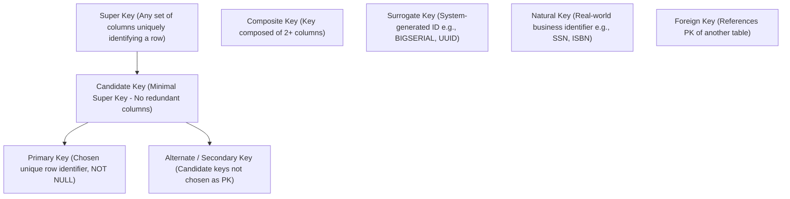

# Database Keys: Complete Taxonomy and Implementation

> **Category:** Database Fundamentals  
> **Target Audience:** Database Engineers, Backend Developers, Schema Designers

---

## 1. What Are Database Keys?
A **key** is an attribute or set of attributes in a relational database table that uniquely identifies an entity (row) or establishes and enforces referential relationships between tables.

---

## 2. Taxonomy of Database Keys



### Key Definitions:
1. **Super Key:** Any set of columns within a table whose values uniquely identify a tuple. May contain redundant attributes.
2. **Candidate Key:** A minimal Super Key from which no attribute can be removed without losing the uniqueness guarantee.
3. **Primary Key (PK):** The designated candidate key chosen by the database architect as the authoritative identifier. It strictly forbids `NULL` values and must be immutable.
4. **Alternate Key:** Candidate keys that were not chosen as the Primary Key (enforced using `UNIQUE` constraints).
5. **Foreign Key (FK):** A column or group of columns that references a Primary Key or Unique Key in another table, guaranteeing referential integrity (`ON DELETE CASCADE`, `ON DELETE RESTRICT`).
6. **Surrogate Key vs Natural Key:**
   - *Natural Key:* An attribute that exists in the real world (e.g., Social Security Number, National Identity, Vehicle VIN). Vulnerable to business requirement changes or privacy compliance laws.
   - *Surrogate Key:* An artificial, system-assigned synthetic key (e.g., auto-incrementing integer, UUIDv7). Highly recommended for software stability and join performance.
7. **Composite Key:** A primary or candidate key that consists of two or more attributes (e.g., `(order_id, line_number)`).

---

## 3. SQL Implementation in PostgreSQL
```sql
-- Parent table demonstrating Primary Key and Alternate Key
CREATE TABLE departments (
    dept_id INT GENERATED ALWAYS AS IDENTITY PRIMARY KEY, -- Surrogate PK
    dept_code VARCHAR(10) NOT NULL UNIQUE,                -- Alternate Key
    dept_name VARCHAR(100) NOT NULL
);

-- Child table demonstrating Foreign Key and Composite Key
CREATE TABLE department_memberships (
    dept_id INT NOT NULL,
    employee_id INT NOT NULL,
    assigned_date DATE NOT NULL DEFAULT CURRENT_DATE,
    role VARCHAR(50) NOT NULL,
    -- Composite Primary Key:
    PRIMARY KEY (dept_id, employee_id),
    -- Foreign Key referential integrity constraint:
    FOREIGN KEY (dept_id) REFERENCES departments (dept_id) ON DELETE CASCADE
);
```

---

## 4. Authoritative References
- [PostgreSQL Constraints Documentation](https://www.postgresql.org/docs/current/ddl-constraints.html)
- [Codd's Relational Completeness Rules](https://en.wikipedia.org/wiki/Codd%27s_12_rules)
