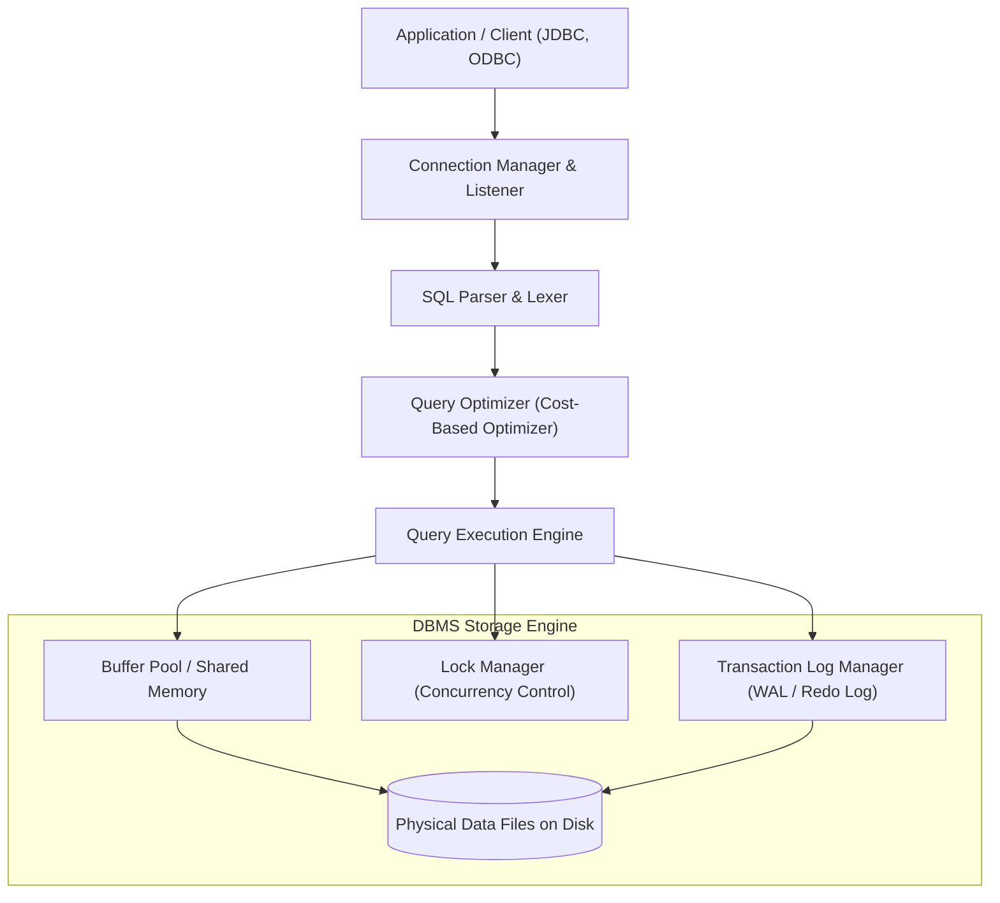

# Database vs DBMS

> **Category:** Database Fundamentals  
> **Target Audience:** Junior to Senior Software Engineers, Students, System Designers  
> **Prerequisites:** Basic understanding of filesystems and data storage

---

## 1. What It Is (Definition & Overview)

- **Database:** A structured, persistent collection of logically related data, stored electronically on computer storage media (disks, SSDs, NVMe). A database itself is the raw data artifacts—tables, records, files, indexes, and logs.
- **DBMS (Database Management System):** The sophisticated software layer that interfaces between the database and end users or application programs. It manages data access, concurrency control, transaction isolation, crash recovery, security privileges, and query execution planning (e.g., PostgreSQL, MySQL, Oracle Database, Microsoft SQL Server).

---

## 2. Why It Is Needed (Problem Statement)
Prior to DBMS software, applications stored data directly in raw filesystem files (CSV, flat text, binary files). This led to severe engineering failures:
1. **Data Redundancy and Inconsistency:** Multiple programs duplicated identical customer data; updating one file left others stale.
2. **Lack of Concurrency Control:** If two programs wrote to the same file simultaneously, data pages became corrupted or suffered lost updates.
3. **Absence of ACID Guarantees:** Power cuts mid-write corrupted the entire file without transactional rollback capabilities.
4. **No Security Granularity:** File systems only provide coarse read/write permissions at the whole-file level, unable to restrict access to specific columns or rows.

---

## 3. Architecture & Internal Components of a DBMS

---

## 4. Key Differences Summary

| Dimension | Database | DBMS |
| :--- | :--- | :--- |
| **Nature** | The passive repository of organized information. | The active software managing the repository. |
| **Primary Purpose** | Storing and persisting data records. | Query processing, concurrency, crash recovery, security. |
| **Physical Manifestation** | Disk files (`.ibd`, `base/`, `.mdf`). | Running daemon/processes (`postgres`, `mysqld`). |
| **User Interaction** | Cannot be interacted with directly without software. | Interacted with via SQL, APIs, and administrative utilities. |

---

## 5. Authoritative References
- [Database System Concepts (Silberschatz, Korth, Sudarshan)](https://www.db-book.com/)
- [PostgreSQL Architecture Overview](https://www.postgresql.org/docs/current/overview.html)
