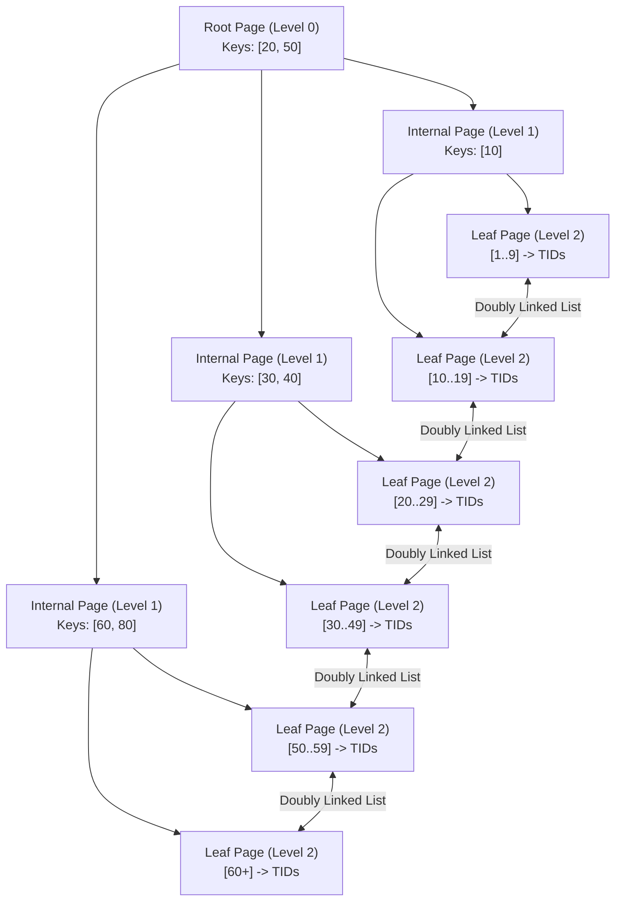

# Database Indexes: Deep-Dive Guide

> **Category:** Database Fundamentals  
> **Target Audience:** Backend Developers, Performance Engineers, Database Administrators  
> **Relevant Engines:** PostgreSQL, MySQL (InnoDB)

---

## 1. What It Is
A **database index** is an auxiliary physical data structure maintained by the storage engine that allows rapid location of specific rows in a table without scanning every single page from disk (Sequential Scan).

---

## 2. B-Tree Index Mechanics
The default and most widely utilized index structure is the **B-Tree** (Balanced Tree).

### Search Flow:
1. **Traverse from Root:** Query `WHERE id = 35` starts at Root, follows pointer between 20 and 50 to Child 2.
2. **Internal Node Navigation:** Child 2 directs to Leaf 4.
3. **Leaf Tuple Pointer:** Leaf 4 contains the sorted key 35 alongside its Tuple Identifier (`TID` = Block Number + Offset) pointing directly to the row in the heap file.
4. **Range Scans:** Leaf pages are linked as a doubly-linked list, allowing fast sequential scanning for `BETWEEN` and `ORDER BY` operations without returning to the root.

---

## 3. PostgreSQL Index Types

| Index Type | Internal Structure | Ideal Use Case |
| :--- | :--- | :--- |
| **B-Tree** | Balanced Tree | Equality (`=`) and Range searches (`<`, `<=`, `>`, `>=`, `BETWEEN`), `ORDER BY`. |
| **Hash** | 32-bit Hash Bucket | Strict equality (`=`) only. Slightly smaller than B-Tree, but cannot do range queries. |
| **GIN** (Generalized Inverted Index) | Inverted list of element pointers | Composite values, JSONB attributes (`@>`), arrays, and full-text search. |
| **GiST** (Generalized Search Tree) | Balanced tree for arbitrary data | Geometric coordinates (PostGIS), ranges (`tsrange`), nearest-neighbor searches. |
| **BRIN** (Block Range Index) | Min/Max values per physical block range | Massive multi-terabyte tables naturally sorted by timestamp or ID. Uses 99% less RAM! |

---

## 4. Production Considerations & Write Penalties
Every added index improves read performance for matching queries but **penalizes write throughput** (`INSERT`, `UPDATE`, `DELETE`).
- Every `INSERT` must write to the heap AND insert new leaf nodes into every active index.
- If a leaf page is full, it triggers an expensive **Page Split** in memory and disk.
- Indexes consume RAM in the buffer pool. Unused indexes should be identified via `pg_stat_user_indexes` and dropped.

---

## 5. Authoritative References
- [PostgreSQL Index Types Guide](https://www.postgresql.org/docs/current/indexes-types.html)
- [Use The Index, Luke!](https://use-the-index-luke.com/)
