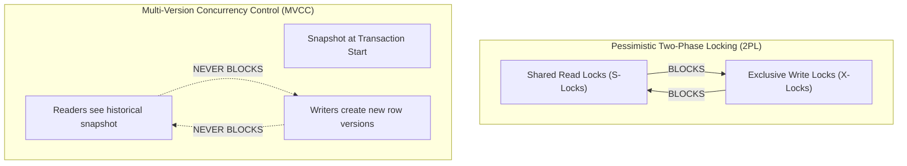

# ANSI SQL Isolation Levels and Concurrency Control

> **Category:** Database Fundamentals  
> **Target Audience:** Backend Developers, Systems Architects, DBA Candidates  
> **Relevant Engines:** PostgreSQL, MySQL (InnoDB), Oracle

---

## 1. What Are Isolation Levels?
Isolation levels define the degree to which a transaction's operations are insulated from concurrent modifications performed by other transactions. It represents the fundamental engineering trade-off between **Data Consistency** and **Concurrency Throughput**.

---

## 2. Concurrency Anomalies & Phenomena

1. **Dirty Read (G1):** Transaction A modifies a row. Transaction B reads the uncommitted row. Transaction A aborts (`ROLLBACK`). Transaction B operated on data that never officially existed.
2. **Non-Repeatable Read (Fuzzy Read - G2a):** Transaction A reads a row. Transaction B updates or deletes that row and commits. Transaction A re-reads the row, observing different column values or finding it gone.
3. **Phantom Read (A3):** Transaction A executes a range query (e.g., `WHERE salary > 50000`). Transaction B inserts a new row matching the condition and commits. Transaction A re-executes the query and sees a new "phantom" record.
4. **Serialization Anomaly (Write Skew):** Two concurrent transactions read overlapping datasets, make disjoint updates based on what they read, and commit. While neither update directly conflicts, the resulting combined state violates a global business invariant (e.g., at least one doctor must be on call; both doctors check who is on call, see the other, and both take leave simultaneously).

---

## 3. The Four ANSI SQL Isolation Levels

| Isolation Level | Dirty Read | Non-Repeatable Read | Phantom Read | Serialization Anomaly |
| :--- | :---: | :---: | :---: | :---: |
| **Read Uncommitted** | Allowed | Allowed | Allowed | Allowed |
| **Read Committed** | **Prevented** | Allowed | Allowed | Allowed |
| **Repeatable Read** | **Prevented** | **Prevented** | Allowed (Prevented in Postgres) | Allowed (Write Skew possible) |
| **Serializable** | **Prevented** | **Prevented** | **Prevented** | **Prevented** |

> [!NOTE]
> **PostgreSQL Implementation Nuance:** In PostgreSQL, `Read Uncommitted` is treated internally as `Read Committed` because MVCC does not support reading uncommitted tuples. Furthermore, PostgreSQL's `Repeatable Read` prevents Phantom Reads as well via transaction snapshot isolation.

---

## 4. MVCC vs Two-Phase Locking (2PL)



### PostgreSQL Serializable Snapshot Isolation (SSI)
In PostgreSQL, `Serializable` is implemented without locking entire tables using **Serializable Snapshot Isolation (SSI)**. 
- It tracks Read-Write dependencies (SIREAD locks in memory) during execution.
- If it detects a dangerous cycle (dependency structure predicting write skew), it aborts one transaction with:
  ```text
  ERROR: could not serialize access due to read/write dependencies among transactions
  ```
- Applications using `Serializable` **must implement retry loops!**

---

## 5. Setting Isolation Levels in SQL and Spring Boot

### In PostgreSQL:
```sql
BEGIN TRANSACTION ISOLATION LEVEL REPEATABLE READ;
-- Statements executed here use a single snapshot taken at the first statement
COMMIT;
```

### In Spring Boot:
```java
@Transactional(isolation = Isolation.SERIALIZABLE)
public void executeStrictFinancialTransfer() {
    // Retried via Spring Retry or Resilience4j on serialization failure
}
```

---

## 6. Authoritative References
- [A Critique of ANSI SQL Isolation Levels (Berenson et al., 1995)](https://www.microsoft.com/en-us/research/publication/a-critique-of-ansi-sql-isolation-levels/)
- [PostgreSQL Concurrency Control & Isolation Levels](https://www.postgresql.org/docs/current/transaction-iso.html)
