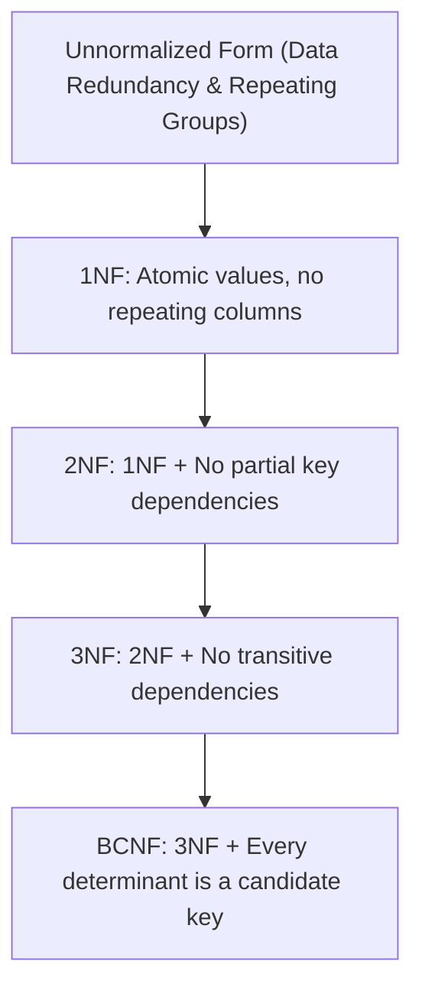

# Normalization and Denormalization

> **Category:** Database Fundamentals  
> **Target Audience:** Database Engineers, Systems Architects, Backend Developers

---

## 1. What is Normalization?
**Normalization** is the systematic database design technique of organizing tables and attributes in a relational database to minimize **data redundancy** and eliminate **update, insertion, and deletion anomalies**.

---

## 2. Relational Anomalies (The Problem Normalization Solves)
Consider an unnormalized table: `Orders(order_id, customer_name, customer_city, product_name, price)`.
1. **Insertion Anomaly:** Cannot record a new customer until they place an order.
2. **Deletion Anomaly:** Deleting an order deletes the only record of that customer from the database.
3. **Update Anomaly:** If a customer changes their city, multiple rows must be updated; missing one row causes inconsistent data.

---

## 3. The Normal Forms Hierarchy

### Detailed Breakdown:
- **First Normal Form (1NF):**
  - Each column contains single, indivisible (atomic) values.
  - No repeating groups or arrays.
  - Each row has a unique primary key.
- **Second Normal Form (2NF):**
  - Table is in 1NF.
  - All non-key attributes are fully functionally dependent on the entire primary key (relevant when the primary key is a composite key).
- **Third Normal Form (3NF):**
  - Table is in 2NF.
  - Eliminates transitive dependencies: non-key attributes must depend solely on the primary key, not on other non-key attributes ($X \to Y$ where $Y \to Z$).
- **Boyce-Codd Normal Form (BCNF / 3.5NF):**
  - Table is in 3NF.
  - For every functional dependency $X \to Y$, $X$ must be a superkey.

---

## 4. Denormalization: Strategic Performance Trade-Off
**Denormalization** is the intentional re-introduction of redundancy into a normalized schema to optimize read query performance and reduce expensive multi-table JOINs in OLAP systems, data warehouses, and distributed sharded architectures.

| Dimension | Normalization (3NF) | Denormalization |
| :--- | :--- | :--- |
| **Primary Goal** | Data integrity; zero redundancy. | Read performance; low join overhead. |
| **Write Performance** | Fast (updates occur in exactly one place). | Slower (updates must write to multiple places). |
| **Read Performance** | Slower for complex queries (requires multiple JOINs). | Extremely fast (single table scans). |
| **Storage Usage** | Minimal. | Higher due to redundant columns. |
| **Ideal Workload** | High-concurrency OLTP (e-commerce checkout, banking). | Analytical OLAP, reporting dashboards, distributed microservices. |

---

## 5. Authoritative References
- [Database Systems: The Complete Book (Garcia-Molina, Ullman, Widom)](http://infolab.stanford.edu/~ullman/dscb.html)
