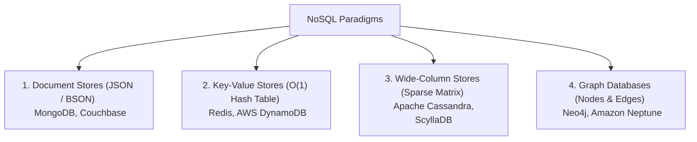

# Relational vs NoSQL Databases

> **Category:** Database Fundamentals  
> **Target Audience:** Software Architects, Backend Developers, Data Engineers

---

## 1. Executive Summary

- **Relational Databases (RDBMS):** Based on E.F. Codd's relational algebra. Data is organized into strictly typed tables with rows and columns, enforced via predefined schemas, primary keys, and foreign keys. Emphasizes ACID transactions and relational integrity (e.g., PostgreSQL, MySQL).
- **NoSQL Databases ("Not Only SQL"):** Non-relational, distributed data management systems designed for horizontal scalability, unstructured or semi-structured data, high velocity ingestion, and flexible schemaless models (e.g., MongoDB, Cassandra, Redis, Neo4j).

---

## 2. The Four Primary NoSQL Data Models

1. **Document Stores:** Store semi-structured documents (JSON/BSON/XML). Perfect for product catalogs and dynamic form submissions where schema evolves constantly.
2. **Key-Value Stores:** High-speed associative arrays storing values referenced by a unique key. Used for session management, user carts, and sub-millisecond caching.
3. **Wide-Column Stores:** Tables organized into rows with dynamic column families. Highly optimized for massive time-series write throughput and analytical scans.
4. **Graph Databases:** Built on graph theory using nodes, edges, and properties. Excels at highly interconnected datasets like social networks, fraud detection rings, and knowledge graphs.

---

## 3. Comprehensive Comparison Matrix

| Dimension | Relational (RDBMS) | NoSQL |
| :--- | :--- | :--- |
| **Data Model** | Tabular (Rows & Columns) | Document, Key-Value, Wide-Column, Graph |
| **Schema** | Rigid, predefined (`CREATE TABLE`) | Dynamic / Schemaless / Schema-on-Read |
| **Transaction Model** | Strict ACID (Atomicity, Consistency, Isolation, Durability) | BASE (Basically Available, Soft State, Eventual Consistency) |
| **Scaling Strategy** | **Vertical Scaling** (Scale-Up); Read replication | **Horizontal Scaling** (Scale-Out across cheap commodity nodes) |
| **Query Mechanism** | Structured Query Language (SQL) | JSON query APIs, REST APIs, CQL, Cypher |
| **Joins & Relationships** | Native multi-table JOINs via relational engine | Denormalized data or client-side joins |
| **Best Used For** | Core banking ledgers, ERP, CRM, e-commerce orders | Real-time chat, IoT telemetry, user sessions, recommendation engines |

---

## 4. Authoritative References
- [ACM Paper: A Relational Model of Data for Large Shared Data Banks (E.F. Codd)](https://dl.acm.org/doi/10.1145/362384.362685)
- [Martin Fowler: NoSQL Distilled](https://martinfowler.com/books/nosql.html)
