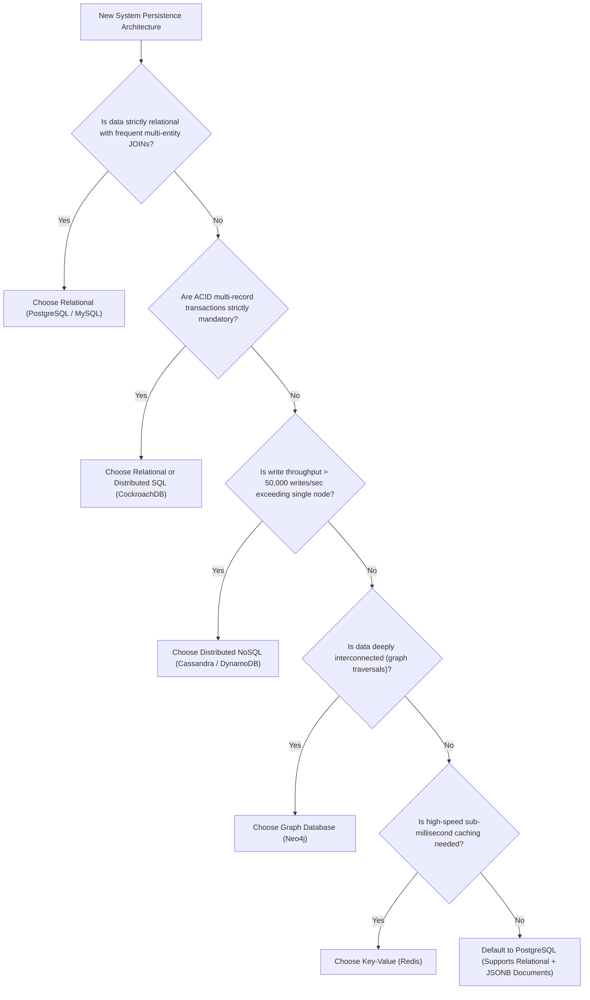

# SQL vs NoSQL: Practical Selection Framework

> **Category:** Database Fundamentals  
> **Target Audience:** Systems Architects, Tech Leads, Engineering Managers

---

## 1. Overview & Architectural Trade-offs

The decision between SQL and NoSQL is fundamentally an architectural trade-off between **Data Integrity & Expressive Relational Querying (SQL)** versus **Horizontal Write Scalability & Schema Fluidity (NoSQL)**.

Modern relational engines (especially PostgreSQL) have largely converged with NoSQL capabilities through native binary JSON support (`JSONB`), GIN indexing, and declarative partitioning, making PostgreSQL a potent multi-model database engine.

---

## 2. Decision Tree Flowchart

---

## 3. Polyglot Persistence: Combining Both Worlds

Modern architectures do not choose exclusively one or the other. They employ **Polyglot Persistence**:
- **PostgreSQL:** Serves as the authoritative source of truth for accounts, orders, inventory, and billing (ACID).
- **Redis:** Serves as the distributed cache for hot catalog items, user session tokens, and rate limiters.
- **Elasticsearch:** Indexes product catalogs and text fields for fuzzy full-text search.
- **Apache Kafka + ClickHouse:** Ingests and aggregates real-time user clickstream and event analytics.

---

## 4. Authoritative References
- [Designing Data-Intensive Applications (Martin Kleppmann)](https://dataintensive.net/)
