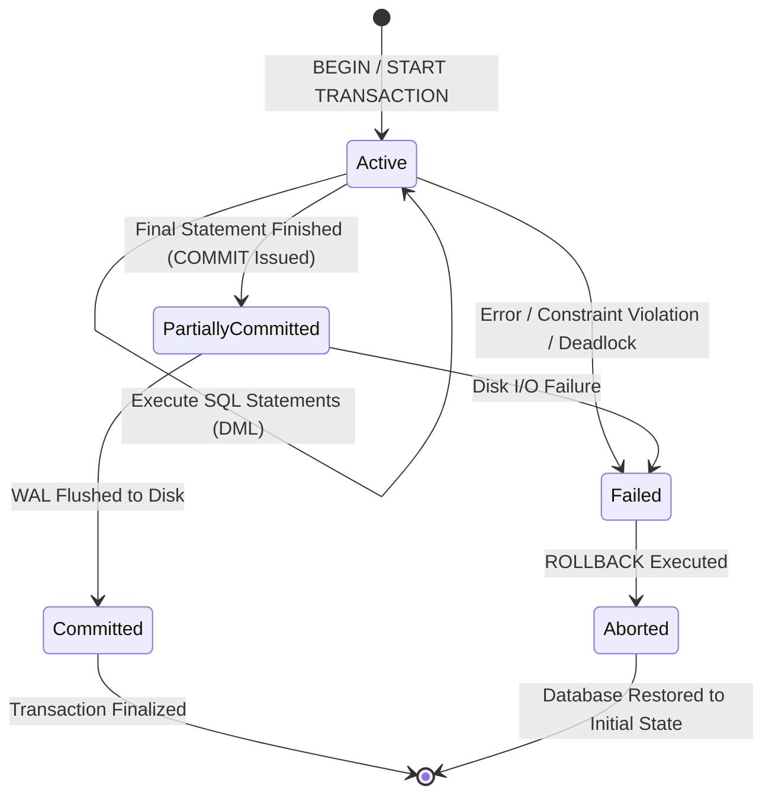

# Database Transactions

> **Category:** Database Fundamentals  
> **Target Audience:** Backend Developers, Software Engineers  
> **Relevant Engines:** PostgreSQL, MySQL, Java Spring Boot

---

## 1. What It Is
A **database transaction** is a logical unit of work that contains one or more SQL statements executed as an atomic batch. A transaction either completes entirely with `COMMIT`, persisting all changes, or aborts with `ROLLBACK`, leaving the database in its original state before the transaction began.

---

## 2. Transaction Lifecycle & State Transitions



---

## 3. Savepoints: Partial Rollbacks
A **Savepoint** defines a bookmark within a transaction, allowing partial rollbacks without aborting the entire unit of work:

```sql
BEGIN;

INSERT INTO customers (id, name) VALUES (1, 'Alice');
SAVEPOINT customer_saved;

-- Attempt an insert that might fail:
INSERT INTO orders (order_id, customer_id, amount) VALUES (101, 999, -50.00); 

-- If the order insert is invalid, rollback to savepoint:
ROLLBACK TO SAVEPOINT customer_saved;

-- Customer 'Alice' is preserved!
COMMIT;
```

---

## 4. Spring Boot Transaction Boundaries (`@Transactional`)
In Spring Boot, transactions are managed via Spring's AOP proxy:
```java
@Service
public class PaymentService {

    @Transactional(rollbackFor = Exception.class, timeout = 10)
    public void transferFunds(Long fromId, Long toId, BigDecimal amount) {
        accountRepository.debit(fromId, amount);
        accountRepository.credit(toId, amount);
        // If an unchecked exception or specified exception is thrown,
        // Spring automatically issues ROLLBACK to the JDBC connection.
    }
}
```

> [!CAUTION]
> **Self-Invocation Gotcha:** Calling a `@Transactional` method from within the same class (`this.transferFunds(...)`) bypasses the Spring AOP proxy, executing the method **without transaction management!**

---

## 5. Authoritative References
- [PostgreSQL Transaction Processing](https://www.postgresql.org/docs/current/tutorial-transactions.html)
- [Spring Framework: Transaction Management Guide](https://docs.spring.io/spring-framework/reference/data-access/transaction.html)
