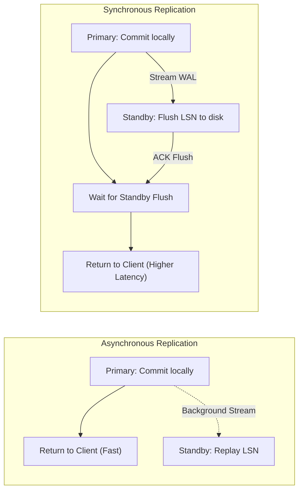

# Database Replication Interview Questions & Answers

> **Module:** Database Interview Preparation  
> **Topic:** Database Replication, High Availability, WAL Streaming, Lag Management  
> **Target Audience:** Software Engineers, Senior Database Engineers, System Architects

---

## Difficulty Navigation
- [Beginner Level](#beginner-level)
- [Intermediate Level](#intermediate-level)
- [Advanced Level](#advanced-level)
- [Senior Engineer Level](#senior-engineer-level)
- [Software Architect Level](#software-architect-level)

---

## Beginner Level

### Q1: What is the primary difference between a Primary database and a Standby/Replica?
#### Short Interview-Ready Answer
"The Primary database is the authoritative node responsible for processing all data modifications (`INSERT`, `UPDATE`, `DELETE`, `DDL`) and generating write-ahead logs. Standby/Replica nodes are read-only copies that continuously consume and replay the Primary's transaction logs to provide read scaling and high-availability failover."

#### Detailed Explanation
- **Primary:** Allocates Transaction IDs (XIDs), manages lock concurrency, enforces schema constraints, and executes autovacuum.
- **Standby:** Enforces `pg_is_in_recovery() = true`. It cannot allocate transaction IDs or modify data pages independently; all changes originate from replaying WAL/binlog streams.
- **Follow-up:** *Can a standby replica have its own local temporary tables?*  
  *(Answer: In PostgreSQL, read replicas support temporary tables if `temp_buffers` are configured, though writes to regular tables remain strictly forbidden).*

---

### Q2: What is synchronous vs asynchronous replication?
#### Short Interview-Ready Answer
"In asynchronous replication, the Primary commits transactions locally and acknowledges the client immediately before changes reach the standby, offering lowest latency but risking data loss during a crash. In synchronous replication, the Primary blocks commit confirmation until at least one standby has received and persisted the log, guaranteeing zero data loss (RPO = 0) at the cost of higher commit latency."

#### Detailed Explanation

- **PostgreSQL Configuration:** Controlled via `synchronous_commit` (`on`, `remote_apply`, `remote_write`, `local`, `off`).
- **Trade-off:** CAP Theorem trade-off—Synchronous replication sacrifices write latency and availability for strict durability and consistency.

---

## Intermediate Level

### Q3: Why is a normal PostgreSQL physical standby strictly read-only?
#### Short Interview-Ready Answer
"A physical standby operates in continuous recovery mode by applying raw binary WAL records directly to data blocks. If arbitrary writes were permitted on the standby, its local physical block layouts and transaction catalogs would immediately diverge from the incoming WAL stream, resulting in catastrophic database corruption."

#### Detailed Explanation
- Physical streaming replication operates at the disk page and byte offset level, not the SQL statement level.
- Replaying WAL assumes the base storage state is an exact byte-for-byte replica of the primary when the transaction occurred.
- Permitting independent writes on a standby would invalidate LSN sequencing and break MVCC visibility pointers (`pg_xact`).

---

### Q4: What causes replication lag and how do you monitor it in PostgreSQL?
#### Short Interview-Ready Answer
"Replication lag is the delay between when a transaction commits on the primary and when it is replayed on the standby. It is caused by network latency, single-threaded WAL replay bottlenecks, heavy bulk writes on the primary, or long-running queries on the standby holding locks that conflict with incoming WAL. It is monitored via `pg_stat_replication` on the primary and `pg_last_xact_replay_timestamp()` on the standby."

#### Practical Monitoring Query
```sql
-- On Primary: Measure byte lag across all standbys
SELECT 
    application_name, 
    client_addr, 
    sync_state,
    pg_wal_lsn_diff(pg_current_wal_lsn(), sent_lsn) AS sent_byte_lag,
    pg_wal_lsn_diff(sent_lsn, flush_lsn) AS flush_byte_lag,
    pg_wal_lsn_diff(flush_lsn, replay_lsn) AS replay_byte_lag
FROM pg_stat_replication;
```

---

## Advanced Level

### Q5: What is a "Replication Conflict" on a PostgreSQL standby, and how do you handle it?
#### Short Interview-Ready Answer
"A replication conflict occurs when an incoming WAL record that must be replayed on the standby conflicts with an active read-only query running on that standby (e.g., WAL wants to vacuum dead tuples or drop a table that the query is reading). PostgreSQL pauses WAL replay up to `max_standby_streaming_delay` (default 30s); if the query does not finish, PostgreSQL cancels the query with `ERROR: canceling statement due to conflict with recovery`."

#### Architectural Mitigation
1. **Enable Feedback:** Set `hot_standby_feedback = on` on the standby. This informs the primary of active standby transactions so autovacuum on the primary does not remove tuples still needed by the standby.
2. **Trade-off of Feedback:** Enabling `hot_standby_feedback` prevents query cancellations on replicas, but causes **table bloat on the primary** if a replica runs a 2-hour reporting query!

---

### Q6: How does PostgreSQL Logical Replication differ from Physical Streaming Replication?
#### Short Interview-Ready Answer
"Physical streaming replication copies raw WAL blocks byte-for-byte, requiring identical major PostgreSQL versions and architecture, and replicates the entire database cluster. Logical replication decodes WAL into discrete row-level mutations (`INSERT`, `UPDATE`, `DELETE`) using a publication/subscription model, enabling selective table replication, cross-major-version upgrades, and writes to non-replicated tables on the subscriber."

| Feature | Physical Streaming Replication | Logical Replication |
| :--- | :--- | :--- |
| **Replication Granularity** | Entire DB cluster (all databases) | Per-table or per-schema publications |
| **PostgreSQL Versions** | Must be identical major version | Can replicate across different major versions (e.g., v14 $\to$ v16) |
| **Target Node Writable?** | Strictly read-only | Subscriber can accept independent writes to other tables |
| **DDL Replication** | Automatically replicates all DDL | Does NOT replicate DDL (schema must be created manually) |

---

## Senior Engineer Level

### Q7: How does an automated failover system select the optimal standby for promotion?
#### Short Interview-Ready Answer
"The failover orchestrator (such as Patroni with etcd) inspects the received and replayed Log Sequence Number (`pg_last_wal_replay_lsn()`) of all registered standbys. The standby with the highest LSN position—representing the most up-to-date data with least lag relative to the failed primary—is chosen as the promotion candidate to minimize or eliminate data loss."

#### Step-by-Step Failover Flow
1. **Heartbeat Loss:** Primary misses lease renewal in etcd.
2. **Fencing:** The orchestrator ensures the dead primary cannot accept writes (STONITH).
3. **Candidate Election:** Standbys compare LSNs via etcd key checks.
4. **Promotion:** The selected standby executes `SELECT pg_promote()`.
5. **Timeline Shift:** Promoted standby increments timeline (e.g., Timeline 1 $\to$ 2) and begins accepting writes.
6. **Remaining Standbys:** Remaining standbys run `pg_rewind` if necessary and re-point their `primary_conninfo` to the newly promoted node.

---

## Software Architect Level

### Q8: How would you architect a zero-data-loss, multi-region database replication system?
#### Short Interview-Ready Answer
"I would architect a hybrid synchronous/asynchronous topology spanning three availability zones locally and a secondary region for disaster recovery. 

Locally, within the primary region, I would deploy a 3-node cluster using **Synchronous Physical Streaming Replication** (`synchronous_commit = on`, `synchronous_standby_names = 'ANY 1 (standby_az2, standby_az3)'`). This guarantees RPO = 0 and sub-15ms write latency across AZs. 

Cross-region, I would deploy an **Asynchronous Standby** connected via high-bandwidth dedicated interconnect. A distributed consensus cluster (etcd across 3 AZs) manages automated local failover, while cross-region failover remains an audited, manual disaster recovery runbook to prevent catastrophic false-positive split-brain scenarios."

```mermaid
flowchart TD
    subgraph PrimaryRegion["Primary Region (e.g., us-east-1)"]
        subgraph AZ1["Availability Zone A"]
            Pri["Primary Node (db-01)"]
        end
        subgraph AZ2["Availability Zone B"]
            SyncStandby["Sync Standby (db-02)"]
        end
        subgraph AZ3["Availability Zone C"]
            etcdArbiter["etcd Quorum Arbiter"]
        end
        Pri ==>|Sync WAL Replication (RPO=0)| SyncStandby
    end

    subgraph DRRegion["Disaster Recovery Region (e.g., us-west-2)"]
        DRStandby["Async Standby (db-dr-01)"]
    end

    Pri -.->|Cross-Region Async WAL Stream| DRStandby
```

---

## Common Mistakes & Misconceptions
- **Misconception:** Standby replication lag is strictly caused by slow networks. *(Reality: In 80% of production incidents, lag is caused by CPU/IO saturation during replay or lock conflicts from reporting queries).*
- **Misconception:** Read-write splitting guarantees that a user will see their newly created record upon redirect. *(Reality: Without causal tokens or primary pinning, asynchronous lag produces stale reads).*

---

## Related References
- [Database Replication Architecture Guide](../database-architecture/database-replication.md)
- [PostgreSQL High Availability Documentation](https://www.postgresql.org/docs/current/high-availability.html)
