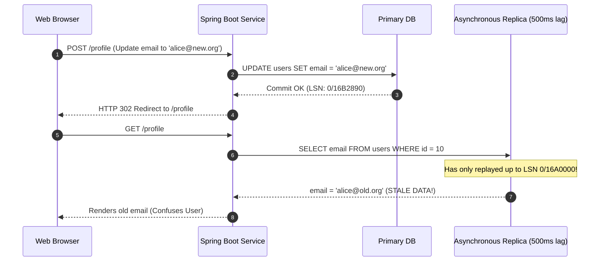
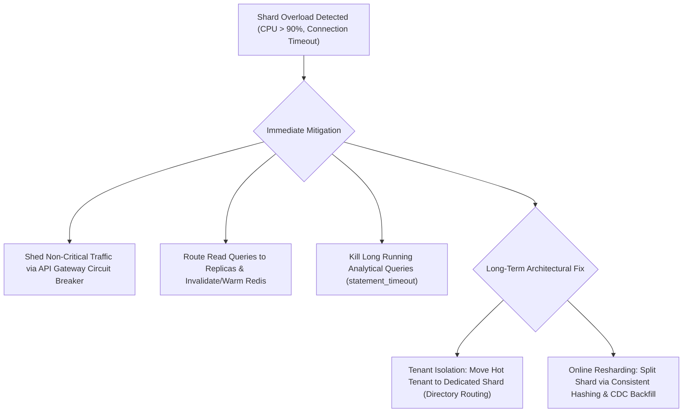
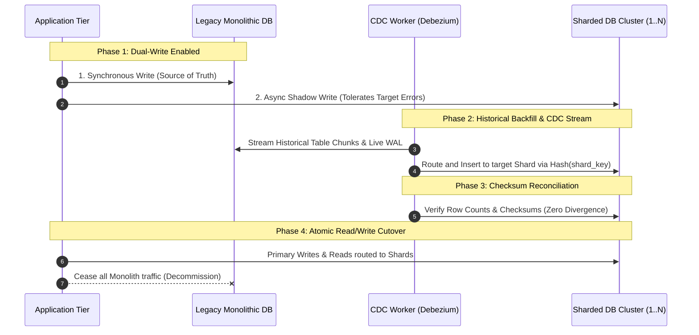
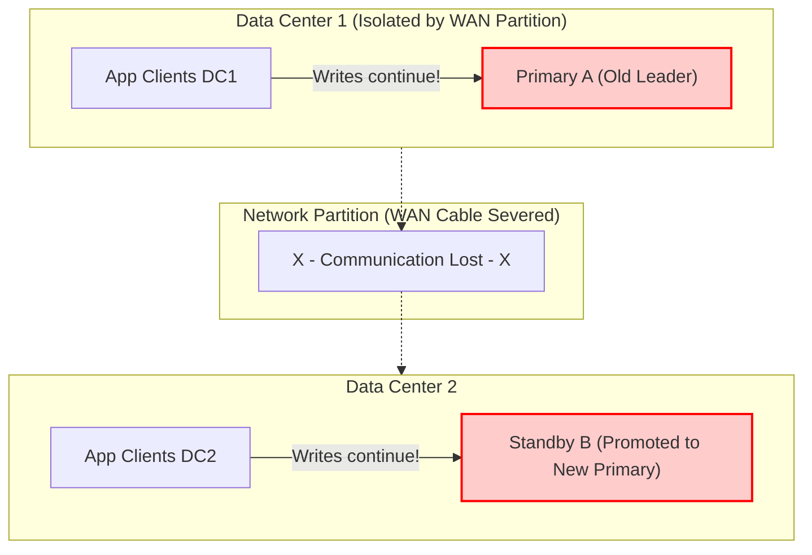
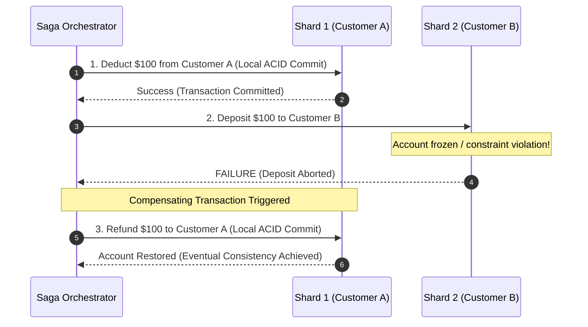

# Scenario-Based Database Interview Questions

> **Category:** Scenario-Based Architecture & Production Engineering  
> **Target Level:** Senior Database Engineer, Principal Backend Engineer, Software Architect  
> **Relevant Engines:** PostgreSQL, MySQL, Distributed Systems

---

## Scenario Index
1. [A primary database fails while thousands of orders are being placed. What happens?](#scenario-1-a-primary-database-fails-while-thousands-of-orders-are-being-placed)
2. [A replica is behind the primary. Can it safely serve a read-after-write request?](#scenario-2-a-replica-is-behind-the-primary-can-it-safely-serve-a-read-after-write-request)
3. [How would you select a shard key for an e-commerce application?](#scenario-3-how-would-you-select-a-shard-key-for-an-e-commerce-application)
4. [What happens when a shard is overloaded?](#scenario-4-what-happens-when-a-shard-is-overloaded)
5. [How do you migrate from one database to multiple shards?](#scenario-5-how-do-you-migrate-from-one-database-to-multiple-shards)
6. [How do you prevent split brain during failover?](#scenario-6-how-do-you-prevent-split-brain-during-failover)
7. [How do you manage transactions spanning multiple shards?](#scenario-7-how-do-you-manage-transactions-spanning-multiple-shards)
8. [When is indexing sufficient, and when should partitioning or sharding be considered?](#scenario-8-when-is-indexing-sufficient-and-when-should-partitioning-or-sharding-be-considered)

---

## Scenario 1: A primary database fails while thousands of orders are being placed. What happens?

### 1. Interview-Ready Answer (30–60 Seconds)
"When a primary crashes mid-flight under high write load, active in-flight transactions that haven't received a commit acknowledgement are terminated and rolled back upon recovery. In an asynchronous replication setup, any transactions committed on the primary but not yet streamed to the standby are lost (RPO > 0). If synchronous replication was configured, committed transactions are preserved on at least one standby. 

The HA manager (e.g., Patroni with etcd) detects the heartbeat loss, fences the dead primary to avoid split-brain, elects the standby with the highest LSN, and executes `pg_promote()`. On the application tier, connection pools (HikariCP) throw connection reset exceptions; the application should implement retries with exponential backoff and idempotency keys to safely reprocess unacknowledged orders once DNS or the virtual IP re-routes to the new primary."

### 2. Detailed Technical Explanation
1. **In-Flight vs Committed Transactions:**
   - Any transaction currently executing `INSERT INTO orders` that has not executed `COMMIT` is aborted. PostgreSQL's crash recovery replays WAL up to the last valid commit checkpoint and rolls back incomplete XIDs.
   - For transactions where `COMMIT` was issued:
     - **Asynchronous Replication:** If the primary acknowledged commit locally and crashed before WAL bytes reached the standby, those committed transactions exist only on the primary's dead disk. When the standby is promoted, it forms a new timeline (Timeline 2). If the old primary is later restarted, its un-streamed transactions cannot be cleanly replayed without running `pg_rewind`.
     - **Synchronous Replication (`synchronous_commit = on`):** The primary held the committing client thread until the standby acknowledged writing the WAL. The promoted standby contains all acknowledged transactions (RPO = 0).
2. **High Availability Detection & Promotion:**
   - Patroni node fails to renew its etcd leader key lease (default TTL: 10s).
   - Once the lease expires, healthy standbys perform candidate selection. The standby with the highest `flush_lsn` acquires the leader lock and calls `pg_promote()`.
   - The engine exits recovery, logs an end-of-recovery checkpoint, increments the timeline ID, and opens for read-write queries.
3. **Application Layer Blast Radius:**
   - Spring Boot threads holding borrowed connections experience `SocketException` or `Connection reset by peer`.
   - HikariCP begins evicting dead physical sockets and enters connection backoff.
   - If clients naively retry non-idempotent order requests, duplicate orders could be placed unless guarded by unique idempotency tokens.

```mermaid
sequenceDiagram
    autonumber
    participant Client as Web / Mobile Client
    participant App as Spring Boot Service
    participant Pri as Primary DB (Crashes)
    participant HA as Patroni / etcd
    participant Standby as Standby DB (Promoted)

    Client->>App: POST /orders (Idempotency-Key: abc-123)
    App->>Pri: BEGIN; INSERT INTO orders...
    Note over Pri: HARDWARE CRASH / KERNEL PANIC
    Pri--x App: TCP RST / Broken Pipe
    App-->>Client: HTTP 503 / 504 (Retryable)

    HA->>Standby: Detect Leader Lease Expiry -> Promote Standby
    Standby->>Standby: pg_promote() -> Opens for Read-Write
    
    Client->>App: Retries POST /orders (Idempotency-Key: abc-123)
    App->>Standby: Reconnects via Updated VIP/DNS -> Inserts Safely
```

### 3. Practical Example & Code
In Spring Boot, idempotency prevents duplicate order billing during failover retries:
```java
@Transactional
public OrderResponse placeOrder(OrderRequest request, String idempotencyKey) {
    // Check if the order was already inserted before the connection dropped
    Optional<Order> existing = orderRepository.findByIdempotencyKey(idempotencyKey);
    if (existing.isPresent()) {
        return OrderResponse.from(existing.get());
    }
    
    Order order = new Order(request, idempotencyKey);
    return OrderResponse.from(orderRepository.save(order));
}
```

### 4. Architecture & Design Considerations
- **RTO vs RPO:** Setting aggressive heartbeat timeouts (e.g., 2 seconds) reduces RTO but increases the risk of false-positive failovers during transient network blips.
- **Idempotency Keys:** Store an idempotency table with a `UNIQUE (idempotency_key)` constraint. When the client retries after an unexpected 500/504 error, the retry either fetches the existing order or completes safely.

### 5. Follow-up Questions
- *How does `pg_rewind` allow the old primary to rejoin the cluster as a standby without a full re-clone?*
- *What happens to transactions that were committed by the client but whose commit confirmation was in transit across the network when the primary crashed?*

### 6. Common Mistakes
- Believing that standard database retries are safe without idempotency tokens (results in double charging customer credit cards).
- Assuming zero data loss on default PostgreSQL or MySQL replication without verifying `synchronous_commit` or semi-sync settings.

---

## Scenario 2: A replica is behind the primary. Can it safely serve a read-after-write request?

### 1. Interview-Ready Answer (30–60 Seconds)
"No, a lagging replica cannot safely serve a read-after-write request. Doing so violates monotonic read consistency (Read-Your-Own-Writes) and causes serious user-experience anomalies—such as a user editing their profile, submitting the form, and being redirected to a page showing their outdated data. 

To prevent this, the architecture must implement one of three strategies:
1. **Pinned Routing:** Route reads to the primary for a time window (e.g., 2–5 seconds) after that specific user performs a write.
2. **LSN/Token Tracking (Causal Consistency):** The primary returns the committed WAL Log Sequence Number (LSN) in the write response header. The application requests the read replica only if `pg_last_wal_replay_lsn() >= required_lsn`.
3. **Explicit Write Path Enforcement:** Execute critical post-mutation reads within the write transaction on the primary."

### 2. Detailed Technical Explanation
In asynchronous streaming replication, the primary flushes WAL and immediately returns `SUCCESS` to the client. The standby's `walreceiver` and `Startup Process` replay this WAL with a variable delay dictated by network bandwidth, CPU load, and replay lock contention.

If User A updates `users SET email = 'alice@new.org' WHERE id = 10` on the Primary, and the next millisecond issues `GET /profile/10` to Replica 1 (which has a 500ms replay lag), the replica's snapshot still reflects the old MVCC tuple.



### 3. Practical Solutions
#### Pattern 1: Pinned Cookie/Token Routing (Spring Boot Aspect)
```java
public class ReplicationRoutingAspect {

    public static final String WRITE_TIMESTAMP_SESSION_KEY = "LAST_WRITE_TIME";

    public DataSource determineDataSource(HttpServletRequest request) {
        Long lastWriteTime = (Long) request.getSession().getAttribute(WRITE_TIMESTAMP_SESSION_KEY);
        long fiveSecondsAgo = System.currentTimeMillis() - 5000;

        // If the user modified data in the last 5 seconds, pin reads to the PRIMARY
        if (lastWriteTime != null && lastWriteTime > fiveSecondsAgo) {
            return primaryDataSource;
        }
        return replicaDataSource;
    }
}
```

#### Pattern 2: Checking Standby LSN in PostgreSQL
```sql
-- Client captures commit LSN from Primary:
SELECT pg_current_wal_lsn(); -- Returns '0/16B2890'

-- Client checks if Standby has caught up before reading:
SELECT pg_last_wal_replay_lsn() >= '0/16B2890'::pg_lsn AS is_safe_to_read;
```

### 4. Architecture Considerations
- **Cost of Pinned Primary Routing:** Pinned routing increases primary read load by ~10–15%, but completely eliminates user-facing consistency bugs.
- **Microservices & Webhooks:** When third-party services send webhooks (e.g., Stripe Payment Succeeded), the receiving service must read from the Primary before provisioning access, as asynchronous replicas may not reflect the newly inserted transaction.

### 5. Follow-up Questions
- *What is the difference between causal consistency and linearizability in this context?*
- *How does MySQL Semi-Synchronous replication with `AFTER_SYNC` help mitigate this issue?*

### 6. Common Mistakes
- Blaming browser caching or Redis for stale reads when the actual culprit is asynchronous database replication lag.
- Querying `pg_last_wal_receive_lsn()` instead of `pg_last_wal_replay_lsn()`—data received over the network is not visible to queries until the startup process actually replays it into the buffer cache!

---

## Scenario 3: How would you select a shard key for an e-commerce application?

### 1. Interview-Ready Answer (30–60 Seconds)
"Selecting a shard key requires balancing three competing requirements: **high cardinality** (to avoid size limits), **even write/read distribution** (to prevent hot shards), and **query colocation** (ensuring the vast majority of queries hit a single shard without cross-shard joins).

For a typical B2C e-commerce platform, `customer_id` (or `account_id`) is almost always the optimal primary shard key. All core transactional entities—`customers`, `orders`, `order_items`, `shipping_addresses`, and `shopping_carts`—are sharded and colocated by `customer_id`. Global read-mostly entities like the `product_catalog` are replicated across all shards or served from a separate read-optimized database/Elasticsearch cluster."

### 2. Detailed Technical Explanation

#### Evaluating Candidate Shard Keys

| Candidate Key | Cardinality | Write Distribution | Query Colocation | Verdict |
| :--- | :--- | :--- | :--- | :--- |
| **`order_date`** | Low (continuous) | **Catastrophic:** 100% of current checkout writes hit the current day's shard (hot spot). | Great for reporting, terrible for transactional lookups. | **REJECT** |
| **`country_code`** | Extremely Low (< 250 values) | **Severe Skew:** 80% of revenue/traffic might originate from US/EU, overloading 2 shards while 200 remain idle. | Good for regulatory compliance, bad for balance. | **REJECT** |
| **`order_id`** | High (UUID/Snowflake) | Uniform distribution across all shards. | **Fractured Joins:** Fetching a customer's order history requires querying every single shard (scatter-gather). | **POOR** |
| **`customer_id`** | **Very High** (Millions) | **Uniform:** Hash of `customer_id` evenly scatters customers across the shard ring. | **Perfect:** 95% of user journeys (cart, checkout, order history) execute within a single shard. | **RECOMMENDED** |

#### Schema Colocation with `customer_id`
Notice that child tables include `customer_id` even if redundant, ensuring database routers direct queries to the exact same physical node:

```sql
-- Orders table sharded by customer_id
CREATE TABLE orders (
    order_id BIGINT NOT NULL,
    customer_id BIGINT NOT NULL, -- Shard Key
    order_date TIMESTAMPTZ NOT NULL,
    total_amount NUMERIC(10,2),
    PRIMARY KEY (order_id, customer_id)
);

-- Order Items colocated with orders on customer_id
CREATE TABLE order_items (
    item_id BIGINT NOT NULL,
    order_id BIGINT NOT NULL,
    customer_id BIGINT NOT NULL, -- Propagated Shard Key
    product_id BIGINT NOT NULL,
    quantity INT NOT NULL,
    price NUMERIC(10,2),
    PRIMARY KEY (item_id, customer_id)
);
```

### 3. Architecture Considerations
- **Merchant/Admin Queries:** How do warehouse workers query "All pending orders needing fulfillment across all customers"?
  - Warehouse fulfillment services should not scatter-gather across 50 production shards. Instead, stream checkout events via Debezium CDC to a centralized data warehouse (ClickHouse / Snowflake) or an Elastic cluster indexed by `warehouse_id` and `order_status`.
- **Celebrity / Bulk Buyers:** If an enterprise customer places 500,000 orders/day, use a **directory-based routing override** to isolate that specific `customer_id` onto a dedicated high-capacity shard.

### 4. Follow-up Questions
- *If `customer_id` is the shard key, how do you handle a user logging in with an email address?*  
  *(Answer: Maintain a global lightweight index/lookup table or Redis cache mapping `email -> customer_id` before routing).*
- *How do you generate unique `order_id`s across shards without collision?*

### 5. Common Mistakes
- Selecting an auto-incrementing integer key that creates temporal hot spots.
- Failing to colocate child tables, resulting in cross-network distributed joins.

---

## Scenario 4: What happens when a shard is overloaded?

### 1. Interview-Ready Answer (30–60 Seconds)
"When an individual shard is overloaded—exhibiting saturated CPU, disk IOPS exhaustion, or connection pool starvation—it threatens the stability of the entire cluster. 

The immediate emergency triage involves:
1. Enabling rate limiting or circuit breaking on that specific shard to shed non-critical traffic.
2. Directing read traffic away from that shard's primary to its read replicas or Redis cache.
3. Terminating long-running reporting queries.

The long-term architectural resolution requires **resharding**: splitting the overloaded shard into two or more new physical shards using consistent hashing and an online data migration pipeline (dual-writing, chunk backfill, CDC catch-up, and cutover)."

### 2. Detailed Technical Explanation
#### Root Causes of Shard Overload
1. **Hot Key / Celebrity Problem:** A single tenant or entity mapped to that shard is experiencing viral activity (e.g., a Black Friday influencer promotion).
2. **Poor Shard Key Cardinality:** Mathematical collision in hash function or low-entropy key causing 40% of records to cluster on Shard 3.
3. **Scatter-Gather Cascade:** Unindexed queries without shard keys broadcasting to all shards, stalling worker threads across the fleet.



### 3. Step-by-Step Triage Runbook
1. **Kill Blocking Queries:**
   ```sql
   SELECT pg_terminate_backend(pid) 
   FROM pg_stat_activity 
   WHERE state = 'active' AND query_start < clock_timestamp() - INTERVAL '30 seconds'
     AND pid <> pg_backend_pid();
   ```
2. **Apply Circuit Breaker:** In Spring Boot (Resilience4j), configure a circuit breaker keyed by Shard ID. When Shard 3 error rate exceeds 50%, return HTTP 429 / 503 for non-essential calls while keeping Shards 1, 2, and 4 online.
3. **Resharding Execution:**
   - Double the virtual node range allocated to that shard.
   - Deploy Shards 3A and 3B.
   - Stream historical data using logical replication (`pgoutput`) and cut over routing.

### 4. Common Mistakes
- Attempting to vertically scale the server without investigating why that shard specifically became hot.
- Blindly increasing connection pool sizes, which exacerbates CPU thrashing on an already overloaded server.

---

## Scenario 5: How do you migrate from one database to multiple shards?

### 1. Interview-Ready Answer (30–60 Seconds)
"Migrating a live monolithic database to a sharded architecture with zero downtime requires a phased, 5-stage migration strategy:
1. **Audit & Shard Key Selection:** Colocate schemas and propagate the shard key (e.g., `tenant_id`) across all tables.
2. **Dual-Writing (Application Layer):** Update the application to write new mutations to both the legacy monolith and the new target shards (with asynchronous shadow writes or message queues).
3. **Historical Backfill:** Backfill historical data in chunks from the monolith to target shards based on the routing hash.
4. **CDC Catch-up & Validation:** Use Change Data Capture (Debezium) to stream updates and reconcile data using cryptographic checksums.
5. **Atomic Read Cutover:** Switch application read traffic to the shards, monitor error rates, cut over primary writes, and eventually decommission the legacy monolith."

### 2. Detailed Technical Architecture



### 3. Step-by-Step Implementation Details
- **Phase 1: Dual Writing:** The application writes synchronously to the legacy database and asynchronously publishes the mutation event to Kafka. A consumer picks up the event and applies it to the appropriate shard.
- **Phase 2: Historical Chunk Backfill:** Run batch queries using keyset pagination:
  ```sql
  SELECT * FROM orders 
  WHERE id > :last_seen_id 
  ORDER BY id ASC LIMIT 5000;
  ```
- **Phase 3: Data Reconciliation:** Compare cryptographic hashes (`MD5` / `SHA256`) of rows grouped by primary key to ensure exact byte parity before cutover.
- **Phase 4: Cutover:** Feature flag flips routing in Spring Boot. If anomalies occur, failback to the monolith is possible because the monolith remained updated during the trial.

### 4. Common Mistakes
- Trying to take a weekend maintenance window to dump and restore terabytes of data (invariably exceeds downtime windows).
- Forgetting to backfill newly added auto-incrementing sequences or sequences colliding across shards.

---

## Scenario 6: How do you prevent split brain during failover?

### 1. Interview-Ready Answer (30–60 Seconds)
"Split-brain occurs when a network partition separates database nodes, causing both the old primary and a newly promoted standby to accept writes concurrently, leading to irreversible data corruption.

To prevent split-brain:
1. **Require Distributed Consensus (Quorum):** A standby cannot promote itself without winning a leader election supported by a strict majority (`(N/2) + 1`) of nodes in a Distributed Consensus Store like `etcd` or `Consul`.
2. **Enforce Fencing (STONITH):** Positively isolate or terminate the old primary before promoting the standby (cutting power via IPMI, revoking network route tables, or detaching cloud storage volumes).
3. **Use Short-Lived Leases with TTLs:** The active primary must renew a time-to-live lease every few seconds. If it loses network connectivity, it automatically demotes itself to read-only before the standby's promotion grace period expires."

### 2. Detailed Technical Explanation
In an active-passive failover system without strict quorum, consider two data centers (DC-1 and DC-2):
- DC-1 hosts Primary A; DC-2 hosts Standby B.
- If the WAN link between DC-1 and DC-2 is severed, DC-2 assumes Primary A has died and promotes Standby B.
- Meanwhile, clients in DC-1 continue writing to Primary A. Clients in DC-2 write to Standby B.
- **Result:** Both databases accept conflicting transactions on the same primary keys. Data reconciliation is practically impossible.



#### The Solution: 3-Node Quorum & STONITH
Deploy a 3rd node as an independent arbiter (e.g., in a 3rd Availability Zone):
- DC-1: Primary A + etcd Node 1
- DC-2: Standby B + etcd Node 2
- DC-3: Arbiter + etcd Node 3
When the WAN between DC-1 and DC-2 fails:
- DC-1 has only 1 etcd node out of 3 $\to$ Cannot achieve majority (2 required) $\to$ Primary A automatically steps down to read-only.
- DC-2 can communicate with DC-3 (2 out of 3 votes) $\to$ Standby B wins quorum and safely promotes.

### 3. Authoritative References
- [Patroni Architecture: Avoiding Split Brain](https://patroni.readthedocs.io/)
- [STONITH Mechanics in High Availability](https://clusterlabs.org/)

---

## Scenario 7: How do you manage transactions spanning multiple shards?

### 1. Interview-Ready Answer (30–60 Seconds)
"Managing transactions across multiple shards involves choosing between **Two-Phase Commit (2PC / XA)** for strict ACID consistency or the **Saga Pattern** for high-throughput eventual consistency.

In practice, high-scale architectures avoid 2PC because it is a blocking protocol: if the coordinator crashes during the prepared state, participating shards hold row locks indefinitely, destroying system availability. Instead, enterprise systems use the **Saga Pattern** with compensating transactions or redesign their schema using **shard key colocation** to ensure that 99% of business transactions execute entirely within a single physical shard."

### 2. Detailed Technical Explanation

#### Why 2PC Fails at Scale
1. **Lock Amplification:** Every participating shard must acquire write locks during Phase 1 (`PREPARE`) and hold them across network round-trips until Phase 2 (`COMMIT`).
2. **Coordinator Vulnerability:** If the coordinator dies after issuing `PREPARE`, the participating shards cannot unilaterally commit or abort. All touched rows remain locked.
3. **Latency Accumulation:** Transaction latency is bounded by the slowest participating shard over the network.

#### The Modern Approach: Sagas with Compensating Transactions
When an operation must touch Customer A (Shard 1) and Customer B (Shard 2), orchestrate the workflow as a Saga:



### 3. Practical Example: Spring Boot Orchestrated Saga
```java
@Service
public class TransferSagaOrchestrator {

    @Autowired private Shard1AccountService shard1Service;
    @Autowired private Shard2AccountService shard2Service;

    public void executeTransfer(String fromAcc, String toAcc, BigDecimal amount) {
        // Step 1: Execute on Shard 1 locally
        boolean debited = shard1Service.debit(fromAcc, amount);
        if (!debited) {
            throw new TransferException("Debit failed");
        }

        try {
            // Step 2: Execute on Shard 2 locally
            shard2Service.credit(toAcc, amount);
        } catch (Exception ex) {
            // Step 3: Trigger Compensation on Shard 1 if Step 2 throws
            shard1Service.compensatingCredit(fromAcc, amount);
            throw new TransferException("Transfer failed, compensated from account", ex);
        }
    }
}
```

### 4. Common Mistakes
- Believing that Spring's `@Transactional` automatically handles multiple datasources without distributed XA transaction managers (it commits each datasource sequentially, leaving partial writes if the second datasource fails!).
- Relying on 2PC over high-latency WAN links.

---

## Scenario 8: When is indexing sufficient, and when should partitioning or sharding be considered?

### 1. Interview-Ready Answer (30–60 Seconds)
"A Senior Engineer evaluates scaling through a progressive three-tier hierarchy:
1. **Indexing is sufficient** when dataset size fits comfortably in physical RAM (buffer pool), queries filter on high-cardinality attributes, and total write throughput does not saturate single-disk IOPS.
2. **Table Partitioning is required** when the table grows beyond RAM (hundreds of millions of rows), B-Tree indexes bloat, and operational maintenance—such as dropping historical data—causes lock contention and WAL bloat that regular indexing cannot resolve.
3. **Database Sharding is considered only as a last resort** when **write IOPS, CPU, or storage capacity exceed the physical boundaries of the largest single hardware server**, necessitating horizontal multi-node distribution."

### 2. Detailed Technical Comparison & Decision Matrix

```mermaid
flowchart TD
    Start["Performance Issue / Data Scale"] --> CheckRAM{"Does active dataset & indexes fit in RAM?"}
    
    CheckRAM -->|Yes| CheckQuery{"Are queries using efficient B-Tree/Composite indexes?"}
    CheckQuery -->|No| FixIndex["Add Composite / Covering Indexes & Vacuum Table"]
    CheckQuery -->|Yes| CheckLock["Tune HikariCP Pool & Connection Contention"]

    CheckRAM -->|No| CheckWrite{"Are writes saturating single node CPU / Disk IOPS?"}
    CheckWrite -->|No (Read / Maintenance Bound)| CheckLifecycle{"Is bulk deletion or index bloat the issue?"}
    CheckLifecycle -->|Yes| Partition["Implement Single-Node Table Partitioning"]
    
    CheckWrite -->|Yes (Write Bound)| Shard["Implement Horizontal Database Sharding"]
```

| Factor | Indexing Alone | Table Partitioning | Database Sharding |
| :--- | :--- | :--- | :--- |
| **Typical Data Volume** | < 50–100 GB (< 50M rows) | 100 GB – 5 TB (50M – 1B rows) | > 5–10 TB (Billions of rows) |
| **Hardware Topology** | Single Node | Single Node (or single Primary cluster) | Multiple physically distinct database nodes |
| **Write Scaling** | Degrades write speed (each index adds WAL & write amplification). | Same single-node write ceiling; does not increase write IOPS. | **Scales writes horizontally** across multiple servers. |
| **Data Cleanup** | `DELETE FROM table WHERE date < ...` (High lock, WAL bloat, slow). | `ALTER TABLE DETACH / DROP PARTITION` (Instantaneous, zero bloat). | Distributed script or per-shard partition maintenance. |
| **B-Tree Size** | Monolithic index exceeds RAM; cache thrashing occurs. | Local B-Trees per partition stay memory-resident. | Indexes distributed across machines; each fits in RAM. |
| **Architectural Cost** | Zero code change. | Minimal code change (PostgreSQL native declarative DDL). | Massive architectural overhead (routing, no joins, sagas). |

### 3. Practical Diagnostic Rule of Thumb
- If query response times increase from 5ms to 2000ms because `EXPLAIN` reveals a `Seq Scan`, **add an index**.
- If deleting last year's logs locks the table for 45 minutes and causes `autovacuum` to pin disk I/O at 100%, **implement declarative table partitioning**.
- If the database server is an AWS `r6i.32xlarge` (128 vCPUs, 1 TB RAM) and write IOPS are pinned at 100% capacity with 50,000 writes/sec, **you must shard**.

---

## Authoritative References
- [PostgreSQL Indexing & Optimization Guide](https://www.postgresql.org/docs/current/indexes.html)
- [PostgreSQL Table Partitioning](https://www.postgresql.org/docs/current/ddl-partitioning.html)
- [Designing Data-Intensive Applications (Martin Kleppmann)](https://dataintensive.net/)
