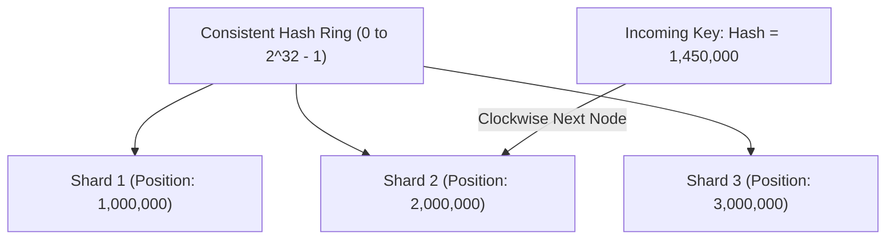

# Database Sharding Interview Questions & Answers

> **Module:** Database Interview Preparation  
> **Topic:** Database Sharding, Horizontal Partitioning, Shard Keys, Routing, Consistent Hashing  
> **Target Audience:** Software Engineers, Senior Backend Engineers, Systems Architects

---

## Difficulty Navigation
- [Beginner Level](#beginner-level)
- [Intermediate Level](#intermediate-level)
- [Advanced Level](#advanced-level)
- [Senior Engineer Level](#senior-engineer-level)
- [Software Architect Level](#software-architect-level)

---

## Beginner Level

### Q1: What is database sharding and how does it differ from single-node partitioning?
#### Short Interview-Ready Answer
"Database sharding is the horizontal distribution of data across multiple physically independent database instances, each with its own CPU, memory, and disk. Single-node partitioning divides a table into smaller physical files within the same database engine on one server. Sharding scales write IOPS and storage beyond the physical limits of a single machine; single-node partitioning improves table manageability and index pruning within one machine."

---

### Q2: What is a shard key?
#### Short Interview-Ready Answer
"A shard key is an attribute (or composite set of attributes) present in every row that the application or routing proxy evaluates to determine which physical shard will store that row and serve queries for it."

#### Key Criteria
- Must have high cardinality (e.g., `user_id`, `account_id`, `tenant_id`).
- Must evenly distribute read and write traffic across shards.
- Must align with the primary filtering criteria of the application's most frequent queries.

---

## Intermediate Level

### Q3: What is the "Hot Shard" problem and what causes it?
#### Short Interview-Ready Answer
"A hot shard occurs when an unequal proportion of read or write traffic concentrates on a single physical shard, saturating its CPU, memory, or disk IOPS while other shards sit underutilized. It is caused by poor shard key selection, such as low-cardinality keys, monotonically increasing timestamp keys where all current writes hit the newest shard, or celebrity tenants with outsized activity."

#### Mitigation Strategies
1. **Compound Shard Key:** Combine the primary attribute with a random or hashed salt (e.g., `user_id + hash(order_id) % 4`).
2. **Dedicated VIP Shards:** Route high-traffic enterprise tenants to dedicated physical shards using directory-based routing.

---

### Q4: How does Consistent Hashing work in database sharding?
#### Short Interview-Ready Answer
"Consistent hashing maps both database shards and data keys to a continuous logical circle (hash ring from $0$ to $2^{32}-1$). A key is assigned to the first shard whose position on the ring is greater than or equal to the key's hash. When a new shard is added, only $K/N$ keys need to be relocated (where $K$ is the total keys and $N$ is the number of shards), unlike simple modulo hashing (`hash % N`) where adding a shard invalidates almost 100% of key mappings."

---

## Advanced Level

### Q5: How do you handle cross-shard joins and queries without a shard key (Scatter-Gather)?
#### Short Interview-Ready Answer
"Cross-shard joins cannot be executed natively by relational database engines across independent servers. Systems solve this by:
1. **Schema Colocation:** Including the shard key on child tables so related rows always land on the same physical shard.
2. **Reference Table Duplication:** Fully replicating small, read-heavy lookup tables (e.g., currencies, states) to every shard.
3. **Scatter-Gather Parallelization:** For queries without a shard key, an application or proxy fires the query concurrently across all shards, collects partial result sets, and performs in-memory sorting, filtering, and aggregation before returning to the client."

#### Blast Radius of Scatter-Gather
A scatter-gather query is as slow as the slowest shard in the fleet (the "straggler problem"). If 1 out of 50 shards is experiencing a spike, all scatter-gather queries block waiting for that single shard.

---

### Q6: How does Spring Boot manage connection pools in a sharded database architecture?
#### Short Interview-Ready Answer
"Spring Boot uses `AbstractRoutingDataSource` to dynamically determine the target datasource at runtime based on a `ThreadLocal` context holder. Crucially, the application **must maintain an independent `HikariDataSource` connection pool for each physical shard**. Maintaining separate pools prevents connection exhaustion on a struggling shard from blocking queries to healthy shards."

---

## Senior Engineer Level

### Q7: How do you generate globally unique Primary Keys across hundreds of shards without collisions?
#### Short Interview-Ready Answer
"Traditional database auto-incrementing serial sequences (`BIGSERIAL`) cannot be used because independent shards will generate identical IDs (e.g., Shard 1 and Shard 2 will both generate ID 101). 

We solve this using:
1. **UUIDv7:** Time-ordered 128-bit UUIDs that are globally unique and index-friendly for B-Trees.
2. **Twitter Snowflake / Distributed ID Generator:** A 64-bit integer composed of 41 bits timestamp, 10 bits machine/shard ID, and 12 bits sequence number.
3. **Database Sequence Offsets:** Configuring sequences with stride:
   - Shard 1: `START 1 INCREMENT 10` (1, 11, 21, ...)
   - Shard 2: `START 2 INCREMENT 10` (2, 12, 22, ...)"

---

## Software Architect Level

### Q8: What are the trade-offs between Application-Level Sharding, Middleware/Proxy Sharding, and Distributed SQL?
#### Short Interview-Ready Answer
"The choice depends on team maturity, existing codebase, performance latency tolerance, and operational overhead:

- **Application-Level Sharding (Spring Boot `AbstractRoutingDataSource`):**
  - *Pros:* Zero proxy latency; fine-grained programmatic control; uses standard PostgreSQL/MySQL.
  - *Cons:* Code pollution; developer must write custom routing and retry logic; complex cross-shard aggregations.
- **Middleware / Proxy Sharding (Vitess, Apache ShardingSphere, Citus):**
  - *Pros:* Transparent SQL interface to applications; handles scatter-gather and simple joins.
  - *Cons:* Additional network hop (0.5–2ms); operational burden of managing high-availability proxy clusters.
- **Distributed SQL (CockroachDB, YugabyteDB, Google Spanner):**
  - *Pros:* Native automated sharding, distributed consensus (Raft/Paxos), global transactions (ACID).
  - *Cons:* Higher write latency due to multi-node consensus; higher compute cost; unfamiliar operational tooling."

---

## Common Mistakes & Misconceptions
- **Misconception:** Sharding should be adopted early to prevent future scaling issues. *(Reality: Sharding introduces immense operational complexity, breaks ACID transactions, and should only be introduced when vertical scaling and read replicas are exhausted).*
- **Misconception:** Any column can be an effective shard key as long as values are unique. *(Reality: A random UUID shard key scatters range queries across every node, destroying range-scan performance).*

---

## Related References
- [Database Sharding Architecture Guide](../database-architecture/database-sharding.md)
- [Spring Boot Shard Routing Implementation](../practical-examples/spring-boot/shard-routing/)
