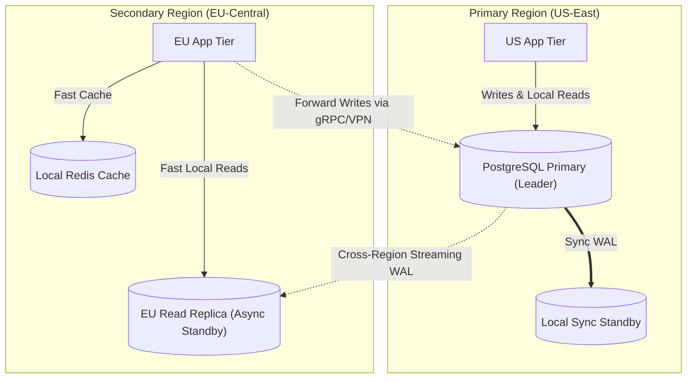
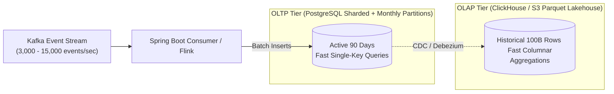
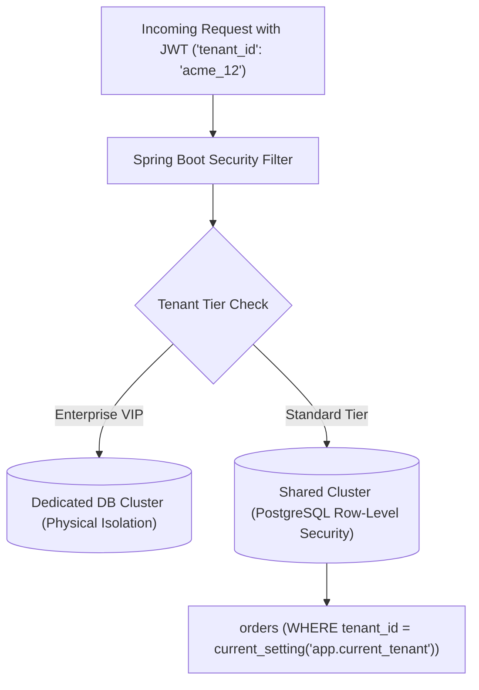

# Software Architect Database Interview Questions

> **Module:** Database Interview Preparation  
> **Topic:** High-Level System Architecture, Data Tier Design, Scalability, Fault Tolerance  
> **Target Audience:** Principal Engineers, Solutions Architects, Head of Engineering Candidates

---

## Question Index
1. [How do you architect a global multi-region database tier with low read latency and strong write consistency?](#question-1-how-do-you-architect-a-global-multi-region-database-tier-with-low-read-latency-and-strong-write-consistency)
2. [How do you architect a storage engine handling 100 billion rows annually?](#question-2-how-do-you-architect-a-storage-engine-handling-100-billion-rows-annually)
3. [How do you execute zero-downtime schema migrations on terabyte-scale production tables?](#question-3-how-do-you-execute-zero-downtime-schema-migrations-on-terabyte-scale-production-tables)
4. [How do you design a database architecture for a multi-tenant enterprise SaaS platform?](#question-4-how-do-you-design-a-database-architecture-for-a-multi-tenant-enterprise-saas-platform)
5. [How do you manage database connection spikes during microservice auto-scaling events?](#question-5-how-do-you-manage-database-connection-spikes-during-microservice-auto-scaling-events)

---

## Question 1: How do you architect a global multi-region database tier with low read latency and strong write consistency?

### 1. Short Interview-Ready Answer (30–60 Seconds)
"To balance low global read latency with strong write consistency, I would deploy a **Primary Region with Cross-Region Read Replicas** or a **Distributed SQL engine** depending on write locality.

For standard enterprise stacks, we establish a single primary region (e.g., US-East) for all authoritative writes. In secondary regions (Europe, Asia), we deploy asynchronous read replicas with local caching layers (Redis/CDN). To prevent read-after-write inconsistency for users mutating data outside the primary region, we implement **Causal Tokens (LSN tracking)** or forward mutations to the primary region before updating the local session context. 

If writes originate evenly worldwide and require multi-region active-active durability, we adopt Distributed SQL (CockroachDB or Google Spanner) using Multi-Raft consensus with regional range leases."

### 2. Detailed Technical Architecture

### 3. Key Architecture Considerations
- **Speed of Light Constraint:** Network RTT between Frankfurt and Virginia is ~80ms. Synchronous cross-region commits impose an unavoidable 80–160ms write penalty.
- **Read-After-Write Mitigation:** EU users performing writes receive a causal token; the EU application reads from the primary region until the EU standby's LSN crosses that token threshold.

---

## Question 2: How do you architect a storage engine handling 100 billion rows annually?

### 1. Short Interview-Ready Answer (30–60 Seconds)
"Handling 100 billion rows annually (~3,200 writes/sec sustained, with 15,000+ peak) requires a **hybrid polyglot storage architecture** separating operational OLTP from analytical OLAP.

1. **Ingestion & Buffering:** Ingest stream via Kafka to absorb sudden traffic spikes.
2. **Operational Tier (Hot Data - 30 to 90 Days):** Partitioned and sharded PostgreSQL cluster. Tables use **declarative monthly range partitioning** so active B-Tree indexes remain memory-resident in RAM.
3. **Analytical & Cold Tier (Historical Data - Years 1 to 7):** Stream data via Debezium CDC into a columnar data warehouse (ClickHouse, Snowflake, or AWS Redshift) or Parquet lakehouse on Amazon S3 queried via Apache Trino.
4. **Lifecycle Automation:** At month end, detach and drop hot PostgreSQL partitions in milliseconds, avoiding `DELETE` locks and VACUUM bloat."

### 2. High-Level Data Pipeline

---

## Question 3: How do you execute zero-downtime schema migrations on terabyte-scale production tables?

### 1. Short Interview-Ready Answer (30–60 Seconds)
"Zero-downtime schema migrations on multi-terabyte tables require avoiding exclusive metadata table locks (`ACCESS EXCLUSIVE`) that stall client queries.

We follow the **Expand and Contract (Parallel Run) Pattern**:
1. **Adding Columns:** In PostgreSQL 11+, `ALTER TABLE ... ADD COLUMN ... DEFAULT NULL` is metadata-only and instantaneous. Avoid non-constant volatile defaults without checking lock implications.
2. **Adding Indexes:** Always use `CREATE INDEX CONCURRENTLY`. This acquires an `EXCLUSIVE SHARE` lock that permits concurrent reads, inserts, updates, and deletes.
3. **Renaming / Modifying Columns:** Never rename a live column directly. Instead:
   - Add the new column (`Expand`).
   - Dual-write to both columns via application code or triggers.
   - Backfill historical rows in small batches.
   - Switch application reads to the new column.
   - Remove legacy column writes (`Contract`).
4. **Tooling:** Use schema migration orchestrators like **gh-ost**, **pt-online-schema-change**, or Liquibase with strict lock-timeout thresholds (`SET lock_timeout = '2s'`)."

### 2. Safe vs Unsafe PostgreSQL Migration Commands

| Migration Operation | Unsafe Approach (Downtime Risk) | Safe Zero-Downtime Approach |
| :--- | :--- | :--- |
| **Index Creation** | `CREATE INDEX idx_user_id ON users (user_id);` (Locks entire table against writes). | `CREATE INDEX CONCURRENTLY idx_user_id ON users (user_id);` (Builds in background). |
| **Adding NOT NULL Column** | `ALTER TABLE orders ADD COLUMN status VARCHAR(20) NOT NULL;` (Fails if table has rows). | 1. Add column as `NULL`. 2. Add `CHECK (status IS NOT NULL) NOT VALID;` 3. `ALTER TABLE ... VALIDATE CONSTRAINT;` |
| **Dropping a Column** | `ALTER TABLE orders DROP COLUMN legacy_field;` | 1. Stop application usage. 2. Mark as unused: `ALTER TABLE ... SET UNUSED;` |

---

## Question 4: How do you design a database architecture for a multi-tenant enterprise SaaS platform?

### 1. Short Interview-Ready Answer (30–60 Seconds)
"There are three primary architectural models for multi-tenant persistence:
1. **Database-per-Tenant:** Maximum security and physical isolation; each tenant gets their own database. Ideal for strictly regulated banking or healthcare enterprise clients, but high infrastructure cost and complex fleet-wide migrations.
2. **Schema-per-Tenant:** Single database, but dedicated PostgreSQL schema per tenant. Balanced isolation, but schema catalog bloat if tenants exceed thousands.
3. **Shared Database, Shared Schema (Discriminator Column):** Every table includes `tenant_id`. Lowest cost and easiest pooling. Isolation is enforced via **PostgreSQL Row-Level Security (RLS)** and Spring Boot dynamic Hibernate tenant filters.

*Enterprise Architecture Standard:* A hybrid model—Shared Schema with RLS for 95% of small/medium tenants, with directory-based routing directing high-paying enterprise tenants to dedicated single-tenant clusters."

---

## Question 5: How do you manage database connection spikes during microservice auto-scaling events?

### 1. Short Interview-Ready Answer (30–60 Seconds)
"When an autoscaling group expands from 10 to 100 microservice pods during a traffic burst, if each pod opens a local HikariCP pool of 20 connections, the database primary is suddenly hit with $100 \times 20 = 2,000$ concurrent connection requests, causing memory exhaustion and operating system context-switching collapse.

To prevent this:
1. **Deploy Server-Side Connection Pooling (PgBouncer):** Deploy PgBouncer in **Transaction Pooling Mode** adjacent to the database cluster. Microservice pods connect freely to PgBouncer, which multiplexes thousands of incoming application connections onto a fixed, optimal pool of 50–100 physical PostgreSQL backend processes.
2. **Right-Size Client-Side Pools:** Set microservice HikariCP `maximum-pool-size` to small values (e.g., 5–10) rather than oversized defaults.
3. **Connection Queue Throttling:** Let requests queue in memory at the application tier rather than overwhelming the database kernel."

---

## Authoritative References
- [PostgreSQL Row-Level Security (RLS) Guide](https://www.postgresql.org/docs/current/ddl-rowsecurity.html)
- [Zero Downtime Migrations (GitLab Engineering Playbook)](https://docs.gitlab.com/ee/development/database/avoiding_downtime_in_migrations.html)
- [PgBouncer Pooling Modes & Best Practices](https://www.pgbouncer.org/)
