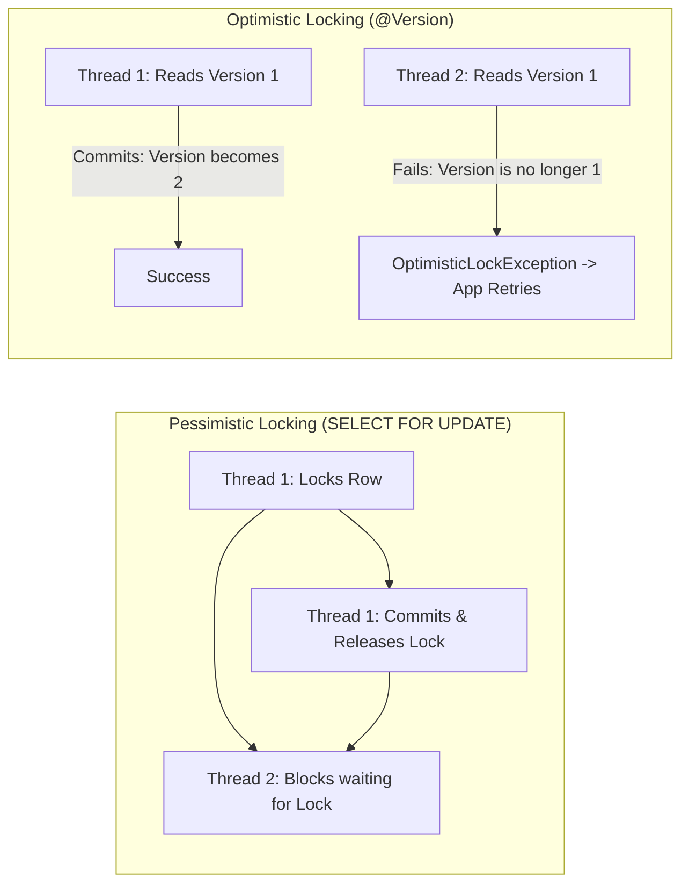

# Transactions & Concurrency Control Interview Questions

> **Module:** Database Interview Preparation  
> **Topic:** ANSI SQL Isolation Levels, Dirty Reads, Phantom Reads, MVCC, Deadlocks, Locks  
> **Target Audience:** Software Engineers, Backend Developers, Systems Architects

---

## Difficulty Navigation
- [Beginner Level](#beginner-level)
- [Intermediate Level](#intermediate-level)
- [Advanced Level](#advanced-level)
- [Senior Engineer Level](#senior-engineer-level)

---

## Beginner Level

### Q1: What are the four ANSI SQL Isolation Levels and which read phenomena do they prevent?

| Isolation Level | Dirty Read | Non-Repeatable Read | Phantom Read |
| :--- | :---: | :---: | :---: |
| **Read Uncommitted** | Allowed | Allowed | Allowed |
| **Read Committed** (PostgreSQL/MySQL default) | **Prevented** | Allowed | Allowed |
| **Repeatable Read** | **Prevented** | **Prevented** | Allowed (Prevented in Postgres MVCC) |
| **Serializable** | **Prevented** | **Prevented** | **Prevented** |

*Definitions:*
- **Dirty Read:** Transaction reads uncommitted data written by a concurrent transaction that might subsequently roll back.
- **Non-Repeatable Read:** Transaction reads a row, another transaction modifies/commits that row, and the first transaction re-reads the row seeing different column values.
- **Phantom Read:** Transaction executes a range query (`WHERE age > 30`), another transaction inserts a new row matching that range and commits, and the first transaction repeats the query seeing a new "phantom" row.

---

## Intermediate Level

### Q2: What is Optimistic Locking vs Pessimistic Locking?
#### Short Interview-Ready Answer
"**Pessimistic Locking** assumes conflicts are frequent and explicitly locks rows at the database level (`SELECT ... FOR UPDATE`) before performing modifications, blocking concurrent transactions until commit. 

**Optimistic Locking** assumes conflicts are rare, allows concurrent reads without locking, and checks for concurrent modifications at commit time using a version or timestamp column (`UPDATE accounts SET balance = 100, version = 2 WHERE id = 1 AND version = 1`). If zero rows are updated, the application detects a concurrent conflict and retries."

---

## Advanced Level

### Q3: How does Multi-Version Concurrency Control (MVCC) eliminate read-write blocking?
#### Short Interview-Ready Answer
"MVCC ensures that **readers do not block writers, and writers do not block readers**. 

In PostgreSQL, every table row has hidden transaction metadata headers: `xmin` (the Transaction ID that created the row) and `xmax` (the Transaction ID that updated/deleted the row). When a query starts, PostgreSQL creates a **Snapshot** recording active in-flight transactions. When scanning the table, the query only sees tuples whose `xmin` was committed before snapshot creation and whose `xmax` is either unset or belongs to an uncommitted transaction. Writers create new versions of rows instead of overwriting existing data, so readers continue reading older committed versions without acquiring shared locks."

---

## Senior Engineer Level

### Q4: What causes a Deadlock, and how do you diagnose and prevent them?
#### Short Interview-Ready Answer
"A deadlock occurs when two or more transactions hold locks that the other transactions need to proceed, forming a circular wait dependency (e.g., Tx 1 locks Row A and requests Row B; Tx 2 locks Row B and requests Row A).

PostgreSQL runs a background deadlock detector that wakes up after `deadlock_timeout` (default 1 second), inspects the lock wait graph, and aborts one of the transactions with `ERROR: deadlock detected`.

*Prevention Strategies:*
1. **Consistent Lock Ordering:** Always acquire locks on multiple tables or rows in the exact same deterministic order (e.g., sorting by primary key `ORDER BY id ASC` before locking).
2. **Shorten Transactions:** Keep transaction blocks minimal; avoid external HTTP calls or heavy computations while holding locks.
3. **Use Explicit Lock Timeouts:** Set `SET lock_timeout = '3s'` so queries fail gracefully instead of blocking indefinitely."

---

## Authoritative References
- [PostgreSQL Concurrency Control & MVCC Guide](https://www.postgresql.org/docs/current/mvcc.html)
- [PostgreSQL Explicit Locking Documentation](https://www.postgresql.org/docs/current/explicit-locking.html)
