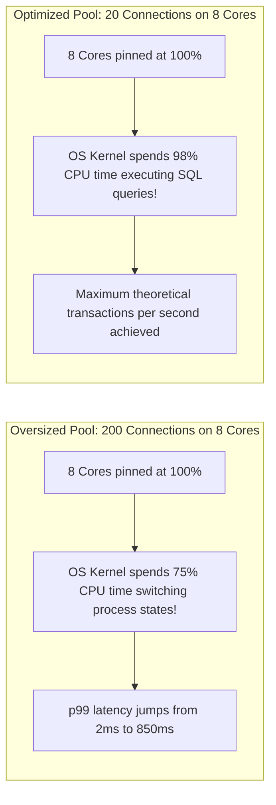

# Connection Pool Tuning and Throughput Optimization

> **Category:** Database Performance  
> **Target Audience:** Systems Architects, Senior Backend Developers (Java Spring Boot), SREs  
> **Key Tools:** HikariCP, PgBouncer, Prometheus, Grafana

---

## 1. The Physics of Connection Pool Sizing

Database servers run on physical hardware with fixed CPU cores, memory channels, and disk I/O controllers. 

When an application framework creates hundreds of concurrent database connections, it does not increase database throughput—it triggers **thread context-switching degradation**.

---

## 2. The HikariCP Sizing Formula
$$\text{Max Connections} = ((\text{Core Count} \times 2) + \text{Effective Spindle Count})$$

- For a standard modern cloud database (e.g., AWS RDS `db.r6g.2xlarge` with 8 vCPUs and NVMe SSD):
  $$\text{Connections} = (8 \times 2) + 1 = 17 \text{ connections}$$
- Across a fleet of 5 microservice instances:
  $$\text{Pool Size per Pod} = \frac{17}{5} \approx 3\text{ to }4\text{ connections per instance!}$$

---

## 3. HikariCP Production Metrics to Alert On
Export these Micrometer metrics to Prometheus and alert when:
- `hikaricp.connections.pending > 5`: Threads are waiting in queue to acquire a connection.
- `hikaricp.connections.timeout.total > 0`: Severe pool starvation; HTTP 500 errors occurring.
- `hikaricp.connections.usage.seconds.max > 5.0`: Long-running transactions holding connections open.

---

## 4. Authoritative References
- [Brett Wooldridge: About Pool Sizing](https://github.com/brettwooldridge/HikariCP/wiki/About-Pool-Sizing)
- [PostgreSQL Connection Overhead Analysis](https://wiki.postgresql.org/wiki/Number_Of_Database_Connections)
