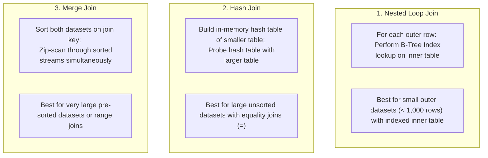

# SQL Query Optimization: Principles and Best Practices

> **Category:** Database Performance  
> **Target Audience:** Backend Developers, Database Engineers, System Architects

---

## 1. What is Query Optimization?
Query optimization is the process of structuring SQL queries and database schemas so that the Cost-Based Optimizer (CBO) can find the most efficient execution plan—minimizing disk I/O, memory consumption, CPU cycles, and lock duration.

---

## 2. Core Antipattern: Non-SARGable Predicates
A predicate is **SARGable** (Search Argument Able) if the engine can utilize an index B-Tree search rather than scanning every row. Wrapping an indexed column in a function destroys SARGability.

| Non-SARGable Query (Forces Full Table Scan) | SARGable Query (Uses Index Range Scan) |
| :--- | :--- |
| `WHERE DATE(created_at) = '2026-02-15'` | `WHERE created_at >= '2026-02-15 00:00:00' AND created_at < '2026-02-16 00:00:00'` |
| `WHERE UPPER(email) = 'ALICE@EXAMPLE.COM'` | `WHERE email = 'alice@example.com'` *(or create index on `UPPER(email)`)* |
| `WHERE amount * 1.1 > 100` | `WHERE amount > 100 / 1.1` |
| `WHERE name LIKE '%tech'` *(Leading wildcard)* | `WHERE name LIKE 'tech%'` *(Trailing wildcard uses B-Tree)* |

---

## 3. The Three Relational Join Algorithms



---

## 4. Keyset Pagination vs `OFFSET`
In web applications, implementing pagination using `LIMIT 20 OFFSET 1000000` is catastrophic:
- The engine must read 1,000,020 rows from disk, sort them, discard 1,000,000, and return 20.
- **Solution (Keyset / Cursor Pagination):**
  ```sql
  -- Keyset pagination utilizes the B-Tree index:
  SELECT * FROM orders 
  WHERE (order_date, order_id) < (:last_date, :last_id)
  ORDER BY order_date DESC, order_id DESC 
  LIMIT 20;
  ```
  Execution time remains constant at 0.5ms regardless of whether the user is on page 1 or page 50,000!

---

## 5. Authoritative References
- [Use The Index, Luke! SQL Indexing and Tuning](https://use-the-index-luke.com/)
- [PostgreSQL Query Planning Strategies](https://www.postgresql.org/docs/current/planner-optimizer.html)
