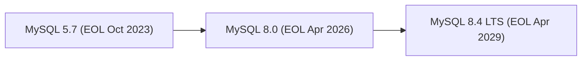

# MySQL Release History & Version Roadmap

> **Data Source:** Oracle MySQL Lifetime Support Policy  
> **Status Verification Date:** 2026-10-23

---

## MySQL Release Model Evolution

Historically, MySQL released single monolithic version families (5.6, 5.7, 8.0) that spanned many years. Starting in late 2023, MySQL introduced the **Innovation vs Long-Term Support (LTS)** cadence.

---

## MySQL Version Lifecycle Status

| Version Family | Release Type | General Availability (GA) | End of Premier Support | Status (as of 2026-10-23) | Landmark Capabilities |
| :---: | :---: | :---: | :---: | :---: | :--- |
| **MySQL 8.4 LTS** | **LTS** | 2024-04-30 | 2029-04-30 | **Supported (Active LTS)** | First official LTS; Group Replication auto-failover; `mysql_native_password` disabled by default. |
| **MySQL 8.0** | Mainstream | 2018-04-19 | 2026-04-30 | **Supported (Approaching EOL)** | Transactional Data Dictionary; CTEs; Window Functions; Roles; Instant DDL; `utf8mb4` default. |
| **MySQL 5.7** | Legacy | 2015-10-21 | 2023-10-25 | **End of Life (EOL)** | JSON data type; Multi-source replication; Sys schema; Optimizer cost model. |
| **MySQL 5.6** | Legacy | 2013-02-05 | 2021-02-05 | **End of Life (EOL)** | InnoDB full-text search; Online DDL; GTID replication; Performance Schema expansion. |

---

## Authoritative Reference
- [Oracle MySQL Lifetime Support Policy](https://www.mysql.com/support/supported-platforms/database.html)
