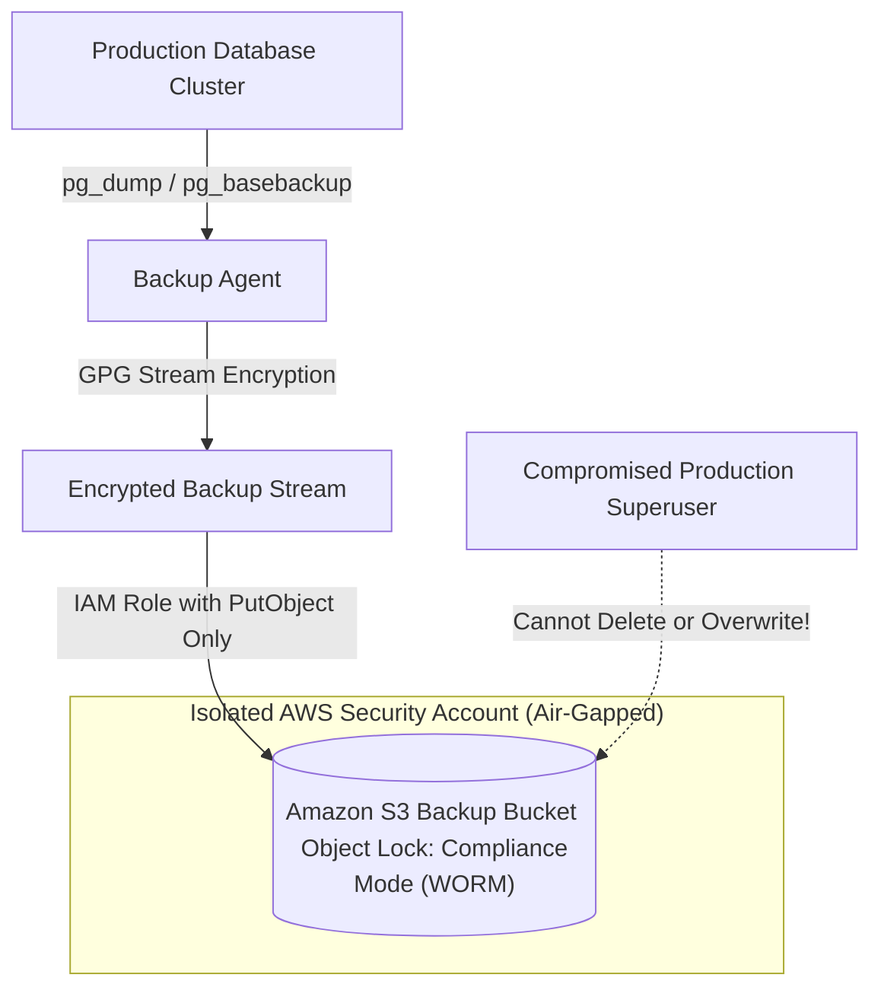

# Database Backup Security and Ransomware Protection

> **Category:** Database Security  
> **Target Audience:** SREs, Security Engineers, Backup Administrators

---

## 1. Threat Landscape: Why Backups are Targeted
In modern cyberattacks and ransomware incidents, attackers spend weeks moving laterally across internal networks. Their first objective is **locating and deleting or encrypting database backups**, ensuring the organization cannot recover without paying the ransom.

---

## 2. Hardened Backup Security Architecture



---

## 3. Core Protection Mechanisms

### 3.1 Immutable WORM Storage (Object Lock)
- Store all database backups and archived WAL files in object storage configured with **WORM (Write Once, Read Many)** in **Compliance Mode**.
- In Compliance Mode, no user—including the AWS root account—can delete or overwrite an object until its retention period (e.g., 90 days) expires.

### 3.2 Air-Gapped Separate Accounts
- Production database instances run in Account A.
- Backups are stored in an entirely separate Account B with independent identity providers and multi-factor authentication (MFA).
- The production backup agent holds only `s3:PutObject` permissions; it does not have `s3:DeleteObject` or `s3:ListBucket` permissions.

### 3.3 Asymmetric Stream Encryption
Never store plaintext database dumps on intermediate backup servers:
```bash
# Encrypt backup stream on-the-fly using GPG public key before touching disk:
pg_dump -U postgres app_db | gpg --encrypt --recipient dba-keys@internal.org > app_db_$(date +%F).dump.gpg
```
Even if the backup server is seized, decryption requires the private key, which is stored securely in an offline hardware security module (HSM).

---

## 4. Authoritative References
- [AWS S3 Object Lock for Ransomware Protection](https://docs.aws.amazon.com/AmazonS3/latest/userguide/object-lock.html)
- [CISA Cybersecurity Guidelines for Data Backup](https://www.cisa.gov/resources-tools/resources/data-backup-options)
