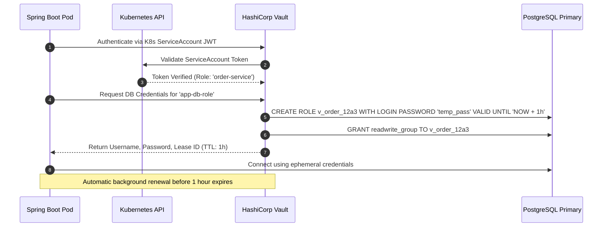

# Database Secrets Management and Dynamic Credential Rotation

> **Category:** Database Security  
> **Target Audience:** DevOps, SREs, Systems Architects  
> **Tooling:** HashiCorp Vault, AWS Secrets Manager, Kubernetes External Secrets

---

## 1. The Danger of Static Database Credentials
Traditional architectures hardcode database usernames and passwords in environment variables, configuration files (`application.properties`), or CI/CD pipelines:
- **Long-Lived Risk:** Passwords often remain unchanged for years.
- **Leak Propagation:** Static secrets leak through Docker image layers, git repositories, crash logs, and process inspect tools (`/proc/$PID/environ`).
- **Rotation Nightmares:** Rotating a static password requires synchronized coordination across dozens of running microservice deployments to avoid connection downtime.

---

## 2. Dynamic Secret Architecture with HashiCorp Vault



---

## 3. Spring Cloud Vault Integration
In Spring Boot, dynamic database credentials are leased and automatically rotated without restarting the application using `spring-cloud-vault-config`:
```yaml
spring:
  cloud:
    vault:
      uri: https://vault.internal:8200
      authentication: KUBERNETES
      database:
        enabled: true
        role: order-service-db-role
        backend: database
```
When Vault approaches the lease expiration time, Spring automatically renews the lease or provisions fresh credentials and swaps HikariCP physical connections gracefully.

---

## 4. Authoritative References
- [HashiCorp Vault Database Secrets Engine](https://developer.hashicorp.com/vault/docs/secrets/databases)
- [Spring Cloud Vault Documentation](https://cloud.spring.io/spring-cloud-vault/)
