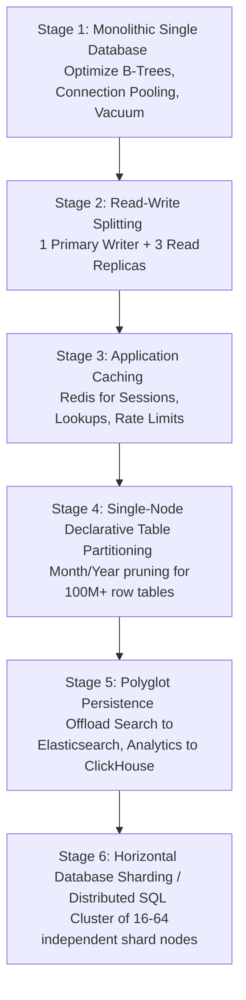

# Database Scaling Strategies: From Monolith to Distributed Scale

> **Category:** Database System Design  
> **Target Audience:** Principal Architects, Engineering Executives, Staff Engineers

---

## 1. The 6-Stage Database Scaling Roadmap

Every high-growth tech platform journeys through a predictable hierarchy of architectural scaling stages:

---

## 2. Stage Breakdown & Engineering Triggers

| Scaling Stage | Engineering Trigger | Architectural Actions | Limitations |
| :--- | :--- | :--- | :--- |
| **Stage 1: Vertical Tuning** | Query latency creeping above 50ms; CPU spikes. | Right-size HikariCP pools; add composite B-Tree indexes; tune `work_mem` and `shared_buffers`. | Bounded by maximum single-machine physical hardware. |
| **Stage 2: Read Replicas** | Read queries consume 85%+ CPU; single primary saturated. | Deploy streaming replication; configure Spring Boot `@Transactional(readOnly=true)` routing. | Does not increase write throughput; replication lag risk. |
| **Stage 3: Caching (Redis)** | Repeated read queries for static data hitting database. | Cache-Aside pattern with Redis; invalidate on primary update. | Cache invalidation complexity; eventual consistency. |
| **Stage 4: Partitioning** | Large tables exceed RAM; index bloat; slow data deletion. | PostgreSQL declarative range partitioning; fast concurrent detachment. | Single machine write IOPS ceiling remains. |
| **Stage 5: Polyglot Specialization** | Full-text search and analytical aggregations stalling OLTP. | Stream WAL via Debezium CDC to Elasticsearch and ClickHouse. | Eventual consistency; multiple persistence frameworks to maintain. |
| **Stage 6: Database Sharding** | Writes exceed 15,000–50,000 writes/sec; single disk IOPS exhausted. | Shard on `tenant_id` or `customer_id` using consistent hashing; maintain per-shard connection pools. | No cross-shard joins; requires Sagas for multi-shard transactions. |

---

## 3. The Anti-Pattern: Premature Sharding
The most common and expensive architectural mistake made by engineering teams is **skipping directly from Stage 1 to Stage 6**. 
- Sharding introduces massive operational overhead, eliminates ACID transactions, fractures relational joins, and increases deployment complexity by 10x.
- A well-tuned, vertically scaled PostgreSQL primary backed by 3 read replicas and a Redis cache can comfortably handle **50,000 requests per second** and multiple terabytes of data before true sharding becomes necessary.

---

## 4. Authoritative References
- [Designing Data-Intensive Applications (Martin Kleppmann)](https://dataintensive.net/)
- [High Performance MySQL (Schwartz et al.)](https://www.oreilly.com/library/view/high-performance-mysql/9781492080503/)
