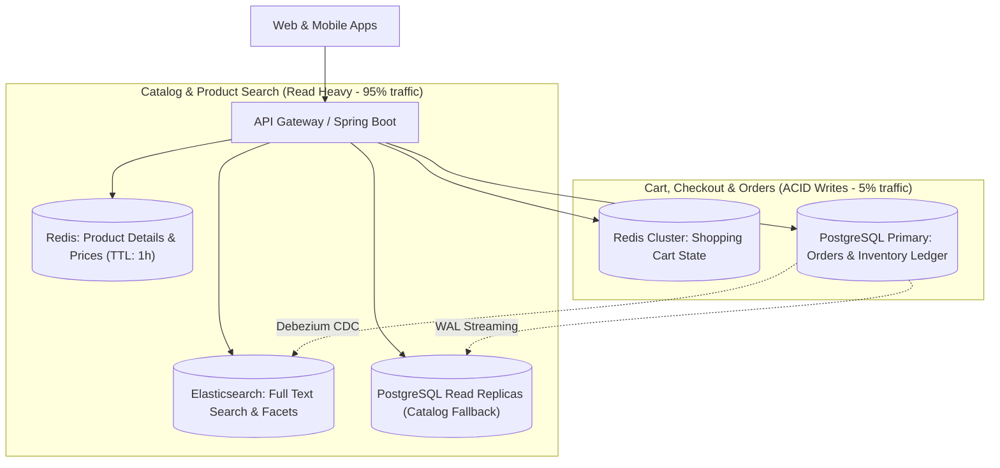

# E-Commerce Database System Design

> **Category:** Database System Design  
> **Target Scale:** 10 Million Active Users, 500,000 Orders/Day, Flash Sale Resilience  
> **Primary Technology:** PostgreSQL, Redis, Elasticsearch

---

## 1. High-Level System Architecture



---

## 2. Core Relational Schema

```sql
-- 1. Products Catalog
CREATE TABLE products (
    product_id BIGINT GENERATED ALWAYS AS IDENTITY PRIMARY KEY,
    sku VARCHAR(64) UNIQUE NOT NULL,
    title VARCHAR(255) NOT NULL,
    price NUMERIC(10, 2) NOT NULL,
    status VARCHAR(20) NOT NULL DEFAULT 'ACTIVE',
    metadata JSONB, -- Flexible attributes (color, size, technical specs)
    created_at TIMESTAMPTZ DEFAULT clock_timestamp()
);

-- 2. Inventory Ledger (Avoid single row lock bottlenecks!)
CREATE TABLE inventory_items (
    product_id BIGINT PRIMARY KEY,
    available_stock INT NOT NULL CHECK (available_stock >= 0),
    reserved_stock INT NOT NULL DEFAULT 0 CHECK (reserved_stock >= 0),
    version INT NOT NULL DEFAULT 0,
    FOREIGN KEY (product_id) REFERENCES products (product_id)
);

-- 3. Orders Master Table (Partitioned by Year/Month)
CREATE TABLE orders (
    order_id BIGINT GENERATED ALWAYS AS IDENTITY,
    order_date DATE NOT NULL,
    customer_id BIGINT NOT NULL,
    status VARCHAR(30) NOT NULL,
    total_amount NUMERIC(12, 2) NOT NULL,
    PRIMARY KEY (order_id, order_date)
) PARTITION BY RANGE (order_date);

-- 4. Order Items
CREATE TABLE order_items (
    item_id BIGINT GENERATED ALWAYS AS IDENTITY,
    order_id BIGINT NOT NULL,
    order_date DATE NOT NULL,
    product_id BIGINT NOT NULL,
    quantity INT NOT NULL,
    unit_price NUMERIC(10, 2) NOT NULL,
    PRIMARY KEY (item_id, order_date)
) PARTITION BY RANGE (order_date);
```

---

## 3. Flash Sale & Overselling Prevention
When 100,000 users attempt to purchase 100 iPhone units simultaneously:
- **Pessimistic DB Locking (`SELECT FOR UPDATE`) destroys throughput:** 100,000 transactions queue on a single row lock, causing database connection pool collapse.
- **Production Solution: Redis Atomic Decrement + Async DB Reconciliation:**
  1. Pre-load stock into Redis: `SET inventory:iphone_16 100`.
  2. Incoming checkout calls atomic `DECRBY inventory:iphone_16 1`:
     - If result $\ge 0$: User wins reservation; enqueue order to Kafka.
     - If result $< 0$: Out of stock; reject immediately with HTTP 409 in sub-millisecond time without touching the database!
  3. Background worker consumes Kafka queue and batch-inserts orders to PostgreSQL.

---

## 4. Authoritative References
- [Designing Data-Intensive Applications (Martin Kleppmann)](https://dataintensive.net/)
- [PostgreSQL Declarative Partitioning](https://www.postgresql.org/docs/current/ddl-partitioning.html)
