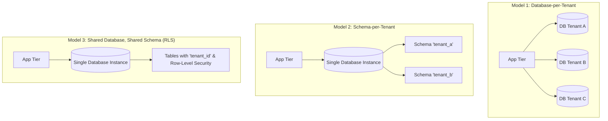

# Multi-Tenant Database System Design

> **Category:** Database System Design  
> **Target Scale:** 50,000 Corporate Tenants, Mixed Enterprise & SMB SaaS  
> **Primary Technology:** PostgreSQL, Row-Level Security (RLS), Spring Boot

---

## 1. The Three Multi-Tenant Persistence Models



### Detailed Trade-Off Matrix

| Evaluation Criteria | 1. Database-per-Tenant | 2. Schema-per-Tenant | 3. Shared Database & Schema (RLS) |
| :--- | :--- | :--- | :--- |
| **Data Isolation** | **Maximum:** Physical hardware/database separation. | **High:** Separate namespace and authorization. | **Logical:** Governed by SQL filters and RLS policies. |
| **Infrastructure Cost** | **Extremely High:** Connection pools and memory overhead per database. | **Moderate:** Shares buffer pool, but metadata bloat at scale. | **Lowest:** Maximum resource multiplexing and cache efficiency. |
| **Schema Migrations** | **Painful:** Flyway/Liquibase must run 50,000 times in parallel. | **Slow:** DDL must iterate through 50,000 schemas. | **Fast & Instant:** Run DDL once; applies globally to all tenants. |
| **Maximum Tenant Limit**| ~100–500 tenants per physical server. | ~1,000–3,000 schemas (catalog bloat limits). | **Unlimited (Millions of tenants).** |

---

## 2. Enterprise Standard: The Hybrid Model

Modern SaaS unicorns (e.g., Slack, Salesforce, Datadog) adopt a **Hybrid Model**:
1. **Tier 1 (SMB / Free Tier - 95% of tenants):** Hosted on **Shared Schema with PostgreSQL Row-Level Security (RLS)**. Extremely cost-effective; tenants share database instances and connection pools.
2. **Tier 2 (Enterprise VIP Tenants - 5% of tenants):** Enterprise customers paying $50,000+/year requiring HIPAA/SOC-2 compliance or custom backup SLAs are routed to **Dedicated Single-Tenant Database Clusters** via directory-based routing.

---

## 3. Implementing Row-Level Security in PostgreSQL

```sql
-- 1. Enable RLS on all tenant tables
ALTER TABLE projects ENABLE ROW LEVEL SECURITY;

-- 2. Define strict tenant isolation policy
CREATE POLICY tenant_isolation_policy ON projects
    FOR ALL
    USING (tenant_id = NULLIF(current_setting('app.current_tenant_id', true), '')::UUID);

-- 3. In Spring Boot application filter, set session setting before each request:
SET LOCAL app.current_tenant_id = 'a0eebc99-9c0b-4ef8-bb6d-6bb9bd380a11';

-- Any subsequent SELECT, UPDATE, DELETE automatically appends:
-- WHERE tenant_id = 'a0eebc99-9c0b-4ef8-bb6d-6bb9bd380a11'
SELECT * FROM projects;
```

---

## 4. Authoritative References
- [AWS Multi-Tenant SaaS Architecture Whitepaper](https://docs.aws.amazon.com/whitepapers/latest/saas-architecture-fundamentals/multi-tenant-data-partitioning.html)
- [PostgreSQL Row-Level Security Guide](https://www.postgresql.org/docs/current/ddl-rowsecurity.html)
