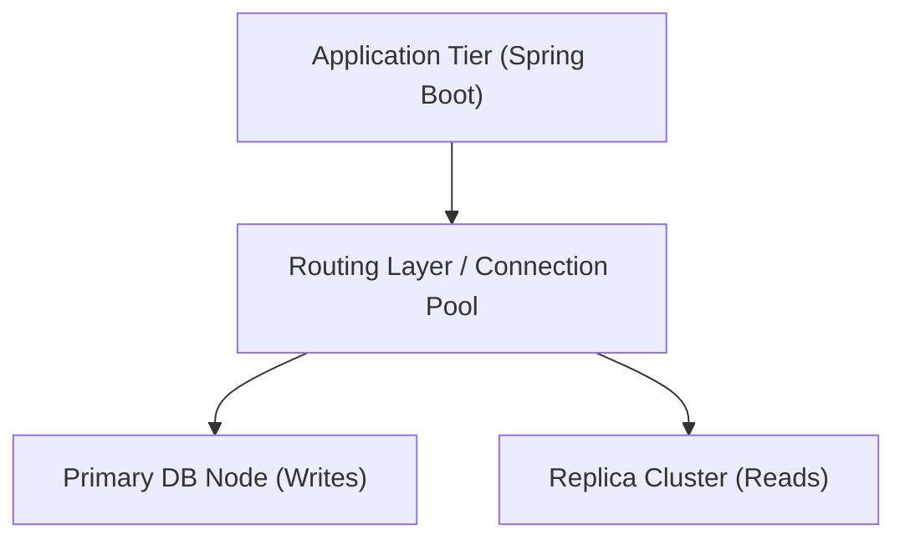

# Architecture Decision Record (ADR) Template

Use this template to capture high-stakes architectural choices relating to database technology selection, topology, replication, sharding, or consistency models.

---

# ADR-[Number]: [Short Title of Architectural Decision]

> **Status:** [ Proposed | Accepted | Superseded | Deprecated | Rejected ]  
> **Date:** [YYYY-MM-DD]  
> **Authors:** [Name / Role]  
> **Stakeholders:** [Backend Team, SRE, Data Engineering, Enterprise Architecture]  
> **Technical Scope:** [Database Architecture / Persistence Layer]

---

## 1. Context & Problem Statement
*Describe the business and technical context, throughput requirements, scale projections, consistency needs, compliance constraints, and current bottlenecks.*

## 2. Decision Drivers
- **Throughput & Latency:** Required writes/sec and reads/sec, target p99 latency.
- **Data Volume:** Anticipated storage growth over 1, 3, and 5 years.
- **High Availability & SLA:** Target 99.99% uptime, RPO (Recovery Point Objective), and RTO (Recovery Time Objective).
- **Team Familiarity & Operational Overhead:** Current operational tooling, DBA expertise, existing Spring Boot ecosystem.
- **Cost & Licensing:** Cloud managed costs, compute/storage ratios, licensing model.

## 3. Considered Options
- **Option 1: [e.g., PostgreSQL with Read-Write Splitting and Declarative Partitioning]**
- **Option 2: [e.g., Application-Level Sharding across multiple PostgreSQL clusters]**
- **Option 3: [e.g., Distributed SQL (CockroachDB / YugabyteDB)]**
- **Option 4: [e.g., NoSQL Solution (MongoDB / Apache Cassandra)]**

## 4. Decision Outcome
**Chosen Option:** [Option X] because [summarize principal reasons].

### Architectural Diagram

## 5. Pros and Cons of the Chosen Option

### Positives (Advantages)
- Benefit 1...
- Benefit 2...

### Negatives (Trade-offs & Risks)
- Drawback 1...
- Drawback 2...

## 6. Implementation & Migration Strategy
- **Phase 1: Proof of Concept & Benchmark:**
- **Phase 2: Schema Migration & Dual-Writing:**
- **Phase 3: Traffic Cutover & Canary:**
- **Phase 4: Decommissioning Legacy Infrastructure:**

## 7. Consequences & Impact Analysis
- **Impact on Application Code (Java/Spring Boot):**
- **Impact on CI/CD & Schema Migrations (Flyway/Liquibase):**
- **Impact on Observability & Backups:**

## 8. Authoritative References & Notes
- Architecture benchmarks and internal performance testing results.
- Vendor architectural best practices.
