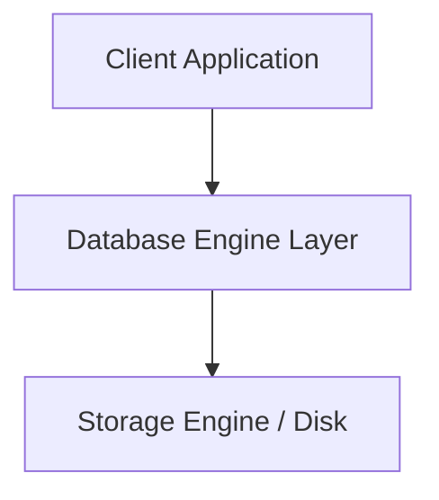

# Database Concept Template

Use this template when authoring a new database concept document in `database-fundamentals/`, `database-architecture/`, `database-performance/`, `database-security/`, or `database-backup-and-recovery/`.

---

# [Concept Title]

> **Category:** [e.g., Database Architecture / Performance / Concurrency Control]  
> **Target Audience:** Software Engineers, Backend Developers, Database Engineers, Solutions Architects  
> **Prerequisites:** [e.g., Basic SQL, Understanding of Relational Modeling, Transaction Semantics]  
> **Supported Engines:** [e.g., PostgreSQL 12+, MySQL 8.0+, Distributed SQL]

---

## 1. What It Is (Definition & Overview)
*Provide a concise, formal definition followed by an accessible explanation. Clarify technical terminology introduced here.*

## 2. Why It Is Needed (Problem Statement)
*Explain the real-world operational or scaling bottleneck that necessitates this concept. What breaks or degrades if this concept is not applied?*
- Problem 1: ...
- Problem 2: ...

## 3. Core Architecture & Internal Mechanics
*Detail how database storage engines, transaction logs, locking subsystems, or buffer pools execute this under the hood.*
- **Component Level Walkthrough:**
- **Execution Flow:**



## 4. Real-World Industry Example
*Describe a concrete production scenario (e.g., high-throughput payment processing, e-commerce flash sales, multi-tenant SaaS analytics).*

## 5. Practical Implementation & Code
*Provide fully runnable, syntax-checked SQL or application-level code (e.g., Java Spring Boot).*

### Setup
```sql
-- DDL & sample data
```

### Execution & Verification
```sql
-- Query, EXPLAIN ANALYZE, or runtime command
```

### Expected Output
```text
-- Paste terminal output or result table
```

### Cleanup
```sql
-- Tear-down statements
```

## 6. Advantages and Disadvantages
| Advantages | Disadvantages & Trade-offs |
| :--- | :--- |
| **Pro 1**: Description | **Con 1**: Description |
| **Pro 2**: Description | **Con 2**: Description |

## 7. Common Implementation Mistakes & Antipatterns
1. **Mistake 1:** Description and how to avoid.
2. **Mistake 2:** Description and how to avoid.

## 8. Production Considerations & Operational Checklist
- **Monitoring & Metrics:** Key metrics to alert on (e.g., prometheus exporters, `pg_stat_activity`, slow logs).
- **Capacity & Sizing:** Buffer sizes, memory, disk I/O implications.
- **Failover & High Availability:** How this concept behaves during node crashes.

## 9. Related Interview Questions
- [Link to interview questions](../database-interview-questions/README.md)
- *Key talking point to highlight in an interview setting.*

## 10. Authoritative References
- [PostgreSQL Official Documentation](https://www.postgresql.org/docs/)
- [MySQL Reference Manual](https://dev.mysql.com/doc/)
