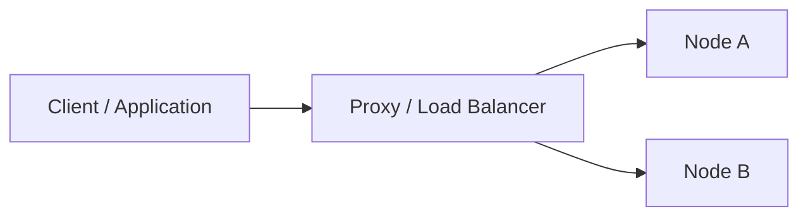

# Interview Question Template

Use this template when authoring technical interview questions across `database-interview-questions/`.

---

# [Question Title / Headline]

> **Category:** [e.g., Replication / Sharding / Concurrency & Locking / System Design]  
> **Target Level:** [Beginner | Intermediate | Advanced | Senior Engineer | Software Architect]  
> **Relevant Engines:** [PostgreSQL | MySQL | Distributed RDBMS / NoSQL]  
> **Estimated Discussion Time:** 5–15 minutes

---

## 1. Interview Question
> *State the exact question or problem statement as typically presented by an interviewer.*

## 2. Short Interview-Ready Answer (30-60 Seconds)
*Provide a crisp, executive summary answer that candidates can deliver verbally in an interview to demonstrate immediate mastery before diving deep.*

## 3. Detailed Technical Explanation
*Explain the mechanics, internal database engine behaviors, storage structures, network protocols, or transaction semantics.*

### Deep-Dive Architecture


### Key Technical Subtopics
- **Mechanic 1:**
- **Mechanic 2:**
- **Engine Differences (e.g., PostgreSQL vs MySQL):**

## 4. Practical Example & Code Walkthrough
*Provide concrete SQL commands, schema snippets, or application logic (e.g., Spring Boot Java) that proves the concept.*

```sql
-- Illustrative verification SQL or command
```

## 5. Architecture & System Design Considerations
*Explain how this concept scales, impacts availability, fault tolerance, consistency, latency, and cost.*
- **CAP/PACELC Trade-offs:**
- **Failover / Disaster Recovery:**
- **Failure Modes & Blast Radius:**

## 6. Follow-up Questions Interviewers Often Ask
1. **Follow-up 1:** *Question text?*  
   *Guidance on how to answer.*
2. **Follow-up 2:** *Question text?*  
   *Guidance on how to answer.*

## 7. Common Mistakes & Misconceptions
- **Mistake 1:** *Candidates confuse X with Y.*
- **Mistake 2:** *Assuming that asynchronous replication guarantees zero data loss.*

## 8. Authoritative References
- [Vendor Official Documentation Link](https://www.postgresql.org/docs/)
