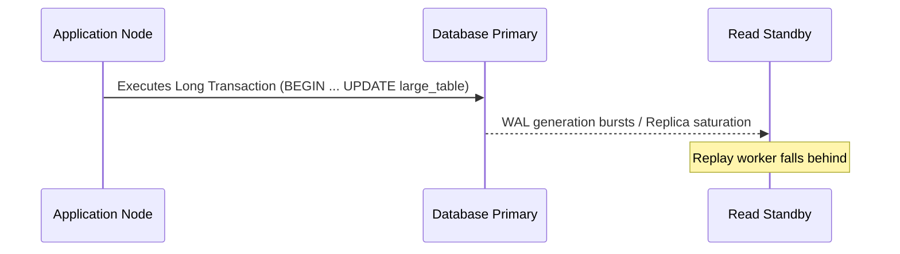

# Troubleshooting Incident Runbook Template

Use this template when authoring incident runbooks, root-cause analyses, or triage guides in `troubleshooting/`.

---

# Incident / Issue Title: [e.g., Replication Lag Spike, Connection Pool Starvation, Deadlock Cascade]

> **Severity Level:** [SEV-1 (Critical Outage) | SEV-2 (Degraded Performance) | SEV-3 (Intermittent Warning)]  
> **Affected Systems:** [e.g., Primary DB, Read Replica Cluster, Connection Pool / App Tier]  
> **Target Audience:** Site Reliability Engineers (SRE), Database Administrators (DBA), Backend Developers

---

## 1. Symptom & Alert Trigger
- **Alert Rule:** *Name of alert (e.g., `PostgresReplicationLagSeconds > 30s` or `HikariPoolPendingThreads > 50`)*
- **User Impact:** *Elevated p99 latency, HTTP 504 Gateway Timeouts, read stale data errors.*
- **Initial Observable Metric:**

## 2. Root Cause Mechanics
*Explain the technical breakdown at the engine or OS level. Why did this occur? (e.g., long-running transaction holding locks, bloat, sub-optimal execution plan causing disk spills).*



## 3. Immediate Triage & Mitigation (Runbook Steps)
*Step-by-step checklist to restore production service immediately before permanent fixes.*

### Step 1: Identify Offending Sessions / Queries
```sql
-- Query to identify long-running or blocking queries
```

### Step 2: Mitigate Immediate Load
```sql
-- Safe query cancellation / session termination
```

### Step 3: Temporary Routing or Throttling
- *e.g., Redirect read traffic away from lagging replica to primary or alternate replica.*

## 4. Root Cause Verification & Deep Analysis
*Commands and diagnostics to verify why the issue started in the first place.*
```sql
-- Deeper inspection queries (locks, catalog tables, wait events)
```

## 5. Permanent Preventive Actions
- **Database Configuration Changes:** (e.g., `statement_timeout`, `max_connections`, `wal_keep_size`).
- **Application-Level Changes:** (e.g., smaller batch sizes, pagination, proper transaction boundaries).
- **Monitoring & Alert Tuning:** (e.g., earlier alerting thresholds, synthetic heartbeat lag monitoring).

## 6. Post-Mortem & Incident Review Checklist
- [ ] Timeline of events documented
- [ ] Root cause identified and confirmed
- [ ] Data consistency verified (no corrupted or dropped records)
- [ ] Long-term preventive tasks logged in issue tracker

## 7. Authoritative References
- [Engine Diagnostic Guides](https://www.postgresql.org/docs/)
